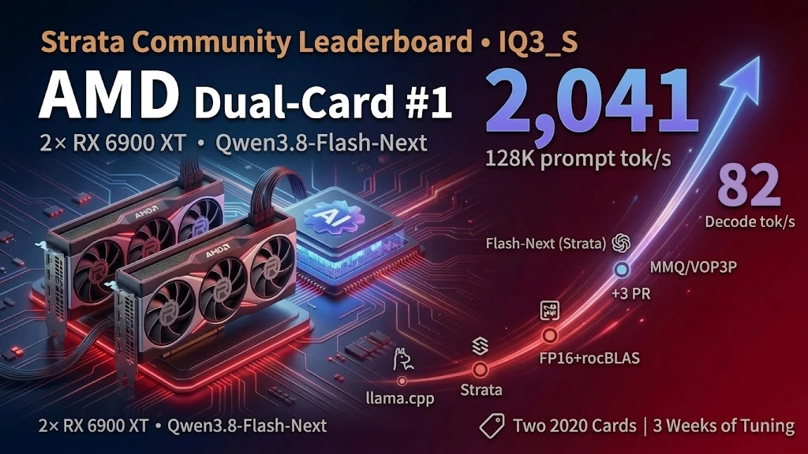
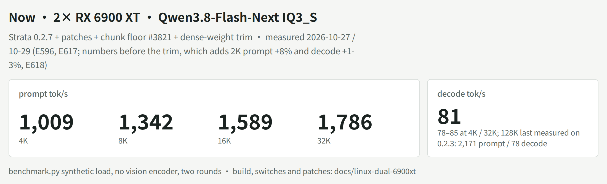
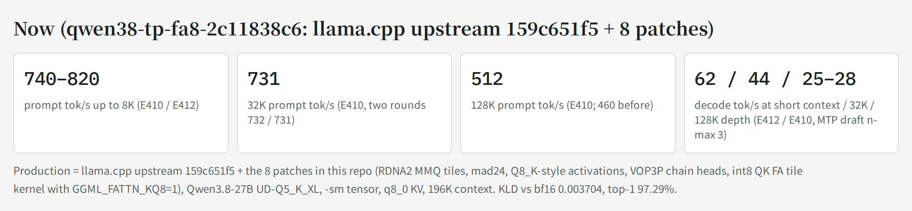
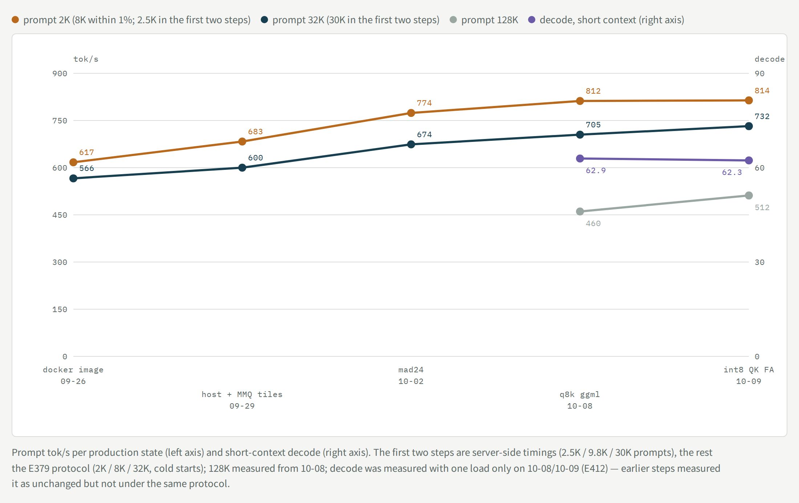
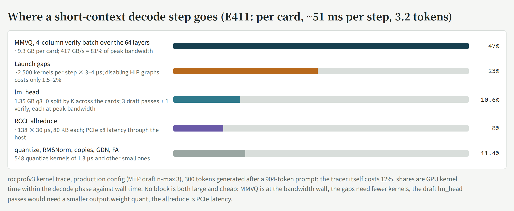
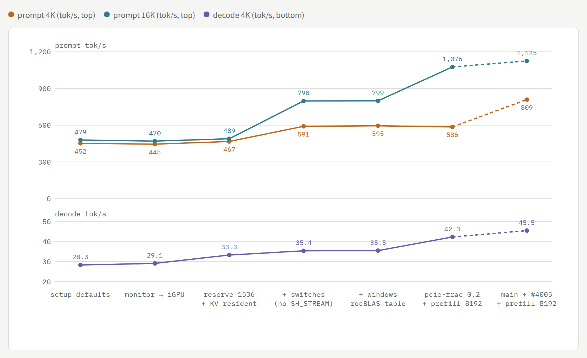

# dual-6900xt-flash-next-tuning

[中文](README.zh-CN.md) · **Interactive timeline: https://vop3p.github.io/dual-6900xt-flash-next-tuning/** (Chinese; every step filterable by line of attack)

<picture>
  <source media="(prefers-color-scheme: dark)" srcset="docs/now-en-dark.png">
  
</picture>

<picture>
  <source media="(prefers-color-scheme: dark)" srcset="docs/speed-chart-en-dark.png">
  
</picture>

*Prompt tok/s at 4K, 32K–37K and 128K (left axis) and decode tok/s (right axis) at each production state. Points come from different experiments under slightly different conditions (the 4K points of the first two steps are 5K prompts; the last two points are E504 and E533, the E415 load on the 10-20 and 10-23 productions; the notes under the chart on the interactive page list the rest); a dashed segment bridges a step where that metric was not measured.*

Tuning log for **Qwen3.8-Flash-Next (GSQ-RCO IQ3_S)** on a home box with **2x AMD RX 6900 XT (gfx1030, PCIe 4.0 x8 each) / Ryzen 5 5600X / 128 GB DDR4**, ROCm 10.0 — from llama.cpp to [Strata](https://github.com/Niko1221/Strata), 2026-09-21 → 10-24; plus one RX 6900 XT under Windows 11 ([section 5](#5-one-rx-6900-xt-under-windows)). Experiment numbers (E…) refer to the author's lab notebook (not public). Every number is measured on this machine unless marked as an estimate.

**`patches/llama.cpp/`** — eight llama.cpp patches on upstream `159c651f5`: 1–7 are the RDNA2 MMQ work behind the `q8k ggml` step (wider tiles, mad24 scales, Q8_K-style activations, VOP3P dot-chain heads), 8 is an int8 QK^T flash-attention tile kernel for a q8_0 K cache; build flags and measured effects in [their README](patches/llama.cpp/README.md). Strata picks the MMQ ones up through `-DSTRATA_GGML_DIR`. They were made on the dense **Qwen3.8-27B** that the same two cards serve through llama.cpp — that line of work is in [section 4](#4-the-dense-27b-on-the-same-box-qwen38-27b-ud-q5_k_xl-on-llamacpp-qwen38-tp).

**License:** the llama.cpp patches (`patches/`) and the scripts (`bench/`) are MIT, the same license as llama.cpp, so they can be taken, merged and shipped; the text, figures and measurement data are CC BY-NC 4.0 (attribution, no commercial use). See `LICENSE`. `CITATION.cff` has a citation entry.

<picture>
  <source media="(prefers-color-scheme: dark)" srcset="docs/modes-chart-en-dark.png">
  
</picture>

*One card vs expert helper vs layer split (E388 / E388a, 0.1.41, 32K prompts, no vision encoder): a 16 GB card alone decodes at 48–52 whatever the tree (about 4,500 expert slots, 83% hit rate); the helper mode lifts decode to 66–75 at one card's prompt speed; the split lifts both, and the E387 decode configuration adds the last step to 82.*

<picture>
  <source media="(prefers-color-scheme: dark)" srcset="docs/udq4-vs-iq3s-en-dark.png">
  
</picture>

*UD-Q4_K_XL beside IQ3_S (E415, 0.1.42, no vision encoder, two runs each, 0 stalls). **One card:** stock 471 / 505 / 489 tok/s at 4K / 32K / 128K for UD-Q4_K_XL against 476 / 504 / 488 for IQ3_S, decode 30–32 against 45–47; with the PRs and switches 676 / 1,117 / 1,087 against 959 / 1,153 / 1,129, decode 32–33 against 47–53. With #1897's switches (`STRATA_ROUTE_TAIL_SKIP=7`) the one-card UD-Q4_K_XL reads 8K at 1,085–1,093 and 16K at 1,121–1,122 tok/s, decode 39–40, over three cold starts on this x8 slot (E414; #1897's x16 card: 1,036 / 1,104, decode 32–38). **Layer split:** see the chart. Raw data: `bench/results/e414`, `e415`, and Strata PR #1927.*

## 0. Where it stands

- **Production (since 10-23 13:27):** `strata-023-b523b933` = Strata upstream **0.2.3** (merged into the 0.2.2 production, no conflicts) + #2985's pipelined MTP (`STRATA_PIPED_MTP=2`, JacobSussan) + five patches of ours: the solo path keeps `--pipeline-windows` beside batch slots (`STRATA_PW_WITH_BATCH=1`, [#3095](https://github.com/Niko1221/Strata/pull/3095)), #2071's SIMT=2 scorer on HIP ([#3073](https://github.com/Niko1221/Strata/pull/3073)), the prompt's CPU share beside `--batch` (`STRATA_PREFILL_CPU_SHARE_BATCH=1`, [#3382](https://github.com/Niko1221/Strata/pull/3382)), a gfx103x prompt-attention kernel (`STRATA_PROMPT_ATTN_RDNA2=1`, [#3381](https://github.com/Niko1221/Strata/pull/3381)), a per-device rocBLAS solution cache; plus `STRATA_PREFILL_STREAM_MIN=2048` and the modified llama.cpp ggml (MMQ dot-chain heads in VOP3P). The config pins `--conversation-cache-mib 0`: 0.2.3 turns a conversation cache on by default, and it read a single session's prompts 3% / 1.4% slower at 4K / 32K-128K here (E533). Two parallel slots (`"parallel": 2`), layer split, IQ3_S experts, int8 KV, `--spec 3 --spec-min-p 0.7 --pipeline-windows 2`; both cards undervolted −81 mV at 245 W since 10-21 (E522/E523: 37 rounds without a flipped token; decode does not follow the clock, E507-E512). Rollback slot `strata-split-prev` = the 0.2.2 merge (`strata-022-34cd8534`). Since 10-20 the engine moved 0.1.45 → 0.2.1.3 (E516/E517) → 0.2.2 (E527) → 0.2.3 (E533), each step speed- and KL-neutral against the one before.
- **Speed (E533, the E415 load, the production config without the vision encoder, two rounds):** prompt **1,008 / 1,800 / 2,171** tok/s at 4K / 32K / 128K (E504 on the 10-20 production: 1,020 / 1,790 / 2,158; E415 on 10-10: 985 / 1,792 / 2,046), decode **75 / 79 / 78** for one request (E504: 80 / 79 / 74); two requests at once 60–64 tok/s together (E481), a second request's first token 0.5 s instead of 12 s (E463–E470). Short prompts: a 430-token read 1.1 s (was 1.7 s, E493). Upstream **0.2.0-beta** stock on the same box and settings (E503, community report [#3426](https://github.com/Niko1221/Strata/pull/3426)): 979 / 1,662 tok/s at 4K / 32K with its own suite, 1,893 at 119K real text, decode 66 for one request - our patches are the difference (each re-measured on 0.2.0 in the PRs above).
- **Whole journey, same IQ3_S model:** decode 26 → ~80 tok/s (≈3×), 32K–37K prompt 274 → 1,790 tok/s (≈6.5×), 128K 821 (0.1.39) → 2,158. The engine switch (llama.cpp → Strata) is most of it; the patches and configuration after that roughly doubled the prompt (37K 714 → 1,433 → 1,705; 32K 1,790 and 128K 2,158 on 10-20) and added about +40% decode (56–58 → 80).
- **Closed directions (measured; do not retry on this box):** every decode-side configuration knob — `--kv-resident` shrink (E382), `--pipeline-windows 2` alone (E384, +1–6%), the 16-point `--spec` × `--spec-min-p` grid at `--pipeline-windows 1` (E385, 4/0.5 is the peak of accepted tokens per window) — **but the combination works**: `--spec 3 --spec-min-p 0.7 --pipeline-windows 2` decodes +10–16% at 4K and +8–11% at 32K (E387, three confirmation rounds; the short draft is accepted 83% of the time instead of 68%, so the speculative second window hits). Prompt speed unchanged; output differs between starts (the baseline is deterministic); 128K +11% in the no-vision-encoder configuration (E388); in production since 10-09 00:16; batch slots as evaluated on 10-08 (resident experts 41% < upstream's 50% gate, slots decode without MTP; **overturned 10-15**: with slot drafts, the solo path kept pipelined and later #2985, `"parallel": 2` is production); MMQ tile / stream-K for IQ3_S (E279/E280); `--prefill` chunks other than 8192 (E296); tensor parallel (E234, +6%); and the upstream opt-ins that upstream itself measured as neutral or negative on small cards (chunked GDN, Foresight swap slots, pinned stage buffers).
- **What is left:** the PCIe topology for long prompts (x8/x8 kept: on Strata a long prompt waits on PCIe only 0.2–0.7% of the time, but a <2K one 43–54%, E482); more expert swaps per decode window (E499: the adaptive cache already hits 85%, a perfect 8-window predictor would not beat it at today's swap rate - the swap budget is the lever, untested). Four PRs wait for upstream review on 0.2.0-beta (#3381, #3382, and #3073 / #3095 reopened 10-20 with the E503 numbers).

## 0.5 Where the time goes: stock against tuned (0.2.0-beta vs the 10-20 production, E505)

<picture>
  <source media="(prefers-color-scheme: dark)" srcset="docs/breakdown-prompt-en-dark.png">
  
</picture>

<picture>
  <source media="(prefers-color-scheme: dark)" srcset="docs/breakdown-decode-en-dark.png">
  
</picture>

*One machine, one model (IQ3_S on the two-card layer split, no vision encoder); two cold servers per side, four requests per length, the timing switches on (they cost 3–6%). **Stock** = 0.2.0-beta (main e88ee39d, built with setup.py's HIP options) with the arguments setup writes on an SSD and no switches; **tuned** = the 10-20 production (0.1.45 + #2985 + our patches + the production switches and arguments, two parallel slots). The bar lengths are measured; the segments come from the engine's own timing switches (prompt: both cards' phases summed; decode: a separate profiling run with one pipeline window), so the split is an estimate. Raw data and scripts: `bench/results/e505/` (the 10-13 version of these charts, 0.1.43.1 vs the 10-13 production, was E449).*

The numbers in the charts (the phases are estimates, the totals measured; prompt in ms per 1,000 tokens, decode in ms per token):

| length | | hc read | GDN | QSA projections | QSA select + attention | experts | other | total (ms per 1K tokens) | tok/s |
|---|---|---|---|---|---|---|---|---|---|
| 4K | stock | 267 | 986 | 283 | 106 | 547 | 29 | **2,217** | 451 |
|  | tuned | 122 | 283 | 76 | 79 | 478 | 18 | **1,056** | 947 |
| 32K | stock | 163 | 596 | 169 | 99 | 271 | 22 | **1,320** | 758 |
|  | tuned | 71 | 160 | 43 | 68 | 210 | 27 | **578** | 1,731 |
| 128K | stock | 138 | 504 | 143 | 122 | 231 | 22 | **1,160** | 862 |
|  | tuned | 57 | 130 | 35 | 63 | 171 | 24 | **479** | 2,088 |

| context | | hc read + router | dense GEMV (projections, shared expert, head) | attention + GDN recurrence | routed experts | waits (CPU experts, PCIe) | draft + commit | total (ms per token) | tok/s |
|---|---|---|---|---|---|---|---|---|---|
| 4K | stock | 3.37 | 4.32 | 1.18 | 3.35 | 1.74 | 1.83 | **15.79** | 63.3 |
|  | tuned | 2.26 | 3.82 | 1.04 | 2.58 | 1.57 | 1.51 | **12.78** | 78.3 |
| 32K | stock | 3.87 | 4.91 | 1.51 | 3.62 | 0.96 | 1.99 | **16.86** | 59.3 |
|  | tuned | 2.29 | 3.89 | 1.23 | 2.66 | 1.08 | 1.59 | **12.74** | 78.5 |
| 128K | stock | 3.21 | 4.08 | 1.69 | 3.15 | 1.30 | 1.91 | **15.33** | 65.2 |
|  | tuned | 2.40 | 4.05 | 1.63 | 2.68 | 1.46 | 1.73 | **13.95** | 71.7 |

- **Prompts read 2.1–2.4× faster**: 451 → 947, 758 → 1,731, 862 → 2,088 tok/s at 4K / 32K / 128K (on 10-13 the same comparison on 0.1.43.1 was 2.06 / 2.28 / 2.29×). Mostly the GDN phase (596 → 160 ms per 1,000 tokens at 32K: FP16 in and out plus the rocBLAS solution table); the hc read and the QSA projections shrink too. New since 10-13: the QSA selection + attention phase (99 → 68 at 32K, 122 → 63 at 128K, against 90 / 87 on 10-13) - the SIMT=2 scorer (#3073) and the RDNA2 prompt attention (#3381), which is why 128K gains the most. The experts barely move (271 → 210).
- **Decode 1.10–1.32× faster**: 63.3 → 78.3, 59.3 → 78.5, 65.2 → 71.7 tok/s (timing switches on; without them 80 / 79 / 74, E504). The hc read and router most (3.4–3.9 → 2.3 ms per token, the persistent hc read), the routed experts and the draft/commit next; the rest is the short draft with two pipeline windows.

**Where each change sits** (the rows come from different versions and measurements and **do not multiply**; the charts above are the combined effect, stock 0.2.0-beta against the production)

| Phase | Change | Source | Measured (version) | Status |
|---|---|---|---|---|
| prompt: dense GEMMs | the 16-bit GEMMs in FP16 in and out (`STRATA_HIP_PROMPT_F16=1`) | [#835](https://github.com/Niko1221/Strata/pull/835) | prompt ≈2× (0.1.39) | upstream, off by default |
| prompt: dense GEMMs | a rocBLAS solution table for gfx1030 | [#1167](https://github.com/Niko1221/Strata/pull/1167) | 1K +13.9%, 4K +12.1% (0.1.43.1, 10 pairs) | upstream (0.2.0) |
| prompt: QSA attention | 8 cells per step + DPP lane exchanges | #849 → 0.1.40.2 | +6–12% (0.1.40) | upstream, on (both sides) |
| prompt: QSA selection | the FP32 tiled block scorer on HIP (`STRATA_SELECT_SIMT=1`) | [#1151](https://github.com/Niko1221/Strata/pull/1151) | 128K +3.2%, 32K +0.6% (0.1.43.1, 10 pairs) | upstream (0.2.0) |
| prompt: QSA selection | #2071's simt2 scorer on HIP too (`STRATA_SELECT_SIMT=2` fell back silently) | [#3073](https://github.com/Niko1221/Strata/pull/3073) | 119K −6.5%, 31K −1.35% (0.2.0-beta, 10 pairs) | open |
| prompt: QSA attention | a gfx103x prompt-attention kernel (no split and merge; `STRATA_PROMPT_ATTN_RDNA2=1`) | [#3381](https://github.com/Niko1221/Strata/pull/3381) | 31K / 119K −3.49% (0.2.0-beta, 10 pairs) | open |
| prompt: short reads | the CPU share beside `--batch` (`STRATA_PREFILL_CPU_SHARE_BATCH=1`) | [#3382](https://github.com/Niko1221/Strata/pull/3382) | reads < 2,048 tokens −28.8% (0.2.0-beta, 10 pairs) | open |
| prompt: short reads | `STRATA_PREFILL_STREAM_MIN=2048` | upstream switch | real text 1.1–1.5K −6~17% (0.1.45, E485) | switch |
| prompt: overall | `STRATA_SPLIT_MTP_BATCH=1` | upstream switch | 4K / 32K / 128K +4 / +7 / +2% (0.1.42) | off since 10-15 (with batch slots) |
| decode: drafting | `--spec 3 --spec-min-p 0.7 --pipeline-windows 2` | configuration | 4K +10–16%, 32K +8–11% (0.1.41, E387) | configuration |
| decode: hc read | the verifier's hc read as one persistent kernel | [#2226](https://github.com/Niko1221/Strata/pull/2226) | per window 4K −6.6%, 32K −4.4% (0.1.43.1, 10 pairs) | upstream (0.2.0) |
| decode: lone request | keep `--pipeline-windows` beside batch slots (`STRATA_PW_WITH_BATCH=1`) | [#3095](https://github.com/Niko1221/Strata/pull/3095) | 4K +16.1%, 32K +12.3% (0.2.0-beta, 10 pairs) | open |
| decode: two requests | pipelined MTP in the batch groups (`STRATA_PIPED_MTP=2`, JacobSussan) | upstream #2985 | two streams +13% (0.1.45, E481) | open PR, ported |
| decode: shared expert | the shared-expert stream fork (calibrate decides it per PC) | [#1992](https://github.com/Niko1221/Strata/pull/1992) | 4K +8.0%, 32K +9.5% (0.1.43.1, 10 pairs) | upstream (0.2.0) |
| start-up | the PLE table locked in RAM (`--ple-io ram`) + `STRATA_IO_THREADS=128` | configuration | first-chunk wait 600 → 306 ms (threads) → 10 ms (locked) | configuration |
| stability | `STRATA_HIP_ADAPT_KERNEL_COPY=1` | upstream switch (#884) | 128K stalls 3/3 → 0/3 | switch |

**Why the experts did not move** (E450–E452): after the tuning the experts are the largest part of a prompt, but there is no room in them - llama.cpp's MMQ tops out at 28–34 TOPS on the real shapes and stops rising from 64 rows per expert; another tile width saves nothing; letting MMQ read the experts in place instead of gathering them into a group buffer (bitwise the same output) is only 0.5% faster, because the copy it saves was cheap and reading in place made the GEMM 1.7% slower.

## 1. Timeline

| Date | Step | Measured effect |
| --- | --- | --- |
| 09-21/22 | llama.cpp expert cache (E140–E146): cache 56, inserts 8, MTP n-max 2 | 120K decode 10.9 → 13.0 tok/s; cache chains > 4 tokens crash in MMQ |
| 09-26 | `GGML_OP_OFFLOAD_MIN_BATCH=136`; PLE direct-read build | cold 8K prefill +13–18%, major page faults gone |
| 09-27 | E165 expert copies over both x8 links | only +1–4%: layers are serial; true pipelining needs a new scheduler (not done) |
| 09-29 | QSA gather (`LLAMA_QSA_GATHER=1`) | 96K: −9.6% per verify step; gather only applies to decode/MTP |
| 09-30 | new alias with GSQ-RCO IQ3_S + 112 cache slots | decode −19–20% per step, prefill +17–22% vs UD-Q4; 77% hit rate |
| 10-01 | upstream MTP vs our dense MTP; Vulkan | no measurable difference; Vulkan 55–90% slower, dropped |
| 10-02 | production llama.cpp build with 137 slots (upstream 159c651f5) | 10–18% faster per step than 112 slots; numerical noise floor KLD ≈ 0.025 |
| **10-04** | **Strata arrives** (E215/E216, HIP gfx1030) | same IQ3_S, 5K prompt: decode llama.cpp 26 → split 56–58 → helper 62–63; 37K prefill 274 → 714 |
| 10-04 02:30 | strata-split / strata-helper live (132a522; HIP: FP16 output GEMM, QSA S4) | 37K prefill split 1,433 / helper 978 |
| 10-04 17:00 | 0.1.39 (6add1a7) + FP16 prompt path → PR #835; #849 / #854 | 9.9K split 906 tok/s; helper needs `--pcie-frac 0` |
| 10-04 21:00 | prompt stall at layer 1 reproducible (~70%) → `--adapt-every 100000` | 0/3 stalls; root cause found 10-06 |
| 10-05 | stall root-cause chain (E251–E264, issue #884): MMQ + primary-card adapt + SDMA together; CP does not release a BARRIER_AND | disabling any one avoids it; one HW queue: 0 stalls but prompt −30% |
| 10-05 15:32 | production strata-238abe8 (0.1.39 + #835/#849/#854/#981 rocBLAS table) | 50K prompt 1,495 → 1,705 (+13–16%), decode unchanged |
| 10-05 19:05 | `STRATA_IO_THREADS=128` + `--ple-io ram` (memlock unlimited) | first-chunk PLE wait 568 → 10 ms, 8K prompt −7.4% latency |
| 10-05 20:25 | production strata-61c59fa (+#1007 select SGEMM) | 128K prompt +5% |
| 10-06 06:33 | **#884's strongest lead: GFXOFF** (0/10 stalls with it off); the knob is a refcount (corrected 11:05) | first a gfxoff guard, later kernel-copy |
| 10-06 09:42 | 0.1.40.1 baseline (E335) | split prompt 745 → 1,455 (F16), decode 58.6 → 64.5 (SH_STREAM) |
| 10-06 18:04 | production strata-341922e (0.1.40.1 + #1149/#1150/#1151 + rocBLAS table; env SH_STREAM=1, PROMPT_F16=1) | 128K split 2,003 tok/s |
| 10-06 19:10 | `STRATA_HIP_ADAPT_KERNEL_COPY=1` avoids the 128K split stall; gfxoff guard removed (power) | 0/3 vs 3/3 stalls, no speed cost |
| 10-06 22:20 | images on both split slots (self-built HIP strata-vision) | primary-card cache −11%, 32K prompt −3.6% |
| 10-07 16:54 | production strata-4592281 (0.1.40.2 + per-device rocBLAS solution cache) | speed flat; solutions no longer change between starts |
| 10-07 evening | #1151 reworked as the SIMT scorer (upstream 65ce329 ported to HIP) | 128K prompt +7.4%, byte-identical scores |
| 10-07 22:10 | vision encoder moved to HIP0 (split 0–26 / 27–47, primary cache 5,256 → 6,123 slots) | 32K prompt +2.8–3.8% |
| 10-08 | strata-ud-q4 slot (UD-Q4_K_XL, K-quant MMQ running on HIP) | decode −38%, 32K prompt −3% vs IQ3_S; kept only for quality comparison |
| 10-08 19:25 | production strata-q8k-4592281: ggml from the modified llama.cpp (MMQ q8_0 / iq3_s dot-chain heads in VOP3P, E378) | iq3_s kernel +2.6% → 32K prompt +1.4–1.5%, outputs byte-identical |
| 10-08 20:30 | E382 `--kv-resident` 32K → 16K | expert slots only +0.7%, 32K decode −3%, dropped |
| 10-08 21:25 | **production strata-141-d14ca361**: upstream 0.1.41 + the 7 patches rebased (clean) | 12 outputs byte-identical, speed ±0.5%, 0 stalls; json gets `gpu_order: as_given` |
| 10-12 02:00 | `strata-ud-q4` slot gets the E387 decode config (`--spec 3 --spec-min-p 0.7 --pipeline-windows 2`), missed when E387 went to the IQ3_S slots (E422 with the vision encoder, E423 without) | decode +13.5 / +9.6 / +5.2% at 4K / 32K / 128K (44.8 / 47.6 / 47.9 → 50.9 / 52.2 / 50.4), acceptance 66 → 79%, prompt −0.3%; the same mechanism as on IQ3_S, independent of the expert format; 0 stalls. UD-Q4_K_XL now decodes 32–36% slower than IQ3_S (76.6 / 81.9 / 74.5) |
| 10-11 01:57 | `strata-ud-q4` slot → 0.1.42 + 7 patches + `-DSTRATA_MMQ_KQUANTS=ON` + `STRATA_SPLIT_MTP_BATCH=1` (E415; community report PR #1927) | split 4K / 32K / 128K 756 / 1,748 / 1,981, decode 45–51 (old slot 715 / 1,640, 43–46); stock 0.1.42 reads both formats at the same speed (one card 471–476 / 504–505 / 488–489: the dense FP16 route is the limit); UD-Q4_K_XL decodes 30–35% slower than IQ3_S |
| 10-10 23:38 | E414: the llama.cpp RDNA2 MMQ patches inside Strata, one card, UD-Q4_K_XL, against PR #1897 | prompt ±1% with tiles / mad24 and with the Q8_K activations compiled into `strata_mmq` (it never defined `GGML_CUDA_MMQ_Q8K`); Q8_K costs 7% of 8K decode; expert GEMMs are 34% of the prompt (`STRATA_PREFILL_TIMING`), wait-copy 1.6%. Our x8 card: 8K 1,085–1,093 / 16K 1,121–1,122 against #1897's x16 1,036 / 1,104 |
| 10-10 14:33 | **production → 0.1.42** (`strata-142-cd87f4d2`) + `STRATA_SPLIT_MTP_BATCH=1` (E413/E413b) | 0.1.42 itself byte-identical and speed-neutral against 0.1.41 (fixed protocol); the batched draft K/V: prompt +4.1 / +6.9 / +2.0% at 4K / 32K / 128K over three rounds, decode and acceptance unchanged |
| 10-10 13:40 | the other 0.1.42 opt-ins, one at a time (E413) | `STRATA_ROUTE_TAIL_SKIP=7` (needs the explicit env on HIP) +4 / +1% decode, within the ±6% run-to-run noise, changes answers; `STRATA_ROUTE_RESIDENT=0.5` hit rate 96→98.7% but decode −1 to −3.5%; `--aux-cpus auto` ±2%; `STRATA_MMQ_RESIDENT_SORT_NE` never eligible here (needs a whole layer resident); `STRATA_PF_FUSED` is gfx11/12 only |
| 10-09 morning | the K1 flag inventory: 35 switches / settings one at a time (E395–E401) | none beyond noise alone; 17 clearly slower (SPLIT_OWN / no prefill borrow −35% at 32K, `--mtp-window 0` decode −30%); six noise-level ones stacked +1% decode, not measurable in production, archived |
| 10-09 04:47 | E391–E394: four outside leads, all negative | `--prefill auto:16384` (#1640) 32K −14%; a 4K prompt as two 2,048 chunks (#1441's idea) −9%; #1123's FP32 SGEMM never runs with the FP16 route on, +66/+73% with it off (already measured 10-06 on its predecessor, cited in the PR); phase timing: FP16 twice as fast on hc read and qsa proj, no route merge |
| 10-09 04:03 | E388a: 0.1.41 one-card / helper arms (completes the report) | one card PRs 976/1,174/1,147, decode 49–51; helper PRs 986/1,173/1,147, decode 72–75; stock +3–6% over 0.1.40.1, switches +5–13%, PRs +1–2%; zero stalls |
| 10-09 00:16 | **E387 config in production** (`strata-split` / `-256k`: `--spec 3 --spec-min-p 0.7 --pipeline-windows 2`, backups `*.bak-2026-10-09-before-e387`) | one real 7K request through llama-swap: confirm line present, split 0–26/27–47, prompt 1,019, decode 73.4, 92% drafts accepted |
| 10-09 00:13 | E388 0.1.41 community report (5 split arms, no vision encoder) | stock 0.1.41 vs 0.1.40.1 stock: prompt +4–6% (464/767/869); the two switches +5/+12/+12% (832/1,619/1,823); PRs unchanged (968/1,714/2,029); kernel-copy free, stock 128K no stall; the E387 decode config +19/+20/+11% (77/82/76) |
| 10-08 23:42 | E387 `--spec 3 --spec-min-p 0.7 --pipeline-windows 2` | decode 4K 66 → 73–77, 32K 74 → 80–83 (+8–16%, 3 rounds), prompt unchanged; output non-deterministic across starts; candidate |
| 10-08 21:27 | E384 `--pipeline-windows 2` | decode +1–6% but outputs differ between starts (2/7 same), 4K prompt −1–5%; dropped |
| 10-08 21:50 | E385 `--spec` × `--spec-min-p`, 16 points | only 5/0.6 at 32K +2.5% (single run); the rest negative; 4/0.5 kept |
| 10-08 22:50 | batch slots evaluated | resident experts 41% < upstream gate 50%; slots decode without MTP; not for this box |
| 10-13 23:40 | production → `strata-144-hcps-fb15a4e6`: #1151 plus #2071's `STRATA_SELECT_SIMT=2` scorer, which upstream compiled for CUDA only and silently fell back on HIP (E457) | prompt +1% over the SGEMM scorer; later sent as #3073 |
| 10-15 | two or three requests at once (`"parallel": 2`, E463–E470): A = keep `--pipeline-windows` for a lone request beside batch slots (`STRATA_PW_WITH_BATCH=1`), B = a long read yields at chunk boundaries, C = slot drafts in the pipelined groups (davidbhoward's work, ported) | a second request's first token 12 → 0.5 s, a short request beside a long read 37 → 8 s, two streams +6%; single-stream decode −2–6% against the solo setup; production 10-15 19:30 (`strata-144-pmtp-a380c2c0`); A sent as #3095 |
| 10-18 13:09 | upstream 0.1.45 (E475): stock lacks A, so a lone request decodes 11–16% slower; 0.1.45 + A + C + SIMT=2 matches the old production | production `strata-145-acx-2e127c66` |
| 10-18 21:10 | upstream #2985 (`STRATA_PIPED_MTP=2`, JacobSussan) in place of our C (E481) | two-stream throughput +13% over C, single stream and the long-read hand-over unchanged, needle 14/14; production `strata-145-2985-3f53fb74` |
| 10-19 02:20 | `STRATA_PREFILL_STREAM_MIN=2048` (E482–E485): below the full-streaming chunk size a short read copies only its routed experts over PCIe, and that wait is 43–54% of a <2K-token read | real-text 1,090–1,542-token prompts −6–17%, a 779-token continuation −7%, ≥2,048 unchanged; 3072 was slower at 2–3K (E485). A synthetic word-list prompt made 3072 look better (E483) - routing-sensitive switches need real text |
| 10-19 17:40 | `STRATA_PREFILL_CPU_SHARE_BATCH=1` (ours, E493/E494): the prompt's CPU share was off whenever `--batch` was set | real-text reads under 2,048 tokens −20–35%, a 455-token continuation 1.86 → 1.25 s, concurrency unchanged; production `strata-145-csb-de8b8636`; PR #3382 |
| 10-19 20:30 | `STRATA_PROMPT_ATTN_RDNA2=1` (ours, E495–E498e): gfx103x's prompt attention ran the decode kernel (64-cell splits + merge); one block per (query, KV head), online softmax, 4 dimensions per thread in the value phase | QSA attention per 8,192-token chunk 500 → 355 ms, 34K / 133K prompt −3.5%; quality gate (8 chats against an FP64-attention reference) not worse; production `strata-145-pa-a6572b34`; PR #3381 |
| 10-19 22:15 | SeqMoE-style expert prefetch, upper bound first (E499): 266K routing records of four real agent conversations replayed against cache policies | the adaptive cache already hits 85.3 / 85.1% (above the best static set); a perfect 8-window predictor at the engine's swap rate would not beat it - dropped; more swaps per window, not prediction, is the lever (untested) |
| 10-20 | the patches re-measured on 0.2.0 main as upstream's new rules ask (E501–E502): setup.py build options, default path byte-identical, ctest against main, 10 interleaved cold-start pairs, FP64-reference quality gate, CUDA 13.2 compile | RDNA2 attention −3.49% at 31K and 119K (10/10 each); CPU share with --batch −28.8% under 2,048 tokens (10/10); sent as #3381 / #3382; #3073 −6.5% at 119K and #3095 +12–16% single-stream decode on 0.2.0 (10/10 each, E503) |
| 10-20 16:40 | production → upstream 0.2.1.3 + #2985 port + our five patches (`strata-0213-40d9a2dc`, E516/E517) | prompt −0.2 to −0.8%, decode within noise, 0 stalls; KL 0.034 / 0.029 against 0.026 (per chat a redistribution, not a loss) |
| 10-21 10:17 | both cards undervolted −81 mV at 245 W (E522/E523) | 37 rounds without a flipped token (card1 at −88 flipped); decode does not follow the clock (E507–E512) |
| 10-22 18:47 | production → 0.2.2 merge (`strata-022-34cd8534`, E527) | KL 0.028 / 0.030 against 0.031, 7 of 8 chats bit-identical; speed flat |
| 10-23 13:27 | production → 0.2.3 merge (`strata-023-b523b933`, E533) with `--conversation-cache-mib 0` | 0.2.3's default conversation cache read single-session prompts 3% / 1.4% slower; pinned off: 1,008 / 1,800 / 2,171, decode 75 / 79 / 78, equal to 0.2.2 |
| 10-24 | one RX 6900 XT under Windows 11 ([section 5](#5-one-rx-6900-xt-under-windows)) | the official package with measured settings: 16K prompt 479 → 1,076, decode 28 → 42, 12/12; PRs [#4005](https://github.com/Niko1221/Strata/pull/4005), [#4006](https://github.com/Niko1221/Strata/pull/4006), report [#4012](https://github.com/Niko1221/Strata/pull/4012) |

## 2. What was learned about the mechanisms

- Strata's expert prompt GEMMs *are* llama.cpp's MMQ kernels (`moe_mmq.cu`), so llama.cpp-side MMQ changes can be carried into Strata through `STRATA_GGML_DIR`; the rocBLAS table and the SIMT scorer only cover the dense projections and QSA scoring.
- Decode: speed = accepted tokens per window ÷ window time. A verify window was ≈ 33 ms of fixed cost with the two cards' layer stages one after the other (10-08, `--pipeline-windows 1`); with two windows in flight (`--pipeline-windows 2`) it is ≈ 25–28 ms (E481, E499). Longer drafts or a lower min-p lower the acceptance rate, shorter drafts or a higher min-p cut the window short: 4/0.5 was the peak without the overlap (E385), 3/0.7 is with it (E387).
- Flash-Next's resident KV window is only ~100–200 MB; VRAM is dominated by the expert cache (6,123 slots on the primary card on 10-07 with the vision encoder there; 5,534 + 4,273 without it on 10-20), and both prompt and decode speed follow the slot count.
- Strata can stream KV from RAM because QSA attention is sparse (98.7% of block reads hit VRAM); a full-attention model (the dense 27B on the same box) has no such path.
- The GFXOFF ↔ ROCm CP-barrier interaction is the root of the stalls (#884, drm/amd #5945); the mitigation is kernel-copy, not the guard.
- The layer-split point is a decode knob on its own: without the vision encoder the second card has 1.7 GiB more free, the auto split moves from 0-26/27-47 to 0-24/25-47 and 32K decode drops 74 → 69 (−8%) while the hit rate goes up; with `--pipeline-windows 2` both splits reach 82 (E388). A manual `layer_split` sweep has not been done.
- A short prompt is a PCIe problem, a long one is not: below the full-streaming chunk size (`stream_all_min`) a chunk copies only its routed experts, and with ~10 of 512 experts per token a few hundred tokens touch most of them - 43–54% of a <2K read waits on PCIe (E482). Hence `STREAM_MIN=2048` and the CPU share for short reads (E485, E493).
- Routing-sensitive switches must be measured on real text: a repeated word-list prompt routes to few experts and made a setting look better than it is (E483 vs E484/E485).
- With batch slots upstream turns two things off silently for a lone request: `--pipeline-windows` (−11–16% decode) and the prompt's CPU share. Both came back as opt-ins (#3095, #3382).
- The expert cache is not prediction-limited (E499): replaying 266K real routing records, the adaptive cache (85%) beats the best static set and Radiance-style decayed LFU is within 1.4 points; foresight only helps when the swap budget per window grows.
- Kernel accuracy: an end-to-end KL "closer to the FP64 reference" does not mean a kernel is more accurate - it was within the run-to-run spread of equivalent FP32 paths; an operator-level FP64 test said the first version was 1.2–1.4x *less* accurate, and a blocked sum per chunk fixed it at +1.6% time (E498e, E502).

## 3. Mistakes made along the way (kept so they are not repeated)

- Treated the `amdgpu_gfxoff` knob as a level when it is a refcount; every "default on" arm of E335–E338 was invalid (10-06).
- Misread the split timing lines: the "whole call" card's `embed+steps` includes waiting for the other card (E361).
- Assumed the resident KV window was a large share of VRAM and ran E382 before doing the arithmetic (+40 slots).
- Read an upstream PR's whole body and grep your own log for it and its predecessor before measuring it: three rounds on #1123 before noticing we had measured its predecessor #1006 on 10-06 and the PR cites our numbers (E392).
- Declared `--pipeline-windows 2` and the spec grid closed after one single-variable sweep each (E384/E385); the two knobs interact and the combination is +10–16% (E387).
- Expected +10–30% from `--pipeline-windows`; measured +1–6% with non-deterministic output — the estimate ignored that the guess rate is bounded by 2.3 accepted tokens per window.
- Upgraded to 0.1.39 without checking the old build's local patches one by one; helper decode fell to 39 tok/s (10-04 19:40).
- Built a comparison tree without diffing CMakeCache and lost a bisection to a missing `STRATA_PREFILL_MMQ=ON` (10-04).
- Wrote "our ggml patches will help #1897" into a draft comment from the 27B kernel numbers, before measuring them inside Strata; measured, they do nothing there (E414). Measure first, then write.
- A gh comment was not posted because the leak check `grep -c claude.ai` returns exit 1 on zero matches and cut the `&&` chain; use `! grep -q`.
- Built upstream 0.2.0 from the docs' minimal command, without setup.py's `STRATA_PREFILL_MMQ=ON`, and read a 1.75x slower prompt as a possible regression before diffing CMakeCache - the 10-04 mistake again (E501).
- Measured with a synthetic word-list prompt for a routing-sensitive switch and nearly put the wrong value in production (E483).
- Called a kernel "more accurate" from an end-to-end KL ranking; an FP64 unit test showed the opposite (E498e).
- Stopped an experiment script before its engine: the restore trap put production back while the test engine still held both cards (~12 s, no request came in). Stop the engine first, then the script; never `pgrep -f` a pattern that is in your own command line (E501).
- A first replay of an expert-cache upper bound treated every expert not needed within the window horizon as never needed again, and produced a "perfect foresight is worse than the real cache" number (E499); the instrumented dump had also been hooked on one of four code paths only.
- Wrote "the same failures as main" in a PR draft for a build whose tests had not been run; caught before posting.

## 4. The dense 27B on the same box: Qwen3.8-27B (UD-Q5_K_XL) on llama.cpp, `qwen38-tp`

The same two cards also serve the dense Qwen3.8-27B through llama.cpp: `-sm tensor` (RCCL allreduce over the two x8 links through the host), q8_0 KV, 196K context, MTP draft (`--spec-draft-n-max 3`), three slots. Full attention, so none of Strata's expert/KV-streaming tricks apply; this is where the llama.cpp patches above were made, and patch 8 only exists for it. It is not on the interactive timeline page.

<picture>
  <source media="(prefers-color-scheme: dark)" srcset="docs/q38-now-en-dark.png">
  
</picture>

**Where it stands (10-09 15:10):** production binary = upstream `159c651f5` + patches 1–8, env `GGML_FATTN_KQ8=1`. Prompt 740–820 tok/s up to 8K, 731 at 32K, 512 at 128K; decode 62 tok/s at short context (MTP: ~3.2 accepted tokens per 51 ms step), 44 at 32K depth, 25–28 at 128K. KLD vs bf16 0.003704, top-1 agreement 97.29% (stock kernels on the same quant: 0.003941 / 97.32%). Needles 8/8 at 32K, 4/4 at 128K. VRAM 15.8 GB per card at 196K.

<picture>
  <source media="(prefers-color-scheme: dark)" srcset="docs/q38-speed-en-dark.png">
  
</picture>

| Date | Step | Measured effect |
| --- | --- | --- |
| 09-26 | E157: v3 UD-Q5_K_XL chosen over UD-Q4_K_XL (KLD vs a 54 GB bf16 reference, 64×512 mixed zh/en) | 0.0039 vs 0.0116; Q4 would be +10.5% faster and 1.2 GiB/card smaller; precision chosen |
| 09-27 | E152: reproducing the production numbers on the host | `--cache-ram 0` switches off idle-slot caching and, with `-kvu`, slows new requests 30–40% — nearly four false conclusions; copy every parameter, caches included |
| 09-29 | host binary instead of the docker image; RDNA2 K-quant MMQ tiles (patch 2; a K512 variant was 1.9× on the sweep and wrong on real shapes) | prefill 2.5K 617→683, 9.8K 623→677, 30K 566→600; bit-identical; decode unchanged |
| 10-02 | mad24 scale multiplies (patch 3) | prefill +8–9%, bit-identical, decode −1% |
| 10-02 | E200b phase timing, 10K prefill: MMQ 64–67%, RCCL ≤13%, FA 5%, GDN 5% | K-quant MMQ ~40% slower than q8_0 because of per-sub-block float scales → the activation layout became the target (done 10-08) |
| 10-08 | Q8_K-style MMQ activations + VOP3P dot-chain heads (patches 4–6) | prefill +4.6–6.1% (2K 774→812, 8K 773→811, 32K 674→705); KLD 0.003941→0.003736; dead ends: 256 values per scale (+25% KLD), k01 unroll (>1000 VGPR), VOP3P heads on q4_K/q5_K (−10%) |
| 10-08 | E377 kernel-level timing: MMQ 60–72%, allreduce 14–16% (BF16, 2 per layer, already at PCIe speed), FA 2% at 2K → 17% at 32K, GDN 5–6% | FA is the long-context target |
| 10-08 | E381 FA tile kernel sweep (nbatch_fa, nbatch_K, occupancy, threads; 10 points) | upstream defaults are the local optimum on gfx1030; no point >+3%; the kernel sits at 35% of fp16 peak by structure (LDS reuse per 32 columns × 64 keys, half2 packing), not by parameters |
| 10-09 | **int8 QK^T in the FA tile kernel** (patch 8; E406–E410, one day) | kernel 1.31× at 16K/64K; end to end prefill 32K +3.3–3.9%, 128K +11.1%, 2K/8K flat; decode/VRAM unchanged; KLD 0.003704; in production 15:10 |
| 10-09 | E411 decode phase timing (short context, production config, rocprofv3; the tracer itself costs 12%) | pie below; MTP is worth 2.1× (25.7 → 62 tok/s); HIP graphs are in use but worth only 2% (E411b) |
| 10-09 | E412 old vs new binary at short context | decode 62 ±1% both, 904-token prompt flat — patch 8 does not touch decode |

**Where a short-context decode step goes (E411, per card per ~51 ms step, 3.2 tokens):**

<picture>
  <source media="(prefers-color-scheme: dark)" srcset="docs/q38-decode-en-dark.png">
  
</picture>

| Block | Share | Distance from the hardware |
| --- | --- | --- |
| MMVQ, 4-column verify batch over the 64 layers (~9.3 GB of weights per card) | 47% | 417 GB/s = 81% of peak bandwidth |
| Launch gaps (~2,500 kernels per step × 3–4 µs) | 23% | the `-sm tensor` meta backend splits each step into ~130 sub-graphs (one per allreduce), so each HIP graph holds a dozen kernels — disabling graphs costs only 1.5–2% |
| lm_head (1.35 GB q8_0, split by K across the cards; 3 draft passes + 1 verify pass) | 10.6% | each pass at peak bandwidth; the three draft passes are 8% |
| RCCL allreduce (~138 × 30 µs, 80 KB each) | 8% | latency-bound on PCIe x8 through the host |
| quantize (548 × 1.3 µs), RMSNorm, copies, GDN, FA | ~10% | small kernels |

No block is both large and cheap: MMVQ is at the bandwidth wall, the gaps need fewer kernels (fusion of the 1–4 µs kernels, +5–8% expected) or the allreduce inside the graph (a backend change, +15–20% at best, not measured), lm_head drafts would need a smaller `output.weight` quant (touches the main model), the allreduce is PCIe latency.

**Closed directions on the 27B (measured):** SGLang at the same bit width is not faster single-stream (E174, the earlier +6–12% was Q4 vs Q5); Vulkan; `-ub 2048` (+4–8% prompt but context must drop to 131K); `-np 1` (no single-stream gain); the FA tile parameter space (E381); MMVQ (at 81% of bandwidth); HIP graphs on/off (2%).

**Mistakes on this line:**

- `--cache-ram 0` in a host reproduction (E152) nearly produced four wrong conclusions; every cache parameter has to be copied.
- The int8 prototype's first four versions (1.04–1.11×) were read as the idea's ceiling; they were a register spill (256 VGPR + 31 spills) from keeping the Q scales in registers. Read the ISA/VGPR count before judging a kernel idea.
- The int8 precision blow-up (KLD 0.059, max 20) was chased for hours in the quantiser (outlier dims, rotations, SmoothQuant) — the cause was `launch_fattn`'s split-KV combine path, which the int8 kernel's LDS footprint had switched on; the upstream f16 kernel forced through the same path also loses precision. Read the launcher before touching the quantiser.
- Two experiment chains sharing one script and build directory produced binaries that were not what the log said (two readings thrown away); one chain at a time.
- Stacked `sed` macro edits deleted a real `#define`; macro variants belong in separate commits.
- Under rocprofv3, `llama-server` ignores SIGINT/SIGTERM (the tracer's handler); the trace database had already been written, and 30 minutes were spent waiting. SIGKILL after the database appears.
- E411's falsification criterion ("kernel time < 60% of wall time") was met and still did not answer "which block to cut"; the criterion should have been "largest block ≥30% and ≥25% from its hardware limit".

## 5. One RX 6900 XT under Windows

<picture>
  <source media="(prefers-color-scheme: dark)" srcset="docs/win1x-chart-en-dark.png">
  
</picture>

*Strata's standard benchmark (`strata bench run`, medians of three, 12/12 sanity at every step), one complete run per step; the runs are in Strata PR [#4012](https://github.com/Niko1221/Strata/pull/4012). The first six steps are the official `rdna2` engine package 0.1.48 unchanged; the dashed last step is `main` + [#4005](https://github.com/Niko1221/Strata/pull/4005) built on the PC, at the auto chunk (6,144), so its 16K is below the 8,192-chunk step before it.*

A second box (IanLAB: i9-10900K, 64 GB DDR4-3600, one RX 6900 XT 16 GB on PCIe 3.0 x16, Windows 11, the same IQ3_S model, 64K context), 10-23 → 10-24. Since 0.2.2 Strata's update feed carries a Windows engine package for RX 6000 cards (`windows-x86_64-hip-rdna2`), "built but untried" in the release notes; this is it on a real card. **A no-compile setup with the settings below: [`windows-rx6000/`](windows-rx6000/)** (the official Terminal, the official package, a saved `strata launch` preset).

**Where it ended (standard benchmark, official package, settings only):** prompt 4K / 16K **452 / 479 → 586 / 1,076** tok/s, decode **28 → 42** tok/s, first token on a short prompt 2.8 → 1.1 s, 12/12. With #4005 on top, 4K reads at 793. Against Linux on the same card model (E540, one card): Windows was 582 / 811 prompt (4K / 32K) and 36.9 decode against Linux 944 / 1,160 and 47.4; after this work 32K reads at 1,163 against Linux 1,165 (8,192 chunk, a local build with the copy-event patch and #3381 / #3073), and decode 43–47.

**What was measured, in the order it mattered**

- **Every submission costs ~80–120 µs under WDDM (E541).** A HIP probe on the two OSes, same card model: back-to-back 2.79 MB copies are no slower on Windows (12.5 against 14.1 GB/s, 5.5 µs fixed per copy), but each `cudaEventRecord` on the copy stream adds 79 µs (Linux 3), each cross-stream wait 43 µs (Linux ~0), and one copy plus its host-function signal takes ~120 µs longer end to end; a kernel launched without a following query does not even reach the GPU. Hardware-accelerated GPU scheduling, which would shorten this, is `AlwaysOff` in the RX 6000 driver. Everything below is this cost, met in different places.
- **Decode: the PCIe share (E538, E545, E547).** The start-up rule sets the share of missed experts read over PCIe from the link alone (12.6 GB/s → 0.35). Swept 0 / 0.1 / 0.2 / 0.3 / 0.35: 0.2 is the single peak, decode **+29%**. Strata's own refinement (`STRATA_PCIE_FRAC_DEFAULT=auto`, default only on gfx12) lands on 0.20 by itself, because this CPU computes experts faster (29.4 GB/s) than the link moves them; on the Linux box it does the same and decodes +1–2%. Proposed as the gfx103x default in [#4007](https://github.com/Niko1221/Strata/issues/4007).
- **Long prompts: the chunk (E543, E548).** On Windows HIP `--prefill auto` stops at 6,144 because 8,192 crashed an RX 7900 XTX at 262K context ([#1630](https://github.com/Niko1221/Strata/issues/1630)). Here 8,192 ran clean in six cold starts, three of them at `--max-context 262144` with 27K and 100K prompts; 32K reads **+17%** (6 streamed passes become 4).
- **Short prompts: copy events (E542, E544).** The prompt path recorded one event and waited on one release event per streamed expert, though the consumer waits once per 16-expert group. Two opt-in switches remove 15 of 16: **4K +36.4%, 32K +14.9%, 10/10 pairs**; on Linux output byte-identical and speed unchanged. PR [#4005](https://github.com/Niko1221/Strata/pull/4005).
- **VRAM reserve.** On a 16 GB card Windows keeps 2,560 MiB free by default; what is left after the load is the reserve minus ~250–340 MiB, and every run that ended below ~1 GiB paged (700: 0/12 sanity). 1,536 is the lowest stable value. More headroom costs little at first: each extra 512 MiB is ~265 fewer expert slots; 2,048 read prompts 1% slower with decode unchanged within noise, 2,560 decoded 32K 6–8% slower, 3,072 decoded 7% (4K) and 9–13% (32K) slower (E553, two runs each).
- **The display.** Two 4K monitors on the card held 2.2 GB of its VRAM (the compositor); moved to the iGPU, the expert cache grew from 3,121 to 3,672 slots at the same reserve, and after a reboot only the engine sits on the card. A browser playing video during a run cut decode by a third.
- **Pictures.** The package ships the picture reader; the CPU reader read a test image correctly in 4–5 s. The GPU reader in the same package (`strata-vision-hip.exe`) is built for gfx1200 / gfx1201 only: with `gpu: true` it stops with `this GPU (gfx1030) is not in the picture reader's build (gfx1200,gfx1201)` (E554, a hand-written config without a CPU fallback). Built from the official source for gfx1030 / gfx1031 it runs on the card (E555/E556): 4/4 answers correct, big pictures at 1,059 image tokens instead of 300, about 1.3 GB of VRAM that the engine takes from the expert cache (3,479 instead of 4,166 slots; decode at 4K 44.4 vs 44.5 tok/s, one run each). The lazy pack's `-Vision gpu` sets this up ([windows-rx6000](windows-rx6000/README.md#pictures-on-the-gpu--vision-gpu-optional)).
- **What did not help:** large pages (64 GB of RAM cannot give 47 GB of contiguous 2 MB pages, error 1450); a rocBLAS table tuned under Linux (refused at run time on Windows; one tuned on Windows helps only prompts under ~1K new tokens, −7.6%); `STRATA_SH_STREAM` (slower decode on Windows, and with KV streaming it stopped the engine, [#3895](https://github.com/Niko1221/Strata/pull/3895)); building the engine locally (same speed as the package, E537).

**Mistakes on this line (kept so they are not repeated)**

- Read `STRATA_PREFILL_TIMING` as the truth for a day: its own per-expert event records cost 8% of a 32K read on Windows and charged ~3.3 s of copy waits to "dequant". The fix is [#4006](https://github.com/Niko1221/Strata/pull/4006); before it, "dequant is 3× slower on Windows" was a measurement artifact.
- Guessed that `--prefill auto` stopped at 6,144 because the card had too few slots to lend; the engine prints the reason (#1630) on start. Read the code (or the log) before explaining a number.
- Explained the decode gap with the expert-slot count (E535–E537), then with WDDM latency missing from the share formula (E541); the measured answer was that the start-up share ignores how fast the CPU is (E545).
- Three arms of one A/B were taken while a video played on the PC (decode −33%); now the runs start after checking that nobody is using the machine.
- Configured the GPU picture reader without `gpu: true`, saw it run on the CPU and blamed the 16 GB of VRAM; the reader only uses the GPU when told to, and when told to it showed the real limit: it is not built for gfx1030.

## 6. Repository contents

- `index.html` — the interactive timeline (speed chart of every production state + every step with reason and effect; Chinese; Flash-Next only).
- `bench/results/e410`, `e411`, `e412` — the 27B raw material: the P/F cold-start A/B of patch 8 (scripts, report, KLD/perf run), the rocprofv3 decode pies and gap analysis (scripts and their text output; the 300–800 MB trace databases are not included), the old/new short-context check.
- `tools/render_charts.py` (+ `render_charts.en.json`) — renders `docs/now-*` and `docs/speed-chart-*` from `index.html` with a headless Chrome (`CHROME=...`).
- `bench/run_ab.sh` — A/B skeleton: one cold server per arm, full logs, confirmation lines; `benchmark.py` load generator (4K/32K/128K prompts, fresh nonce each), `ab_compare.py` pairwise text/speed comparison, `monitor_amd.py` telemetry sampler. Paths are placeholders.
- Upstream community reports from this box: Strata PR #927, #1270, #1657 (0.1.41), #1927 (0.1.42, UD-Q4_K_XL beside IQ3_S) and [#3426](https://github.com/Niko1221/Strata/pull/3426) (0.2.0-beta stock, 10-20). Engine PRs on 0.2.0-beta: #3381, #3382, #3073, #3095.

Developed with an AI coding assistant; every number here was measured on 2x RX 6900 XT (gfx1030, PCIe 4.0 x8 each) / Ryzen 5 5600X, ROCm 10.0.
