# dual-6900xt-flash-next-tuning（中文）

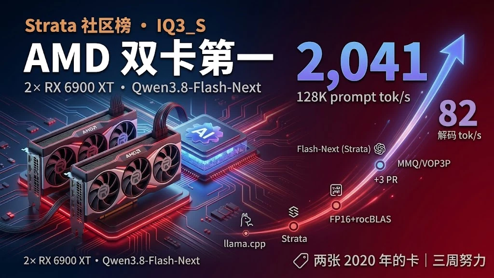

[English](README.md) · **交互版时间线：https://vop3p.github.io/dual-6900xt-flash-next-tuning/** （每一步可按思路筛选）

<picture>
  <source media="(prefers-color-scheme: dark)" srcset="docs/now-zh-dark.png">
  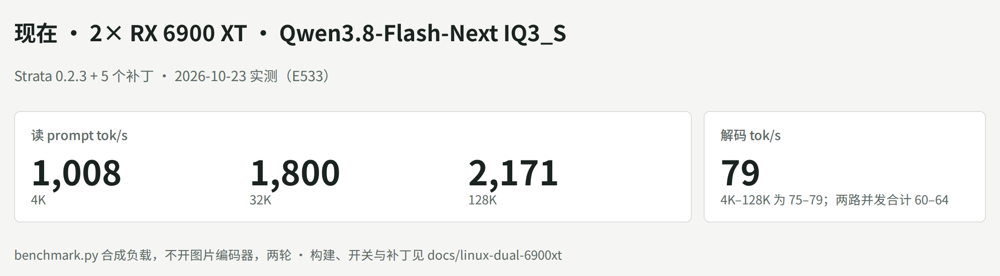
</picture>

<picture>
  <source media="(prefers-color-scheme: dark)" srcset="docs/speed-chart-dark.png">
  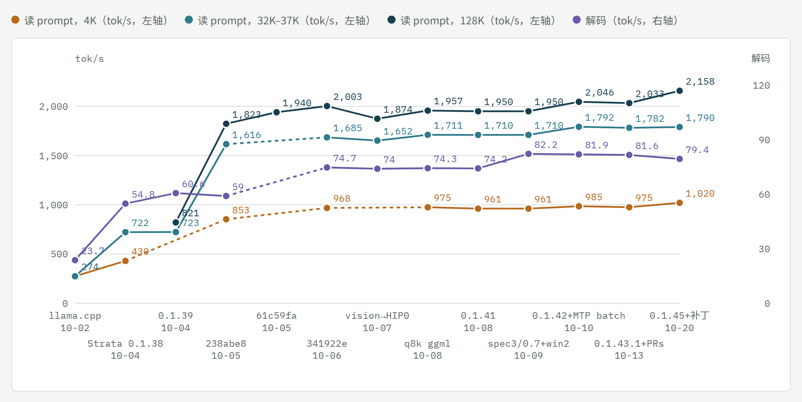
</picture>

*各生产状态的读 prompt（4K、32K–37K、128K，左轴）和解码（右轴）tok/s。各点来自不同实验、条件不完全相同（前两步的 4K 点是 5K prompt；最后两点是 E504 和 E533，即 10-20 和 10-23 的生产跑 E415 同款负载；其余见交互页图下说明）；虚线段表示那一步没测这个指标。*

在一台家用机器（**2× AMD RX 6900 XT，gfx1030，各 PCIe 4.0 x8 / Ryzen 5 5600X / 128 GB DDR4**，ROCm 10.0）上跑 **Qwen3.8-Flash-Next（GSQ-RCO IQ3_S）** 的调优记录，从 llama.cpp 到 [Strata](https://github.com/Niko1221/Strata)，2026-09-21 → 10-24；另有一张 RX 6900 XT 在 Windows 11 上的调优（[第 5 节](#5-windows-单卡rx-6900-xt)）。

`patches/llama.cpp/` 是基于上游 `159c651f5` 的 8 个 llama.cpp 补丁：1–7 是时间线里 `q8k ggml` 那一步背后的 RDNA2 MMQ 工作（更宽的 tile、mad24 缩放、Q8_K 式激活、dot 链头 VOP3P），8 是 q8_0 K cache 的 int8 QK^T flash-attention tile 内核；编译选项和实测见[其 README](patches/llama.cpp/README.md)（英文）；Strata 通过 `-DSTRATA_GGML_DIR` 吃到 MMQ 那几个。这些补丁都是在同一台机器用 llama.cpp 跑的稠密 **Qwen3.8-27B** 上做出来的，那条线见[第 4 节](#4-同一台机器上的稠密-27bqwen38-27bud-q5_k_xlllamacpp-qwen38-tp)。

**许可**：llama.cpp 补丁（`patches/`）和脚本（`bench/`）是 MIT，与 llama.cpp 相同，可以直接拿走、合并、随软件分发；文字、图和测量数据是 CC BY-NC 4.0（署名、禁止商用）。见 `LICENSE`；`CITATION.cff` 可直接引用。

<picture>
  <source media="(prefers-color-scheme: dark)" srcset="docs/modes-chart-zh-dark.png">
  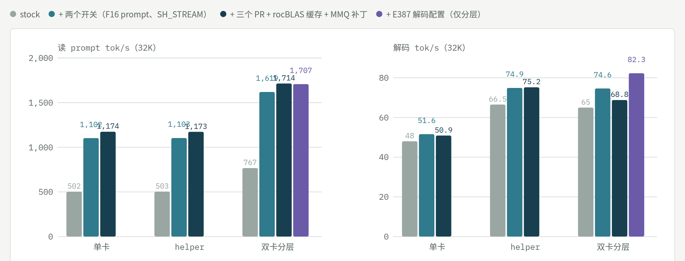
</picture>

*单卡 vs helper vs 双卡分层（E388 / E388a，0.1.41，32K，无图片编码器）：16 GB 单卡不管哪个树解码都是 48–52（约 4,500 专家槽、命中 83%）；helper 把解码提到 66–75、prompt 仍是单卡速度；分层两项都提，E387 解码配置再加最后一步到 82。*

`bench/` 是 A/B 骨架：`run_ab.sh`（每臂一个冷启动 server、全量日志、确认行核对）、`benchmark.py`（负载）、`ab_compare.py`（逐请求对比文本与速度）、`monitor_amd.py`（遥测采样）。路径是占位符，按自己的机器改。

Developed with an AI coding assistant; every number here was measured on the machine above.

---

# Flash-Next 调优时间线（2026-09-21 → 10-08）

[English](README.md) · 交互式时间线页面：`index.html`（GitHub Pages）

AiBox：2× RX 6900 XT（gfx1030，各 PCIe 4.0 x8）/ Ryzen 5 5600X / 128 GB，ROCm 10.0。模型 Qwen3.8-Flash-Next（GSQ-RCO IQ3_S 为主）。
实验编号（E…）对应作者的实验日志（未公开）；每条数字都是本机实测，推算的单独标明。

<picture>
  <source media="(prefers-color-scheme: dark)" srcset="docs/udq4-vs-iq3s-zh-dark.png">
  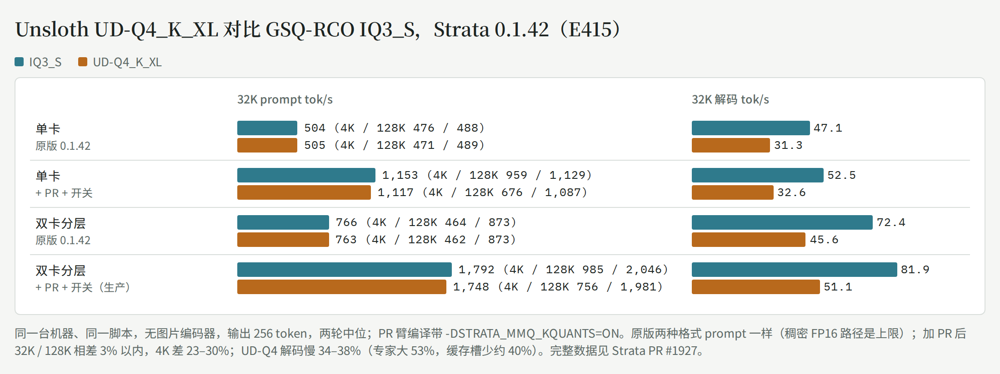
</picture>

*UD-Q4_K_XL 对比 IQ3_S（E415，0.1.42，无图片编码器，每格两轮，0 停转）。**单卡**：原版 UD-Q4 4K / 32K / 128K 为 471 / 505 / 489 tok/s，IQ3_S 为 476 / 504 / 488，解码 30–32 对 45–47；加 PR 和开关后 676 / 1,117 / 1,087 对 959 / 1,153 / 1,129，解码 32–33 对 47–53。按 #1897 的开关（加 `STRATA_ROUTE_TAIL_SKIP=7`），单卡 UD-Q4 在这条 x8 链路上 8K 1,085–1,093、16K 1,121–1,122 tok/s，解码 39–40，三次冷启动（E414；#1897 的 x16 卡是 1,036 / 1,104，解码 32–38）。**双卡分层**见图。原始数据：`bench/results/e414`、`e415`，以及 Strata PR #1927。*

## 0. 结论（先看这里）

- **生产（10-23 13:27 起）**：`strata-023-b523b933` = Strata 上游 **0.2.3**（合并进 0.2.2 生产，无冲突）+ #2985 的流水 MTP（`STRATA_PIPED_MTP=2`，JacobSussan）+ 我们的 5 个补丁：开批槽时单路保留 `--pipeline-windows`（`STRATA_PW_WITH_BATCH=1`，[#3095](https://github.com/Niko1221/Strata/pull/3095)）、HIP 上接通 #2071 的 SIMT=2 打分（[#3073](https://github.com/Niko1221/Strata/pull/3073)）、`--batch` 下读 prompt 也用 CPU 分担（`STRATA_PREFILL_CPU_SHARE_BATCH=1`，[#3382](https://github.com/Niko1221/Strata/pull/3382)）、gfx103x 读 prompt 注意力内核（`STRATA_PROMPT_ATTN_RDNA2=1`，[#3381](https://github.com/Niko1221/Strata/pull/3381)）、rocBLAS 解的本机缓存；外加 `STRATA_PREFILL_STREAM_MIN=2048` 和自改的 llama.cpp ggml。配置钉 `--conversation-cache-mib 0`：0.2.3 默认按内存自动开会话缓存，本机单会话读 prompt 因此 4K 慢 3%、32K–128K 慢 1.4%（E533）。两路并发（`"parallel": 2`）、双卡分层、IQ3_S 专家、int8 KV、`--spec 3 --spec-min-p 0.7 --pipeline-windows 2`；10-21 起两卡降压 −81 mV @245 W（E522/E523：37 轮 0 次翻转；解码不随频率变，E507–E512）。回退槽 `strata-split-prev` = 0.2.2 合并版（`strata-022-34cd8534`）。10-20 以来引擎 0.1.45 → 0.2.1.3（E516/E517）→ 0.2.2（E527）→ 0.2.3（E533），每一步速度和 KL 都与上一版持平。
- **现在的速度**（E533，E415 同款负载，生产配置去图片编码器，两轮）：prompt **1,008 / 1,800 / 2,171** tok/s（4K / 32K / 128K；10-20 生产的 E504 是 1,020 / 1,790 / 2,158，10-10 的 E415 是 985 / 1,792 / 2,046），单请求解码 **75 / 79 / 78**（E504：80 / 79 / 74）；两个请求同时跑合计 60–64 tok/s（E481），第二个请求首字 12 s → 0.5 s（E463–E470）。短 prompt：430 token 读 1.1 s（原来 1.7 s，E493）。同一台机器、同样设置下的上游 **0.2.0-beta** 原版（E503，社区报告 [#3426](https://github.com/Niko1221/Strata/pull/3426)）：自带套件 4K / 32K 979 / 1,662 tok/s，真实文本 119K 1,893，单请求解码 66——差距就是我们的补丁（每个都在上面的 PR 里用 0.2.0 重测过）。
- **从 llama.cpp 到 Strata 的总账**（同一份 IQ3_S）：解码 26 → 约 80 tok/s（≈3×），32K–37K prompt 274 → 1,790（≈6.5×），128K 821（0.1.39）→ 2,158。其中换引擎占大头，之后我们的补丁和配置让 prompt 大约翻倍（37K 714 → 1,433 → 1,705；10-20 的 32K 1,790、128K 2,158），解码约 +40%（56–58 → 80）。
- **已经到地板的（别再试）**：解码的配置级杠杆**单独调**全部否定——`--kv-resident` 缩小（E382）、单开 `--pipeline-windows 2`（E384，+1–6%）、pipeline-windows 1 下的 `--spec`/`--spec-min-p` 16 点网格（E385/b，4/0.5 是峰值）；**但组合有效**：`--spec 3 --spec-min-p 0.7 --pipeline-windows 2` 解码 4K +10–16%、32K +8–11%（E387，三轮确认；短草稿接受率 83% vs 68%，第二窗的推测才命中），prompt 不变，输出跨启动不确定（基线是确定的），128K 在无编码器配置下 +11%（E388）；10-09 00:16 上生产；并发批槽（10-08 结论：常驻专家 41% < 上游门槛 50%，槽里不带 MTP；**10-15 推翻**：加上槽位草稿、单路保留流水窗口和后来的 #2985，`"parallel": 2` 已是生产）；IQ3_S 的 MMQ 分块/stream-K（E279/E280）；`--prefill` chunk 8192 即甜点（E296）；上游的 GDN 分块、Foresight、STAGE_PIN（上游自测对小卡无益或有害）。
- **还有空间的**：长 prompt 的 PCIe 拓扑（保持 x8/x8：Strata 上长 prompt 等 PCIe 只占 0.2–0.7%，但 <2K 的短 prompt 占 43–54%，E482）；解码时每窗多换入专家（E499：自适应缓存命中已 85%，完美的 8 窗预测器在现在的换入量下也不更好——杠杆是换入预算，未测）。四个 PR 在 0.2.0-beta 上等上游审（#3381、#3382，以及 10-20 带 E503 数据重开的 #3073 / #3095）。

## 0.5 时间花在哪：原版对比调优后（0.2.0-beta 对比 10-20 的生产，E505）

<picture>
  <source media="(prefers-color-scheme: dark)" srcset="docs/breakdown-prompt-zh-dark.png">
  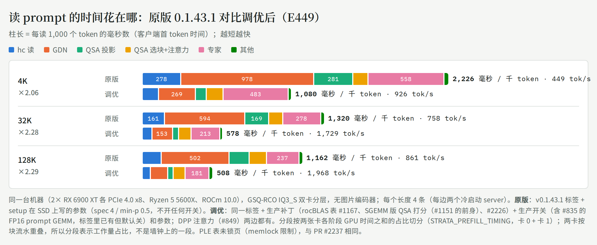
</picture>

<picture>
  <source media="(prefers-color-scheme: dark)" srcset="docs/breakdown-decode-zh-dark.png">
  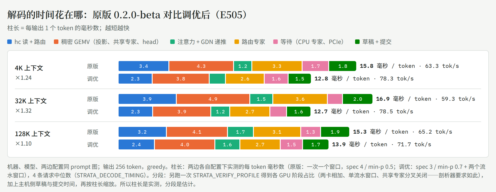
</picture>

*同一台机器、同一模型（IQ3_S 双卡分层，无图片编码器），每边两个冷启动 server，每个长度 4 条请求，开着计时开关（代价 3–6%）。**原版** = 0.2.0-beta（main e88ee39d，按 setup.py 的 HIP 选项构建）+ setup 在 SSD 上写出的参数，不开任何开关；**调优** = 10-20 的生产（0.1.45 + #2985 + 我们的补丁 + 生产开关与参数，两路并发槽）。柱长是实测；分段来自引擎自带的计时开关（prompt：两张卡各阶段相加；解码：另跑一次剖析，单流水窗口），所以分段是估计。原始数据与脚本：`bench/results/e505/`（10-13 的上一版是 E449：0.1.43.1 对比当时的生产）。*

图中的数字（各段为估计，合计为实测；prompt 为每千 token 毫秒，解码为每 token 毫秒）：

| 长度 | | hc 读 | GDN | QSA 投影 | QSA 选块 + 注意力 | 专家 | 其他 | 合计（每千 token 毫秒） | tok/s |
|---|---|---|---|---|---|---|---|---|---|
| 4K | 原版 | 267 | 986 | 283 | 106 | 547 | 29 | **2,217** | 451 |
|  | 调优 | 122 | 283 | 76 | 79 | 478 | 18 | **1,056** | 947 |
| 32K | 原版 | 163 | 596 | 169 | 99 | 271 | 22 | **1,320** | 758 |
|  | 调优 | 71 | 160 | 43 | 68 | 210 | 27 | **578** | 1,731 |
| 128K | 原版 | 138 | 504 | 143 | 122 | 231 | 22 | **1,160** | 862 |
|  | 调优 | 57 | 130 | 35 | 63 | 171 | 24 | **479** | 2,088 |

| 上下文 | | hc 读 + 路由 | 稠密 GEMV（投影、共享专家、head） | 注意力 + GDN 递推 | 路由专家 | 等待（CPU 专家、PCIe） | 草稿 + 提交 | 合计（每 token 毫秒） | tok/s |
|---|---|---|---|---|---|---|---|---|---|
| 4K | 原版 | 3.37 | 4.32 | 1.18 | 3.35 | 1.74 | 1.83 | **15.79** | 63.3 |
|  | 调优 | 2.26 | 3.82 | 1.04 | 2.58 | 1.57 | 1.51 | **12.78** | 78.3 |
| 32K | 原版 | 3.87 | 4.91 | 1.51 | 3.62 | 0.96 | 1.99 | **16.86** | 59.3 |
|  | 调优 | 2.29 | 3.89 | 1.23 | 2.66 | 1.08 | 1.59 | **12.74** | 78.5 |
| 128K | 原版 | 3.21 | 4.08 | 1.69 | 3.15 | 1.30 | 1.91 | **15.33** | 65.2 |
|  | 调优 | 2.40 | 4.05 | 1.63 | 2.68 | 1.46 | 1.73 | **13.95** | 71.7 |

- **读 prompt 快 2.1–2.4 倍**：4K / 32K / 128K 451 → 947、758 → 1,731、862 → 2,088 tok/s（10-13 在 0.1.43.1 上同样的对比是 2.06 / 2.28 / 2.29 倍）。主要来自 GDN 段（32K 每千 token 596 → 160 ms：FP16 进出 + rocBLAS 解表），hc 读和 QSA 投影也明显变小。10-13 以后新出现的是 QSA 选块 + 注意力段（32K 99 → 68、128K 122 → 63，10-13 时调优侧是 90 / 87）——SIMT=2 打分（#3073）和 RDNA2 读 prompt 注意力（#3381），所以 128K 提升最多。专家段基本没动（271 → 210）。
- **解码快 1.10–1.32 倍**：63.3 → 78.3、59.3 → 78.5、65.2 → 71.7 tok/s（开着计时；不开时 80 / 79 / 74，E504）。hc 读 + 路由降得最多（3.4–3.9 → 2.3 ms/token，常驻 hc 读），其次是路由专家和草稿/提交；其余来自短草稿 + 两个流水窗口。

**每一项改在哪里**（各项来自不同版本、不同测量，**不能相乘**；合计效果看上面两张图：原版 0.2.0-beta 对比生产）

| 阶段 | 改动 | 来源 | 实测（版本） | 状态 |
|---|---|---|---|---|
| prompt：稠密 GEMM | 16 位 GEMM 以 FP16 进出（`STRATA_HIP_PROMPT_F16=1`） | [#835](https://github.com/Niko1221/Strata/pull/835) | prompt ≈2×（0.1.39） | 已收录，默认关 |
| prompt：稠密 GEMM | gfx1030 的 rocBLAS 解表 | [#1167](https://github.com/Niko1221/Strata/pull/1167) | 1K +13.9%、4K +12.1%（0.1.43.1，10 对） | 已收录（0.2.0） |
| prompt：QSA 注意力 | 每步 8 cell + DPP 交换 | #849 → 0.1.40.2 | +6–12%（0.1.40） | 已收录，默认开（两边都有） |
| prompt：QSA 选块 | HIP 上的 FP32 分块打分核（`STRATA_SELECT_SIMT=1`） | [#1151](https://github.com/Niko1221/Strata/pull/1151) | 128K +3.2%、32K +0.6%（0.1.43.1，10 对） | 已收录（0.2.0） |
| prompt：QSA 选块 | #2071 的 simt2 打分在 HIP 上接通（`STRATA_SELECT_SIMT=2` 原先静默退回） | [#3073](https://github.com/Niko1221/Strata/pull/3073) | 119K −6.5%、31K −1.35%（0.2.0-beta，10 对） | 待收录 |
| prompt：QSA 注意力 | gfx103x 读 prompt 注意力内核（不切块不合并，`STRATA_PROMPT_ATTN_RDNA2=1`） | [#3381](https://github.com/Niko1221/Strata/pull/3381) | 31K / 119K −3.49%（0.2.0-beta，10 对） | 待收录 |
| prompt：短读 | `--batch` 下的 CPU 分担（`STRATA_PREFILL_CPU_SHARE_BATCH=1`） | [#3382](https://github.com/Niko1221/Strata/pull/3382) | <2,048 token 的读 −28.8%（0.2.0-beta，10 对） | 待收录 |
| prompt：短读 | `STRATA_PREFILL_STREAM_MIN=2048` | 上游开关 | 真实文本 1.1–1.5K −6~17%（0.1.45，E485） | 开关 |
| prompt：整体 | `STRATA_SPLIT_MTP_BATCH=1` | 上游开关 | 4K / 32K / 128K +4 / +7 / +2%（0.1.42） | 10-15 起关（开批槽后） |
| 解码：草稿 | `--spec 3 --spec-min-p 0.7 --pipeline-windows 2` | 配置 | 4K +10–16%、32K +8–11%（0.1.41，E387） | 配置 |
| 解码：hc 读 | 验证器的 hc 读改成一个常驻内核 | [#2226](https://github.com/Niko1221/Strata/pull/2226) | 每窗 4K −6.6%、32K −4.4%（0.1.43.1，10 对） | 已收录（0.2.0） |
| 解码：单个请求 | 开批槽时单路保留 `--pipeline-windows`（`STRATA_PW_WITH_BATCH=1`） | [#3095](https://github.com/Niko1221/Strata/pull/3095) | 4K +16.1%、32K +12.3%（0.2.0-beta，10 对） | 待收录 |
| 解码：两个请求 | 批分组里的流水 MTP（`STRATA_PIPED_MTP=2`，JacobSussan） | 上游 #2985 | 两路 +13%（0.1.45，E481） | 他人的 PR，已移植 |
| 解码：共享专家 | 共享专家分叉流（calibrate 按机器决定） | [#1992](https://github.com/Niko1221/Strata/pull/1992) | 4K +8.0%、32K +9.5%（0.1.43.1，10 对） | 已收录（0.2.0） |
| 启动 | PLE 表锁进内存（`--ple-io ram`）+ `STRATA_IO_THREADS=128` | 配置 | 首块等待 600 → 306 ms（线程）→ 10 ms（锁页） | 配置 |
| 稳定性 | `STRATA_HIP_ADAPT_KERNEL_COPY=1` | 上游开关（#884） | 128K 停转 3/3 → 0/3 | 开关 |

**专家段为什么没动**（E450–E452）：调优后专家成了 prompt 里最大的一段，但测下来没有空间——llama.cpp 的 MMQ 在真实形状上 28–34 TOPS 封顶，每专家行数 ≥64 后不再涨；换 tile 宽度不省时；让 MMQ 原地读专家、不再搬进分组缓冲（输出逐位相同）只快 0.5%，因为省下的拷贝本来就便宜，原地读又让 GEMM 慢了 1.7%。

## 1. 时间线

| 日期 | 事件 | 效果（实测） |
| --- | --- | --- |
| 09-21/22 | llama.cpp 专家 cache（E140–E146）：cache 56、inserts 8、MTP n-max 2 | 120K 解码 10.9 → 13.0 t/s；cache 链 >4 token 在 MMQ 崩 |
| 09-26 | `GGML_OP_OFFLOAD_MIN_BATCH=136`；PLE 直读构建 build-pleds | 冷 8K prefill +13–18%，主缺页归零 |
| 09-27 | E165 专家拷贝分两条 x8 | 只 +1–4%，层串行是瓶颈；流水线并行需重写调度器，未做 |
| 09-29 | QSA gather（`LLAMA_QSA_GATHER=1`，冻结 flash-next-qsa-fe7c12b19） | 96K 每验证步 −9.6%；gather 只在 decode/MTP 生效 |
| 09-30 | 新 alias flash-next-iq3s（GSQ-RCO IQ3_S + 112 槽） | 解码 −19–20%/步、prefill +17–22%（vs UD-Q4），命中 77% |
| 10-01 | 官方 MTP vs 自家稠密 MTP；Vulkan | 无可分辨差异；Vulkan 慢 55–90%，否决 |
| 10-02 | 生产换 flash-next-mtp-410e94c34（137 槽，上游 159c651f5） | 每步比 112 槽快 10–18%；数值噪声地板 KLD ≈0.025 |
| **10-04** | **Strata 引擎到位**（E215/E216，HIP gfx1030） | 同 IQ3_S 5K 提示词解码：llama.cpp 26 → split 56–58 → helper 62–63；37K prefill 274 → 714 |
| 10-04 02:30 | 上线 strata-split / strata-helper（strata-132a522，HIP 优化：FP16 输出 GEMM、QSA S4） | 37K prefill split 1,433 / helper 978 |
| 10-04 17:00 | 升 0.1.39（strata-6add1a7）+ FP16 prompt 路径 → PR #835；#849/#854 | 9.9K split 906 t/s；helper 需 `--pcie-frac 0` |
| 10-04 21:00 | 读提示词第 1 层卡死可复现（~70%）→ 临时 `--adapt-every 100000` | 0/3 卡；根因追到 10-06 |
| 10-05 | 卡死根因链（E251–E264，issue #884）：MMQ + 主卡 adapt + SDMA 三者同时；CP 不放行 BARRIER_AND | 关任一不卡；单硬件队列 0 卡但 prompt −30% |
| 10-05 15:32 | 生产 strata-238abe8（0.1.39 + #835/#849/#854/#981 rocBLAS 表） | 50K prompt 1,495 → 1,705（+13–16%），解码不变 |
| 10-05 19:05 | `STRATA_IO_THREADS=128` + `--ple-io ram`（memlock 无限） | 首 chunk 等 PLE 568 → 10 ms，8K prompt −7.4% |
| 10-05 20:25 | 生产 strata-61c59fa（+#1007 select SGEMM） | 128K prompt +5% |
| 10-06 06:33 | **#884 最强线索：GFXOFF**（写 0 后 0/10 不卡）；knob 是引用计数（11:05 更正） | 之后用 gfxoff-guard，再换 kernel-copy |
| 10-06 09:42 | 0.1.40.1 基线（E335） | split prompt 745 → 1,455（F16），解码 58.6 → 64.5（SH_STREAM） |
| 10-06 18:04 | 生产 strata-341922e（0.1.40.1 + #1149/#1150/#1151 + rocBLAS 表，env SH_STREAM=1、PROMPT_F16=1） | 128K split 2,003 tok/s |
| 10-06 19:10 | `STRATA_HIP_ADAPT_KERNEL_COPY=1` 绕 128K 停转，撤 gfxoff-guard（省电） | 0/3 vs 3/3 停转，无速度代价 |
| 10-06 22:20 | split 两槽开图片（自编 HIP strata-vision） | 主卡缓存 −11%，32K prompt −3.6% |
| 10-07 16:54 | 生产 strata-4592281（0.1.40.2 + rocBLAS 解本机缓存） | 速度持平，选解不再随启动变化 |
| 10-07 晚 | #1151 改为 SIMT 打分核（上游 65ce329 移植） | 128K prompt +7.4%，逐字节一致 |
| 10-07 22:10 | 图片编码器挪到 HIP0（分层 0–26/27–47，主卡缓存 5,256 → 6,123 槽） | 32K prompt +2.8–3.8% |
| 10-08 | strata-ud-q4 槽（UD-Q4_K_XL，K-quant MMQ 在 HIP 跑通） | 解码 −38%、32K prompt −3% vs IQ3_S，只用于比质量 |
| 10-08 19:25 | 生产 strata-q8k-4592281：ggml 换 llama-q2k（MMQ q8_0/iq3_s 链头 VOP3P，E378） | iq3_s 内核 +2.6% → 32K prompt +1.4–1.5%，输出逐字相同 |
| 10-08 20:30 | E382 `--kv-resident` 32K → 16K | 专家槽只 +0.7%，32K 解码 −3%，否决 |
| 10-08 21:25 | **生产 strata-141-d14ca361**：上游 0.1.41 + 7 补丁 rebase（无冲突） | 12 条输出逐字相同、速度 ±0.5%、0 停转；json 加 `gpu_order: as_given` |
| 10-12 02:00 | `strata-ud-q4` 槽补上 E387 解码配置（`--spec 3 --spec-min-p 0.7 --pipeline-windows 2`；E387 上线时只改了 IQ3_S 两个槽，漏了它。E422 带图片编码器、E423 不带） | 解码 4K / 32K / 128K +13.5 / +9.6 / +5.2%（44.8 / 47.6 / 47.9 → 50.9 / 52.2 / 50.4），草稿接受 66 → 79%，prompt −0.3%；与 IQ3_S 同一机制，和专家格式无关；0 停转。UD-Q4 解码现比 IQ3_S 慢 32–36%（IQ3_S 76.6 / 81.9 / 74.5） |
| 10-11 01:57 | `strata-ud-q4` 槽 → 0.1.42 + 7 补丁 + `-DSTRATA_MMQ_KQUANTS=ON` + `STRATA_SPLIT_MTP_BATCH=1`（E415；社区报告 PR #1927） | 分层 4K / 32K / 128K 756 / 1,748 / 1,981，解码 45–51（旧槽 715 / 1,640，43–46）；原版 0.1.42 两种格式 prompt 一样（单卡 471–476 / 504–505 / 488–489：稠密 FP16 路径是上限）；UD-Q4 解码比 IQ3_S 慢 30–35% |
| 10-10 23:38 | E414：llama.cpp 的 RDNA2 MMQ 补丁放进 Strata，单卡 UD-Q4，对照 PR #1897 | tile / mad24、以及把 Q8_K 激活编进 `strata_mmq`（它原本就没定义 `GGML_CUDA_MMQ_Q8K`）都只有 prompt ±1%；Q8_K 让 8K 解码 −7%；专家 GEMM 只占 prompt 34%，等拷贝 1.6%。我们 x8 单卡 8K 1,085–1,093 / 16K 1,121–1,122，#1897 的 x16 是 1,036 / 1,104 |
| 10-10 14:33 | **生产升 0.1.42**（`strata-142-cd87f4d2`）+ `STRATA_SPLIT_MTP_BATCH=1`（E413/E413b） | 0.1.42 本身与 0.1.41 固定协议下逐字相同、速度持平；草稿 K/V 批量化：prompt +4.1 / +6.9 / +2.0%（4K/32K/128K，三轮同向），解码与接受率不变 |
| 10-10 13:40 | 0.1.42 其余 opt-in 逐个单变量（E413） | `STRATA_ROUTE_TAIL_SKIP=7`（HIP 要显式设）解码 +4 / +1%，在 ±6% 轮间噪声内且改答案；`STRATA_ROUTE_RESIDENT=0.5` 命中 96→98.7% 但解码 −1~−3.5%；`--aux-cpus auto` ±2%；`STRATA_MMQ_RESIDENT_SORT_NE` 要整层专家全常驻，本机永不触发；`STRATA_PF_FUSED` 只有 gfx11/12 |
| 10-09 上午 | flag 清单 K1：35 个开关/档位逐个单变量（E395–E401） | 单独没有一个超过噪声；17 个明确变慢（SPLIT_OWN / no-prefill-borrow 32K −35%，`--mtp-window 0` 解码 −30%）；六个噪声内的叠加解码 +1%，生产里测不出，归档 |
| 10-09 04:47 | E391–E394：四条外来线索全部否定 | `--prefill auto:16384`（#1640）32K −14%；短 prompt 切 2048（#1441 思路）4K −9%；#1123 FP32 SGEMM 在 F16 开着时零调用、F16 关时 +66/+73%（10-06 已测过同款，正文已引用）；相位计时 F16 在 hc/qsa proj 都快一倍，不合并 |
| 10-09 04:03 | E388a 0.1.41 单卡 / helper 六臂（补齐报告） | 单卡 PRs 976/1,174/1,147、解码 49–51；helper PRs 986/1,173/1,147、解码 72–75；stock 比 0.1.40.1 +3–6%，两开关 +5–13%，PRs +1–2%；0 停转 |
| 10-09 00:16 | **E387 配置上生产**（strata-split / -256k：`--spec 3 --spec-min-p 0.7 --pipeline-windows 2`，备份 *.bak-2026-10-09-before-e387） | 经 llama-swap 实发 7K 请求：确认行出现，分层 0–26/27–47，prompt 1,019、解码 73.4，草稿接受 92% |
| 10-09 00:13 | E388 0.1.41 社区报告（split 五臂，无图片编码器） | stock 0.1.41 比 0.1.40.1 stock prompt +4–6%（464/767/869），两开关 +5/+12/+12%（832/1,619/1,823），PRs 持平（968/1,714/2,029）；kernel-copy 无代价、stock 128K 不停转；E387 解码配置 +19/+20/+11%（77/82/76） |
| 10-08 23:42 | E387 `--spec 3 --spec-min-p 0.7 --pipeline-windows 2` | 解码 4K 66 → 73–77、32K 74 → 80–83（+8–16%，三轮），prompt 不变；输出跨启动不确定；候选 |
| 10-08 21:27 | E384 `--pipeline-windows 2` | 解码 +1–6% 但跨启动输出不确定（2/7 同），4K prompt −1–5%，否决 |
| 10-08 21:50 | E385/E385b `--spec`×`--spec-min-p` 16 点 | 只有 5/0.6 在 32K +2.5%（单轮），其余全负；4/0.5 保留 |
| 10-08 22:50 | 并发批槽评估 | 常驻专家 41% < 上游门槛 50%，槽里不带 MTP，不做 |
| 10-13 23:40 | 生产 → `strata-144-hcps-fb15a4e6`：#1151 加 #2071 的 `STRATA_SELECT_SIMT=2`（上游只在 CUDA 生效，HIP 静默退回）（E457） | prompt +1%；后来送 PR #3073 |
| 10-15 | 两三路并发（`"parallel": 2`，E463–E470）：A 单路保留 `--pipeline-windows`、B 长读在块边界让路、C 流水分组的槽位草稿（移植 davidbhoward） | 第二个请求首字 12 → 0.5 s，长读旁插短请求 37 → 8 s，两路 +6%；单路比独占配置 −2~6%；10-15 19:30 上生产；A 送 PR #3095 |
| 10-18 13:09 | 上游 0.1.45（E475）：原版缺 A，单路解码慢 11–16%；0.1.45 + A + C + SIMT=2 与旧生产打平 | 生产 `strata-145-acx-2e127c66` |
| 10-18 21:10 | 上游 #2985（`STRATA_PIPED_MTP=2`，JacobSussan）换掉我们的 C（E481） | 两路总吞吐 +13%，单路与交接不变，找针 14/14；生产 `strata-145-2985-3f53fb74` |
| 10-19 02:20 | `STRATA_PREFILL_STREAM_MIN=2048`（E482–E485）：低于全量搬运阈值的块只搬路由到的专家，<2K 的读有 43–54% 时间在等 PCIe | 真实文本 1,090–1,542 token −6~17%，779 token 续写 −7%，≥2048 不变；3072 在 2–3K 变慢。合成词表提示让 3072 看起来更好（E483）——路由相关的开关必须用真实文本测 |
| 10-19 17:40 | `STRATA_PREFILL_CPU_SHARE_BATCH=1`（我们的，E493/E494）：开 `--batch` 时上游直接关掉 CPU 分担 | <2048 token 的真实文本 −20~35%，455 token 续写 1.86 → 1.25 s，并发不变；生产 `strata-145-csb-de8b8636`；PR #3382 |
| 10-19 20:30 | `STRATA_PROMPT_ATTN_RDNA2=1`（我们的，E495–E498e）：gfx103x 读 prompt 的注意力借用解码内核（64 单元切块 + 合并）；改为每（查询，KV 头）一个 block、在线 softmax、加权阶段每线程 4 维 | 每 8,192 token 块注意力 500 → 355 ms，34K / 133K −3.5%；质量门（8 段对 FP64 注意力参照）不劣；生产 `strata-145-pa-a6572b34`；PR #3381 |
| 10-19 22:15 | SeqMoE 式专家预取先测上界（E499）：4 段真实 agent 对话的 26.6 万条路由记录回放 | 自适应缓存命中已 85.3 / 85.1%（高于全知静态集）；按现在的换入量，完美的 8 窗预测器也不更好——放弃；杠杆是每窗换入量（未测） |
| 10-20 | 补丁按上游新规在 0.2.0 main 上复测（E501–E503）：setup.py 构建、默认路径逐字节、ctest 对照 main、10 对交错冷启动、FP64 参照质量门、CUDA 13.2 编译 | RDNA2 注意力 31K / 119K −3.49%（各 10/10）；CPU 分担 <2048 −28.8%（10/10）；送 #3381 / #3382。#3073 在 0.2.0 上 119K −6.5%，#3095 单路解码 +12~16%（各 10/10，E503） |
| 10-20 16:40 | 生产 → 上游 0.2.1.3 + #2985 移植 + 我们的 5 个补丁（`strata-0213-40d9a2dc`，E516/E517） | 读 prompt −0.2~−0.8%、解码在噪声内，0 停转；KL 0.034 / 0.029 对旧 0.026（逐段看是重分布不是变差） |
| 10-21 10:17 | 两卡降压 −81 mV @245 W（E522/E523） | 37 轮 0 次翻转（card1 到 −88 就有翻转）；解码不随频率变（E507–E512） |
| 10-22 18:47 | 生产 → 0.2.2 合并（`strata-022-34cd8534`，E527） | KL 0.028 / 0.030 对 0.031，8 段里 7 段逐位相同；速度持平 |
| 10-23 13:27 | 生产 → 0.2.3 合并（`strata-023-b523b933`，E533），钉 `--conversation-cache-mib 0` | 0.2.3 默认开的会话缓存让单会话读 prompt −3% / −1.4%；钉住后 1,008 / 1,800 / 2,171，解码 75 / 79 / 78，与 0.2.2 持平 |
| 10-24 | 一张 RX 6900 XT 在 Windows 11 上（[第 5 节](#5-windows-单卡rx-6900-xt)） | 官方包只改设置：16K 读 prompt 479 → 1,076、解码 28 → 42，12/12；PR [#4005](https://github.com/Niko1221/Strata/pull/4005)、[#4006](https://github.com/Niko1221/Strata/pull/4006)，报告 [#4012](https://github.com/Niko1221/Strata/pull/4012) |

## 2. 机制上学到的

- Strata 的专家 prompt 矩阵乘就是 llama.cpp 的 MMQ（`moe_mmq.cu`），所以 llama.cpp 侧的 MMQ 改动可以通过 `STRATA_GGML_DIR` 直接带入；rocBLAS 表和 SIMT 只管稠密投影和 QSA 打分。
- 解码速度 = 每窗接受的 token 数 ÷ 窗口时间。两卡层分段串行时每窗约 33 ms 固定开销（10-08，`--pipeline-windows 1`）；两个窗口同时在途（`--pipeline-windows 2`）后约 25–28 ms（E481、E499）。草稿更长或 min-p 更低接受率掉，更短或更高窗口截短：没有重叠时 4/0.5 是峰值（E385），有重叠时是 3/0.7（E387）。
- Flash-Next 的 KV 常驻窗口只占一百多 MB，不是显存大头；显存大头是专家缓存（10-07 图片编码器在主卡时主卡 6,123 槽；10-20 无编码器时 5,534 + 4,273），prompt 和解码都直接跟着槽数走。
- Strata 能把 KV 放 RAM 是因为 QSA 稀疏（98.7% 块读命中 VRAM）；全注意力模型（qwen38-tp）没有这条路。
- GFXOFF 与 ROCm CP barrier 的交互是卡死的根（#884、drm/amd #5945）；缓解靠 kernel-copy，不靠 guard。
- 分层边界本身是个解码旋钮：去掉图片编码器后第二卡多 1.7 GiB，自动分层从 0–26/27–47 变成 0–24/25–47，32K 解码 74 → 69（−8%），命中率反而更高；开 pipeline-windows 2 后两种分层都到 82（E388）。没扫过手动 `layer_split`。
- 短 prompt 是 PCIe 问题，长 prompt 不是：低于全量搬运阈值（`stream_all_min`）的块只搬路由到的专家，每 token 选 512 个里的约 10 个，几百 token 就碰到大部分专家——<2K 的读有 43–54% 时间在等 PCIe（E482）。所以有了 `STREAM_MIN=2048` 和短读的 CPU 分担（E485、E493）。
- 路由相关的开关必须用真实文本测：重复的词表提示只路由到少数专家，会把一个设置测得比实际好（E483 对 E484/E485）。
- 开批槽时上游会静默关掉单个请求的两样东西：`--pipeline-windows`（解码 −11~16%）和读 prompt 的 CPU 分担。两者都以可选开关的形式补回来了（#3095、#3382）。
- 专家缓存不受预测限制（E499）：回放 26.6 万条真实路由，自适应缓存（85%）胜过全知静态集，Radiance 式衰减 LFU 只差 1.4 点；预知未来只有在每窗换入预算变大时才有用。
- 内核精度：端到端 KL "更接近 FP64 参照"不代表内核更准——那在等价 FP32 路径的跑间波动之内；算子级 FP64 单测显示第一版反而误差大 1.2–1.4 倍，改成每块分块求和后修正，只多 1.6% 时间（E498e、E502）。

## 3. 我在这个题目上犯过的错

- 把 `amdgpu_gfxoff` knob 当电平用（它是引用计数），E335–E338 的"默认开"臂全部作废（10-06）。
- 读 split 计时行时把"整条调用"那张卡的等待当成计算，读错一轮（E361）。
- 以为 KV 常驻窗口占大块显存，没先算就开了 E382（结果只多 40 槽）。
- 测上游 PR 前先通读正文、再搜自己日志里它和它前身的编号——#1123 跑了三轮才发现 10-06 在 #1006 上测过、正文还引用了我们的数字（E392）。
- E384/E385 各扫完一个单变量就宣布"否定"，没想到两个旋钮有交互，组合是 +10–16%（E387）。
- 对 `--pipeline-windows` 预期 +10–30%，实测 +1–6% 且输出不确定；预期是按"省掉一段"算的，没考虑猜中率受每窗 2.3 token 限制。
- 升级前没逐条核对旧版本地补丁，0.1.39 升级后 helper 掉到 39 t/s（10-04 19:40）。
- 新建对比构建没 diff CMakeCache，漏了 STRATA_PREFILL_MMQ=ON 导致二分作废（10-04）。
- 凭 27B 上的内核数字，在评论草稿里先写了"我们的 ggml 补丁能帮 #1897"，之后才在 Strata 里测——实测无效（E414）。先测再写。
- 一条 gh 评论没发出去：泄露检查 `grep -c claude.ai` 匹配 0 时退出码是 1，截断了 `&&` 链；应写 `! grep -q`。
- 照文档最简命令编上游 0.2.0，没加 setup.py 的 `STRATA_PREFILL_MMQ=ON`，读 prompt 慢 1.75 倍，差点当成回归——没先 diff CMakeCache，10-04 的错又犯一次（E501）。
- 用合成词表提示测一个路由相关的开关，差点把错误的值上生产（E483）。
- 凭端到端 KL 的排名说内核"更准"，FP64 单测一查是反的（E498e）。
- 先停实验脚本、后停引擎：恢复 trap 把生产切回去时实验引擎还占着两张卡（约 12 s，没有请求进来）。先停引擎再停脚本；不要用 `pgrep -f` 匹配自己命令行里也有的字符串（E501）。
- 专家缓存上界回放的第一版，把视野外的专家都当成"再也不用"，得出"全知比实际缓存还差"的荒谬数（E499）；导出钩子也只挂在了四条代码路径中的一条上。
- PR 草稿里写了"失败集与 main 相同"，那份构建其实还没跑测试；发帖前查出来了。

## 4. 同一台机器上的稠密 27B：Qwen3.8-27B（UD-Q5_K_XL），llama.cpp `qwen38-tp`

同样两张卡还用 llama.cpp 跑稠密的 Qwen3.8-27B：`-sm tensor`（RCCL allreduce 走两条 x8 经主机）、q8_0 KV、196K 上下文、MTP 草稿（`--spec-draft-n-max 3`）、3 个槽。全注意力模型，Strata 那套专家缓存 / KV 流式都用不上；上面的 llama.cpp 补丁就是在它身上做的，补丁 8 只为它而存在。它不在交互式时间线页面里。

<picture>
  <source media="(prefers-color-scheme: dark)" srcset="docs/q38-now-zh-dark.png">
  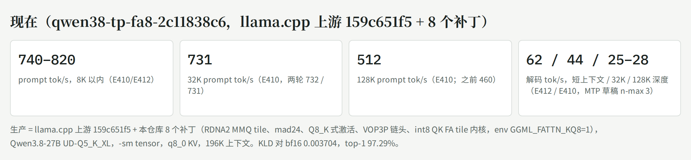
</picture>

**现状（10-09 15:10）**：生产二进制 = 上游 `159c651f5` + 补丁 1–8，env `GGML_FATTN_KQ8=1`。prompt 8K 以内 740–820 tok/s，32K 731，128K 512；解码短上下文 62 tok/s（MTP：每步约 51 ms 出 3.2 个 token），32K 深度 44，128K 25–28。KLD 对 bf16 0.003704，top-1 一致率 97.29%（同一量化用原版内核：0.003941 / 97.32%）。针 32K 8/8、128K 4/4。196K 上下文每卡显存 15.8 GB。

<picture>
  <source media="(prefers-color-scheme: dark)" srcset="docs/q38-speed-zh-dark.png">
  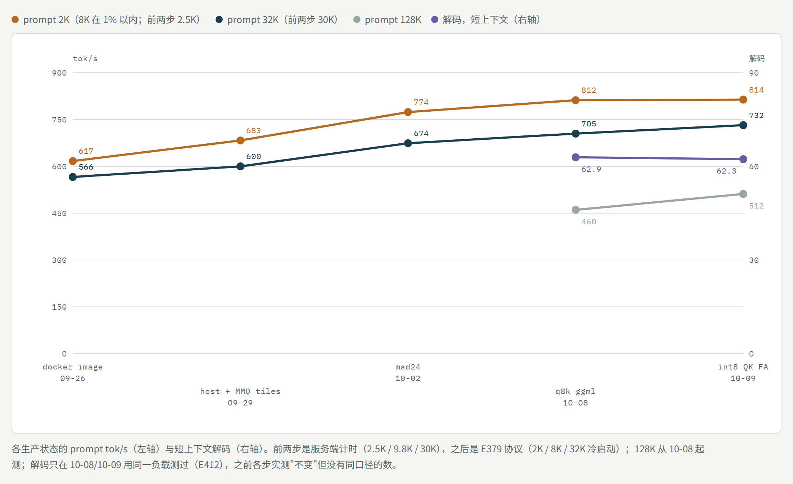
</picture>

| 日期 | 这一步 | 实测效果 |
| --- | --- | --- |
| 09-26 | E157：选 v3 UD-Q5_K_XL 而不是 UD-Q4_K_XL（对 54 GB bf16 基准算 KLD，64×512 中英混合语料） | 0.0039 vs 0.0116；Q4 快 10.5%、每卡省 1.2 GiB；选了精度 |
| 09-27 | E152：在宿主上复现生产数字 | `--cache-ram 0` 会关掉空闲槽缓存，`-kvu` 下新请求慢 30–40%——差点得出四个假结论；复现必须逐项复制参数，包括缓存类 |
| 09-29 | 宿主二进制替代 docker 镜像；RDNA2 K-quant MMQ tile（补丁 2；扫描里 K512 变体快 1.9× 但真实形状算错，否决） | prefill 2.5K 617→683、9.8K 623→677、30K 566→600；逐位相同；解码不变 |
| 10-02 | mad24 缩放乘法（补丁 3） | prefill +8–9%，逐位相同，解码 −1% |
| 10-02 | E200b 分时，10K prefill：MMQ 64–67%、RCCL ≤13%、FA 5%、GDN 5% | K-quant MMQ 比 q8_0 慢约 40%，来源是每子块的浮点缩放 → 激活布局成为目标（10-08 做成） |
| 10-08 | Q8_K 式 MMQ 激活 + dot 链头 VOP3P（补丁 4–6） | prefill +4.6–6.1%（2K 774→812、8K 773→811、32K 674→705）；KLD 0.003941→0.003736；弯路：每 256 值一个缩放（KLD +25%）、k01 展开（>1000 VGPR）、q4_K/q5_K 上用 VOP3P 链头（−10%） |
| 10-08 | E377 内核级分时：MMQ 60–72%、allreduce 14–16%（BF16，每层 2 次，已是 PCIe 速度）、FA 2%@2K → 17%@32K、GDN 5–6% | FA 是长上下文的目标 |
| 10-08 | E381 FA tile 内核参数扫描（nbatch_fa、nbatch_K、占用率、线程数，10 个点） | 上游默认就是 gfx1030 上的局部最优，没有一点 >+3%；内核卡在 fp16 峰值的 35% 是结构（每 32 列 × 64 key 的 LDS 复用、half2 打包）不是参数 |
| 10-09 | **FA tile 内核 int8 QK^T**（补丁 8；E406–E410，一天） | 内核 16K/64K 1.31×；端到端 prefill 32K +3.3–3.9%、128K +11.1%、2K/8K 持平；解码/显存不变；KLD 0.003704；15:10 上生产 |
| 10-09 | E411 解码分时（短上下文，生产配置，rocprofv3；追踪工具本身拖慢 12%） | 饼图见下；MTP 值 2.1×（25.7 → 62 tok/s）；HIP 图在用但只值 2%（E411b） |
| 10-09 | E412 新旧二进制短上下文对照 | 解码两边都 62 ±1%，904 token prompt 持平——补丁 8 不碰解码 |

**短上下文一个解码步的时间去向（E411，每卡每步约 51 ms，3.2 个 token）：**

<picture>
  <source media="(prefers-color-scheme: dark)" srcset="docs/q38-decode-zh-dark.png">
  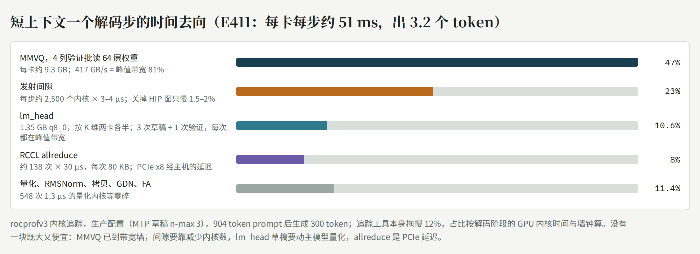
</picture>

| 块 | 占比 | 离硬件上限 |
| --- | --- | --- |
| MMVQ，4 列验证批读 64 层权重（每卡约 9.3 GB） | 47% | 417 GB/s = 峰值带宽的 81% |
| 发射间隙（每步约 2,500 个内核 × 3–4 µs） | 23% | `-sm tensor` 的 meta 后端把每步切成约 130 个子图（每个 allreduce 一段），每张 HIP 图只装十几个内核——关掉图只慢 1.5–2% |
| lm_head（1.35 GB q8_0，按 K 维两卡各半；3 次草稿 + 1 次验证） | 10.6% | 每次都在峰值带宽；草稿那 3 次占 8% |
| RCCL allreduce（约 138 次 × 30 µs，每次 80 KB） | 8% | PCIe x8 经主机的延迟 |
| 量化（548 次 × 1.3 µs）、RMSNorm、拷贝、GDN、FA | 约 10% | 零碎小内核 |

没有一块既大又便宜：MMVQ 已到带宽墙；间隙要靠减少内核数（把 1–4 µs 的小内核融合，预期 +5–8%）或把 allreduce 做进图里整步一张图（后端改动，上限 +15–20%，未实测）；草稿的 lm_head 只能换更小的 `output.weight` 量化（动主模型）；allreduce 是 PCIe 延迟。

**27B 上已经关掉的方向（实测）**：SGLang 同位宽单路不比 llama.cpp 快（E174，之前的 +6–12% 是 Q4 vs Q5）；Vulkan；`-ub 2048`（prompt +4–8% 但上下文得降到 131K）；`-np 1`（单路无收益）；FA tile 参数空间（E381）；MMVQ（已到带宽 81%）；HIP 图开关（2%）。

**这条线上犯过的错：**

- 宿主复现时 `--cache-ram 0`（E152）差点出四个错结论；缓存类参数一个都不能漏。
- int8 原型前四版（1.04–1.11×）被当成思路的上限，其实是把 Q 的缩放放寄存器导致的溢出（256 VGPR + 31 次 spill）。判断一个内核思路之前先看 ISA / VGPR 数。
- int8 的精度爆炸（KLD 0.059、最大 20）在量化器里追了几小时（离群维度、旋转、SmoothQuant），真因是 `launch_fattn` 的 split-KV 合并路径——int8 内核的 LDS 占用把它触发了；上游 f16 内核强制走同一条路也掉精度。先读发射器，再动量化器。
- 两条实验链共用一个脚本和构建目录，产出的二进制和日志写的不是一回事（两组读数作废）；一次只跑一条链。
- 用 `sed` 叠加宏开关删掉了一个真正的 `#define`；宏变体应各自成提交。
- rocprofv3 下 `llama-server` 不响应 SIGINT/SIGTERM（追踪器的信号处理），追踪库其实早已落盘，白等 30 分钟。库出现后直接 SIGKILL。
- E411 的证伪条件（"内核时间 < 墙钟 60%"）满足了，却回答不了"切哪块"；条件应写成"最大块 ≥30% 且离硬件上限 ≥25%"。

## 5. Windows 单卡（RX 6900 XT）

<picture>
  <source media="(prefers-color-scheme: dark)" srcset="docs/win1x-chart-zh-dark.png">
  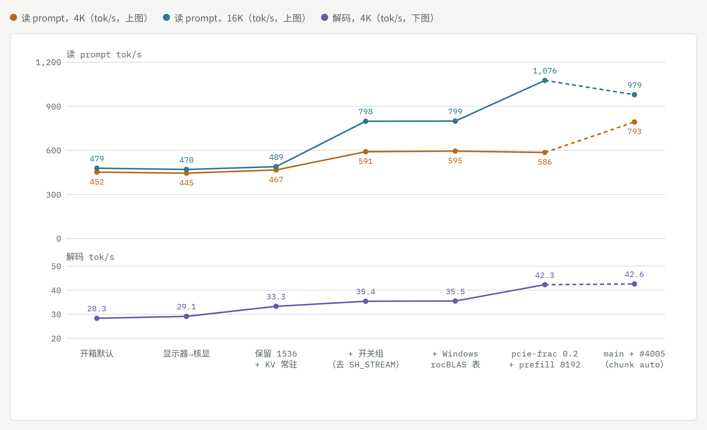
</picture>

*Strata 标准基准（`strata bench run`，三次中位，每一步都 12/12），每一步一次完整运行，原始数据在 Strata PR [#4012](https://github.com/Niko1221/Strata/pull/4012)。前六步都是官方 `rdna2` 引擎包 0.1.48 原样；最后一点（虚线）是 `main` + [#4005](https://github.com/Niko1221/Strata/pull/4005) 在本机自编，同样 8,192 chunk（E559，12/12，这次不在 #4012 里）：4K 586 → 809、16K 1,076 → 1,125、解码 42 → 45.5。同一二进制用 auto chunk（6,144）时 16K 只有 979（#4012 里的 `…-c97e2108`）。*

第二台机器（IanLAB：i9-10900K，64 GB DDR4-3600，一张 RX 6900 XT 16 GB，PCIe 3.0 x16，Windows 11，同一个 IQ3_S 模型，64K 上下文），10-23 → 10-24。Strata 从 0.2.2 起在更新源里放了 RX 6000 的 Windows 引擎包（`windows-x86_64-hip-rdna2`），发布说明写"编了但没在真卡上试"；这里是它在真卡上的结果。**不用编译、照下面设置一键装好的脚本：[`windows-rx6000/`](windows-rx6000/)**（官方 Terminal、官方包、存一个 `strata launch` 预设）。

**最后到了哪里（标准基准，官方包，只改设置）：**读 prompt 4K / 16K **452 / 479 → 586 / 1,076** tok/s，解码 **28 → 42** tok/s，短 prompt 首字 2.8 → 1.1 s，12/12。再加 #4005（本机自编，E559），4K / 16K 读到 809 / 1,125、解码 45.5。对比同型号卡在 Linux 上（E540，单卡）：Windows 原来读 prompt 582 / 811（4K / 32K）、解码 36.9，Linux 944 / 1,160、47.4；调完 32K 读到 1,163，Linux 是 1,165（8,192 chunk，带拷贝事件补丁和 #3381 / #3073 的本地构建），解码 43–47。

**测出来的东西，按影响大小排**

- **WDDM 下每次提交约 80–120 µs（E541）。**同一个 HIP 小程序在两个系统、同型号卡上跑：背靠背拷 2.79 MB 的块，Windows 并不慢（12.5 对 14.1 GB/s，每次固定开销 5.5 µs）；但拷贝流上每记一个事件多 79 µs（Linux 3），每次跨流等待多 43 µs（Linux 约 0），一次拷贝加回调通知端到端多约 120 µs；发了 kernel 不跟一次 query，它甚至不会下发到 GPU。能缩短这笔开销的"硬件加速 GPU 计划"在 RX 6000 驱动里是 `AlwaysOff`。下面每一条都是这笔开销在不同地方出现。
- **解码：PCIe 份额（E538、E545、E547）。**启动时的规则只按链路带宽定 PCIe 份额（12.6 GB/s → 0.35）。扫 0 / 0.1 / 0.2 / 0.3 / 0.35：0.2 是唯一的峰，解码 **+29%**。Strata 自带的运行时细化（`STRATA_PCIE_FRAC_DEFAULT=auto`，只在 gfx12 默认开）自己就收敛到 0.20，因为这台 CPU 算专家（29.4 GB/s）比链路搬得快；在 Linux 那台上它同样收敛到 0.20，解码 +1–2%。已在 [#4007](https://github.com/Niko1221/Strata/issues/4007) 提议 gfx103x 默认开。
- **长 prompt：chunk 大小（E543、E548）。**Windows HIP 上 `--prefill auto` 卡在 6,144，因为 8,192 在一张 RX 7900 XTX、262K 上下文下崩过（[#1630](https://github.com/Niko1221/Strata/issues/1630)）。这里 8,192 六次冷启动都没出问题，其中三次是 `--max-context 262144`、27K 和 100K 的 prompt；32K 读 prompt **+17%**（流式 6 遍变 4 遍）。
- **短 prompt：拷贝事件（E542、E544）。**读 prompt 路径每流一个专家就记一个事件、等一次释放事件，而消费端每 16 个专家一组只等一次。两个 opt-in 开关去掉其中 15/16：**4K +36.4%、32K +14.9%，10/10 对**；Linux 上输出逐字节相同、速度不变。PR [#4005](https://github.com/Niko1221/Strata/pull/4005)。
- **显存余量。**16 GB 卡上 Windows 默认留 2,560 MiB；加载后剩下的约等于保留值减 250–340 MiB，剩下不到约 1 GiB 的运行都换页了（700：12 题 0/12）。1,536 是最低的稳定值。再多留一些代价起初不大：每多 512 MiB 少约 265 个专家槽；2,048 读 prompt 慢 1%、解码在噪声内，2,560 的 32K 解码慢 6–8%，3,072 的 4K 解码慢 7%、32K 慢 9–13%（E553，每档两次）。
- **显示器。**两台 4K 显示器接在卡上时，桌面合成器占了 2.2 GB 显存；挪到核显后，同样的保留值下专家缓存从 3,121 槽涨到 3,672 槽，重启后卡上只剩引擎。测试时浏览器在放视频，解码掉了三分之一。
- **看图。**包里带图片编码器；CPU 版读一张测试图 4–5 s、全对。同一个包里的 GPU 版（`strata-vision-hip.exe`）只为 gfx1200 / gfx1201 编译：设 `gpu: true` 就报 `this GPU (gfx1030) is not in the picture reader's build (gfx1200,gfx1201)`（E554，手写配置、没配 CPU 后备）。用官方源码为 gfx1030 / gfx1031 自编后能在显卡上跑（E555/E556）：4/4 全对，大图按 1,059 个图像 token 读（CPU 版 300），占约 1.3 GB 显存、引擎自动从专家缓存让出（3,479 对 4,166 槽；4K 解码 44.4 对 44.5，各一次）。懒人包加了 `-Vision gpu` 选项（[windows-rx6000](windows-rx6000/README.md#pictures-on-the-gpu--vision-gpu-optional)）。
- **没用的：**大页（64 GB 内存拿不出 47 GB 连续的 2 MB 页，错误 1450）；Linux 上调的 rocBLAS 表（Windows 运行时全部拒绝；在 Windows 上调的表只对 ~1K 以内的新 prompt 有用，−7.6%）；`STRATA_SH_STREAM`（Windows 上解码变慢，和 KV 流式一起用会让引擎停掉，[#3895](https://github.com/Niko1221/Strata/pull/3895)）；本机自编引擎（和官方包一样快，E537）。

**在这条线上犯过的错（留着，下次不再犯）**

- 把 `STRATA_PREFILL_TIMING` 的读数当真了一天：它自己每个专家记一个事件，在 Windows 上让 32K 读 prompt 慢 8%，还把约 3.3 s 的等拷贝记成了"dequant"。修正是 [#4006](https://github.com/Niko1221/Strata/pull/4006)；修之前"Windows 上 dequant 慢 3 倍"是测量工具造出来的。
- 猜 `--prefill auto` 卡在 6,144 是因为卡上槽太少借不出；引擎启动时就打印了原因（#1630）。解释一个数之前先读代码或日志。
- 先拿专家槽数解释解码差距（E535–E537），又说份额公式缺了 WDDM 延迟（E541）；实测答案是启动时的份额没看 CPU 有多快（E545）。
- 一组 A/B 里有三臂是在电脑上放视频时测的（解码 −33%）；现在开跑前先确认没人在用这台机器。
- 配 GPU 图片编码器时漏了 `gpu: true`，看它跑在 CPU 上就怪 16 GB 显存不够；编码器只有被要求才会用 GPU，要求之后才看到真正的限制：它根本没为 gfx1030 编译。

## 6. 仓库里的 27B 原始材料

`bench/results/e410`、`e411`、`e412`：补丁 8 的 P/F 冷启动交替 A/B（脚本、报告、KLD/perf 运行）、rocprofv3 解码饼图与间隙分析（脚本及其文本输出；300–800 MB 的追踪库不含）、新旧二进制短上下文对照。
