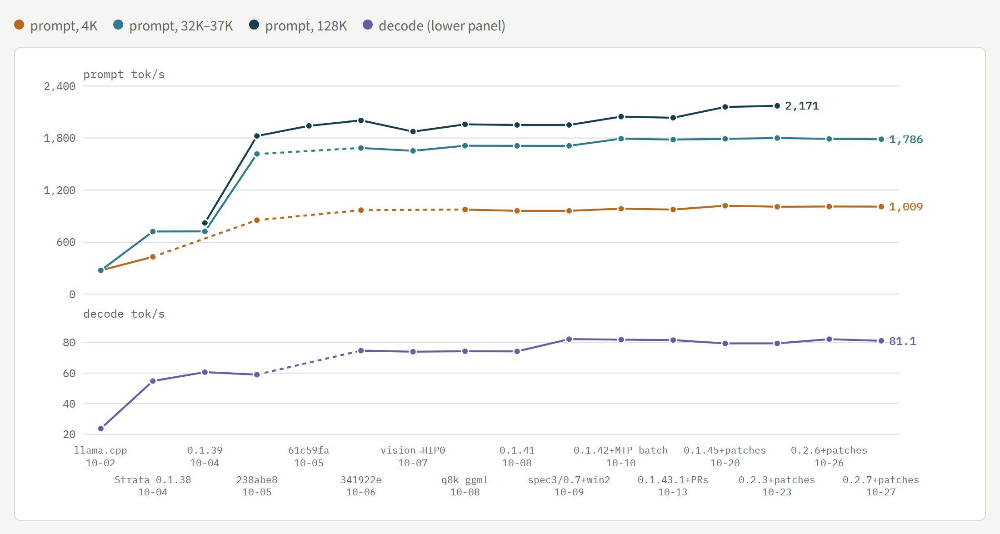
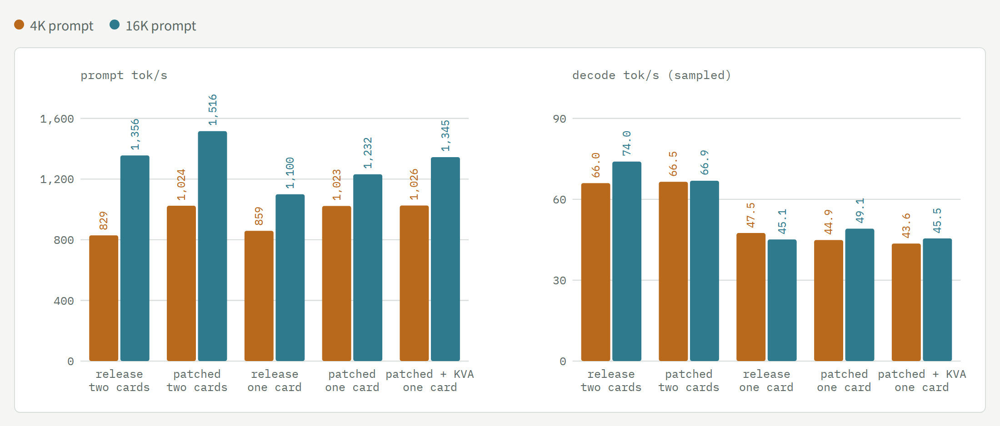
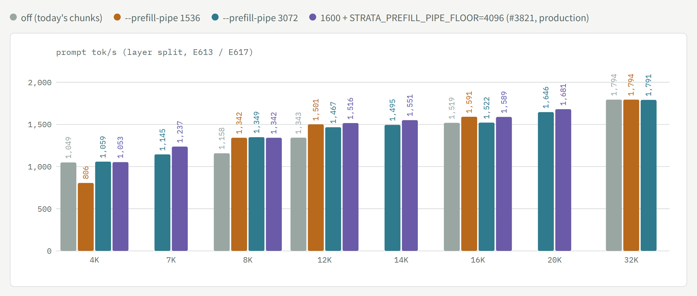
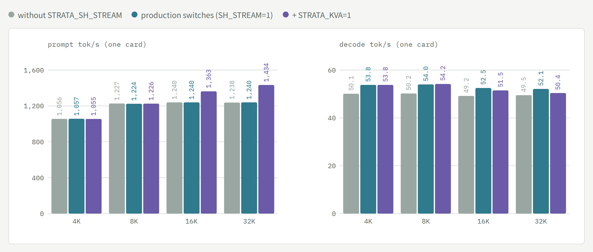
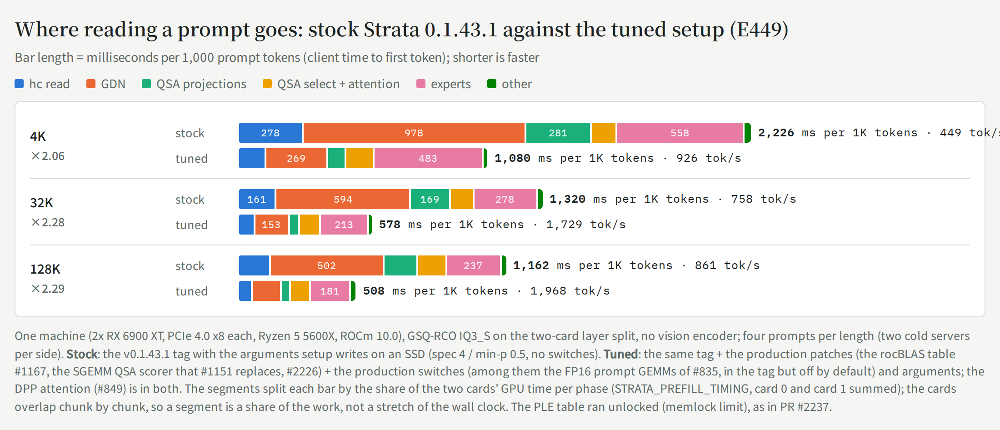
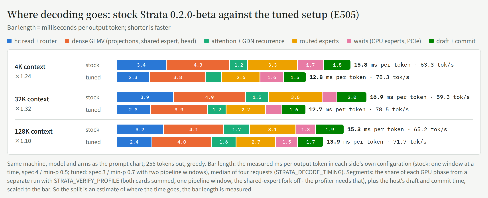
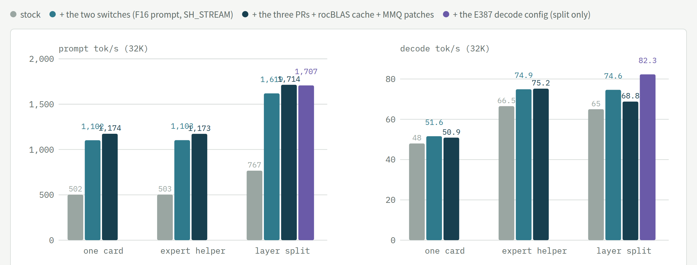
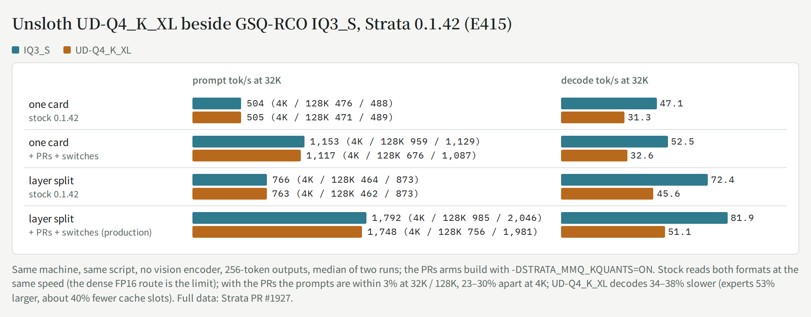

# Two RX 6900 XT under Linux: Qwen3.8-Flash-Next on Strata

[← README](../README.md) · [中文](linux-dual-6900xt.zh-CN.md)

Tuning log for **Qwen3.8-Flash-Next (GSQ-RCO IQ3_S)** on a home box with **2x AMD RX 6900 XT (gfx1030, PCIe 4.0 x8 each) / Ryzen 5 5600X / 128 GB DDR4**, ROCm 10.0 — from llama.cpp to [Strata](https://github.com/Niko1221/Strata), 2026-09-21 → 10-24; plus one RX 6900 XT under Windows 11 ([Windows notes](windows-one-card.md)). Experiment numbers (E…) refer to the author's lab notebook (not public). Every number is measured on this machine unless marked as an estimate.

<picture>
  <source media="(prefers-color-scheme: dark)" srcset="speed-chart-en-dark.png">
  
</picture>

*Prompt tok/s at 4K, 32K–37K and 128K (left axis) and decode tok/s (right axis) at each production state. Points come from different experiments under slightly different conditions (the 4K points of the first two steps are 5K prompts; the last two points are E504 and E533, the E415 load on the 10-20 and 10-23 productions; the notes under the chart on the interactive page list the rest); a dashed segment bridges a step where that metric was not measured.*

## Where it stands

- **Production (since 10-27 18:40 on 0.2.7, `--prefill-pipe 3072` since 10-29 05:06):** `strata-027-9ca7fd21` = Strata upstream **0.2.7** (engine 0.1.52; #2985's pipelined MTP is upstream now as #4121) merged into the local patch set - #3381 (RDNA2 prompt attention), #3382 (CPU share beside `--batch`), #3073 (SIMT=2 scorer), #3095 (pipeline windows beside batch slots) - plus the modified llama.cpp ggml and the rocBLAS 5.6.0 table; 0.2.6 (E587) and 0.2.7 (E596) were each flat against the build before. Benchmark load (E596): prompt **1,009 / 1,786** at 4K / 32K, decode 78-85. `--prefill-pipe 3072` then lifted 8K **+16%** and 12K **+8%** (E613), and upstream #3821's chunk floor (`STRATA_PREFILL_PIPE_FLOOR=4096` with `--prefill-pipe 1600`) another +3-8% at 7K-20K (E617, below); production is `strata-027f-3177b96f` since 10-29 07:1x.
- **Strata's standard benchmark on 0.2.7 (E616, 10-29, all 12/12, 0 stalls):**

| Arm | Prompt 4K | Prompt 16K | Decode short / 4K / 16K |
|---|---|---|---|
| Patched, two cards (production) | 1,024 | 1,516 | 79.4 / 66.5 / 66.9 |
| Release package 0.1.52 + upstream switches, two cards | 829 | 1,356 | 73.8 / 66.0 / 74.0 |
| Patched, one card | 1,023 | 1,232 | 49.0 / 44.9 / 49.1 |
| Patched + `STRATA_KVA=1`, one card | 1,026 | 1,345 | 50.3 / 43.6 / 45.5 |
| Release package + upstream switches, one card | 859 | 1,100 | 46.2 / 47.5 / 45.1 |

  <picture>
    <source media="(prefers-color-scheme: dark)" srcset="std-chart-en-dark.png">
    
  </picture>

  The patches are worth +19% / +12% prompt on one card and +24% / +12% on two; decode is within the protocol's sampling noise. The release package's rocBLAS (5.4.0) does not match the shipped gfx1030 table (5.6.0), so it runs the default kernels, as on 0.2.2 (#3790). The default track (`strata launch` setup) did not run: an installed 0.1.47 engine is not upgraded by the 0.2.7 Terminal until `strata update`, and after the update 0.2.7's launch could not reach its runtime host here (the engine itself served) - not yet understood.
- **Production (since 10-23 13:27):** `strata-023-b523b933` = Strata upstream **0.2.3** (merged into the 0.2.2 production, no conflicts) + #2985's pipelined MTP (`STRATA_PIPED_MTP=2`, JacobSussan) + five patches of ours: the solo path keeps `--pipeline-windows` beside batch slots (`STRATA_PW_WITH_BATCH=1`, [#3095](https://github.com/Niko1221/Strata/pull/3095)), #2071's SIMT=2 scorer on HIP ([#3073](https://github.com/Niko1221/Strata/pull/3073)), the prompt's CPU share beside `--batch` (`STRATA_PREFILL_CPU_SHARE_BATCH=1`, [#3382](https://github.com/Niko1221/Strata/pull/3382)), a gfx103x prompt-attention kernel (`STRATA_PROMPT_ATTN_RDNA2=1`, [#3381](https://github.com/Niko1221/Strata/pull/3381)), a per-device rocBLAS solution cache; plus `STRATA_PREFILL_STREAM_MIN=2048` and the modified llama.cpp ggml (MMQ dot-chain heads in VOP3P). The config pins `--conversation-cache-mib 0`: 0.2.3 turns a conversation cache on by default, and it read a single session's prompts 3% / 1.4% slower at 4K / 32K-128K here (E533). Two parallel slots (`"parallel": 2`), layer split, IQ3_S experts, int8 KV, `--spec 3 --spec-min-p 0.7 --pipeline-windows 2`; both cards undervolted −81 mV at 245 W since 10-21 (E522/E523: 37 rounds without a flipped token; decode does not follow the clock, E507-E512). Rollback slot `strata-split-prev` = the 0.2.2 merge (`strata-022-34cd8534`). Since 10-20 the engine moved 0.1.45 → 0.2.1.3 (E516/E517) → 0.2.2 (E527) → 0.2.3 (E533), each step speed- and KL-neutral against the one before.
- **Speed (E533, the E415 load, the production config without the vision encoder, two rounds):** prompt **1,008 / 1,800 / 2,171** tok/s at 4K / 32K / 128K (E504 on the 10-20 production: 1,020 / 1,790 / 2,158; E415 on 10-10: 985 / 1,792 / 2,046), decode **75 / 79 / 78** for one request (E504: 80 / 79 / 74); two requests at once 60–64 tok/s together (E481), a second request's first token 0.5 s instead of 12 s (E463–E470). Short prompts: a 430-token read 1.1 s (was 1.7 s, E493). Upstream **0.2.0-beta** stock on the same box and settings (E503, community report [#3426](https://github.com/Niko1221/Strata/pull/3426)): 979 / 1,662 tok/s at 4K / 32K with its own suite, 1,893 at 119K real text, decode 66 for one request - our patches are the difference (each re-measured on 0.2.0 in the PRs above).
- **Whole journey, same IQ3_S model:** decode 26 → ~80 tok/s (≈3×), 32K–37K prompt 274 → 1,790 tok/s (≈6.5×), 128K 821 (0.1.39) → 2,158. The engine switch (llama.cpp → Strata) is most of it; the patches and configuration after that roughly doubled the prompt (37K 714 → 1,433 → 1,705; 32K 1,790 and 128K 2,158 on 10-20) and added about +40% decode (56–58 → 80).
- **Closed directions (measured; do not retry on this box):** every decode-side configuration knob — `--kv-resident` shrink (E382), `--pipeline-windows 2` alone (E384, +1–6%), the 16-point `--spec` × `--spec-min-p` grid at `--pipeline-windows 1` (E385, 4/0.5 is the peak of accepted tokens per window) — **but the combination works**: `--spec 3 --spec-min-p 0.7 --pipeline-windows 2` decodes +10–16% at 4K and +8–11% at 32K (E387, three confirmation rounds; the short draft is accepted 83% of the time instead of 68%, so the speculative second window hits). Prompt speed unchanged; output differs between starts (the baseline is deterministic); 128K +11% in the no-vision-encoder configuration (E388); in production since 10-09 00:16; batch slots as evaluated on 10-08 (resident experts 41% < upstream's 50% gate, slots decode without MTP; **overturned 10-15**: with slot drafts, the solo path kept pipelined and later #2985, `"parallel": 2` is production); MMQ tile / stream-K for IQ3_S (E279/E280); `--prefill` chunks other than 8192 (E296); tensor parallel (E234, +6%); and the upstream opt-ins that upstream itself measured as neutral or negative on small cards (chunked GDN, Foresight swap slots, pinned stage buffers).
- **What is left:** the PCIe topology for long prompts (x8/x8 kept: on Strata a long prompt waits on PCIe only 0.2–0.7% of the time, but a <2K one 43–54%, E482); more expert swaps per decode window (E499: the adaptive cache already hits 85%, a perfect 8-window predictor would not beat it at today's swap rate - the swap budget is the lever, untested). Four PRs wait for upstream review on 0.2.0-beta (#3381, #3382, and #3073 / #3095 reopened 10-20 with the E503 numbers).

## Prompt speed by length: `--prefill-pipe` (0.2.7, 10-29, E613)

<picture>
  <source media="(prefers-color-scheme: dark)" srcset="pipe-chart-en-dark.png">
  
</picture>

On a layer split the prompt is read as a two-stage pipeline: card 1 runs layers 0-23 on chunk *n* while card 2 runs layers 24-47 on chunk *n-1*. Strata's `--prefill-pipe R` (from #1441; R = how many tokens one stage takes to cover the other's fixed cost) re-chunks a cold prompt when its cost formula says the pipeline wins by more than 3%; the auto chunk here is 8,192, so without it an 8K prompt is one chunk and the second card waits for the whole first stage.

- **3072 is in production** (all three Qwen slots): 8K becomes 2x4096 (**+16%**, 1,158 -> 1,347 synthetic, 1,145 -> 1,327 real text), 12K 2x6144 (**+8%**), and 4K / 16K / 32K keep today's chunks.
- **1536** also splits 16K (+5%) and gives 12K +12%, but it cuts 4K into 2x2048, **-23%**. Working the cost formula through, no value of R splits 16K without also splitting 4K, so 3072 is the best single value here.
- One cold engine, the value switched per request (`strata_tune.prefill_pipe`), an "off" control before and after every value; the real-text check (E572 lesson: chunking switches are judged on real text) agreed at 4K / 8K / 12K. Data point upstream: Strata PR #4587 (docs).
- This overturns E393's "pipe does nothing on two stages": E393 tested only 4K and 32K, the two lengths it leaves alone.

**Is there a better number than 3072?** Not as a single value. `Prefill::pipeline_chunk` (src/prefill/prefill.cpp) costs a plan of k chunks of c tokens as `k*R + n + (stages-1)*(R + min(c, n))`, tries k from today's count up to 64 (chunks on a 256 grid, at least 512) and takes the cheapest only if it is under 97% of today's cost. Running that formula for every R from 1 to 20,000 over 2K-128K prompts (auto chunk 8,192, two stages):

| R | What changes against 3072 | Measured |
|---|---|---|
| 2,976-3,400 (3072 is here) | the same plan: 8K 2x4096, 10K 2x5120, 12K 2x6144, 14K 2x7168, 20K 3x6912; every chunk >= 4,096 | 8K +16%, 12K +8% |
| 2,551-2,975 | 7K cut into 2x3584 | not measured |
| 2,048-2,550 | 6K cut too | not measured |
| 1,792-2,047 | 12K becomes 3x4096; 5K cut too | 12K +12%; 5K not measured |
| 1,701-1,791 | as above, 20K 4x5120 | as above |
| <= 1,700 (1536 is here) | 4K cut into 2x2048 | 4K -23% |

The formula charges every chunk the same fixed cost R, but here a chunk under ~4,096 tokens costs far more than that (4K as 2x2048 -23%, 8K as 3x2816 -2%, 8K as 2x4096 +16%; the guess, not measured, is MMQ efficiency at small row counts plus one full expert pass per chunk). So no single R both splits 12K / 16K into three and leaves 5K-7K alone. What could beat 3072 is a code change, not a number: a configurable minimum chunk (4,096 instead of 512) with R near 1,536 would, by the formula, give 8K 2x4096, 12K 3x4096, 16K 3x5632 (+16 / +12 / +5% measured for those plans) and leave everything under 8K whole. **Measured (E617, 10-29): upstream #3821 is exactly this switch** (`STRATA_PREFILL_PIPE_FLOOR`, ruibeikaa). With the floor at 4,096 the plan at R = 1,600 keeps 4K-6K whole and cuts 7K into 4,096 plus a 3,071 tail - and that tail split is a win: against 3072, 7K **+8%**, 12K **+3%** (3x4096), 14K **+4%** (3x4864), 16K **+5%** (3x5632), 20K **+2%** (4x5120), 4K / 8K unchanged, on synthetic and real text alike (same engine, value switched per request, 3072 controls on both sides). What hurts is every chunk being small (4K as 2x2048), not one big chunk plus a tail. In production since 10-29 07:1x (`strata-027f`).

## Two switches on one card: SH_STREAM and KVA (0.2.7, 10-29, E615)

<picture>
  <source media="(prefers-color-scheme: dark)" srcset="one-chart-en-dark.png">
  
</picture>

One RX 6900 XT (GPU 1), the production 027 binary and switches, 131072 context, parallel 1; six cold-started arms (N S K K S N), synthetic prompts 4K-32K twice each, 128-token greedy answers, 0 stalls. For one-card readers (asked in Strata PR #4475):

- **`STRATA_SH_STREAM=1` is worth +5-7% decode on one card** (54 -> 50 tok/s without it, same direction at every length, prompt unchanged). It has been so since 0.1.40 (E335); upstream's AMD_HIP page has gfx1151 preferring it off, so A/B it on your card. On Windows it was better off (E535).
- **`STRATA_KVA=1`** (0.2.7, approximates the last 12 layers' KV on cold prompts, exact 2,048-token tail): **+10% / +16% prompt at 16K / 32K**, decode -2 to -3.5%, the 32K needle (depths 10/50/90) 3/3. Nothing below 16K with the 8,192 chunk: the threshold is 4,096 and the first chunk is always exact. It applies to one card without batch slots only, so the two-card production cannot use it.
- One card's prompt rate flattens at ~1,240 tok/s from 8K on (two cards: 1,794 at 32K); KVA skipping the last 12 layers for three quarters of the positions buys only 16%, so the one-card prompt wall is not mainly the card's compute.

## Where the time goes: stock against tuned (0.2.0-beta vs the 10-20 production, E505)

<picture>
  <source media="(prefers-color-scheme: dark)" srcset="breakdown-prompt-en-dark.png">
  
</picture>

<picture>
  <source media="(prefers-color-scheme: dark)" srcset="breakdown-decode-en-dark.png">
  
</picture>

*One machine, one model (IQ3_S on the two-card layer split, no vision encoder); two cold servers per side, four requests per length, the timing switches on (they cost 3–6%). **Stock** = 0.2.0-beta (main e88ee39d, built with setup.py's HIP options) with the arguments setup writes on an SSD and no switches; **tuned** = the 10-20 production (0.1.45 + #2985 + our patches + the production switches and arguments, two parallel slots). The bar lengths are measured; the segments come from the engine's own timing switches (prompt: both cards' phases summed; decode: a separate profiling run with one pipeline window), so the split is an estimate. Raw data and scripts: `bench/results/e505/` (the 10-13 version of these charts, 0.1.43.1 vs the 10-13 production, was E449).*

The numbers in the charts (the phases are estimates, the totals measured; prompt in ms per 1,000 tokens, decode in ms per token):

| length | | hc read | GDN | QSA projections | QSA select + attention | experts | other | total (ms per 1K tokens) | tok/s |
|---|---|---|---|---|---|---|---|---|---|
| 4K | stock | 267 | 986 | 283 | 106 | 547 | 29 | **2,217** | 451 |
|  | tuned | 122 | 283 | 76 | 79 | 478 | 18 | **1,056** | 947 |
| 32K | stock | 163 | 596 | 169 | 99 | 271 | 22 | **1,320** | 758 |
|  | tuned | 71 | 160 | 43 | 68 | 210 | 27 | **578** | 1,731 |
| 128K | stock | 138 | 504 | 143 | 122 | 231 | 22 | **1,160** | 862 |
|  | tuned | 57 | 130 | 35 | 63 | 171 | 24 | **479** | 2,088 |

| context | | hc read + router | dense GEMV (projections, shared expert, head) | attention + GDN recurrence | routed experts | waits (CPU experts, PCIe) | draft + commit | total (ms per token) | tok/s |
|---|---|---|---|---|---|---|---|---|---|
| 4K | stock | 3.37 | 4.32 | 1.18 | 3.35 | 1.74 | 1.83 | **15.79** | 63.3 |
|  | tuned | 2.26 | 3.82 | 1.04 | 2.58 | 1.57 | 1.51 | **12.78** | 78.3 |
| 32K | stock | 3.87 | 4.91 | 1.51 | 3.62 | 0.96 | 1.99 | **16.86** | 59.3 |
|  | tuned | 2.29 | 3.89 | 1.23 | 2.66 | 1.08 | 1.59 | **12.74** | 78.5 |
| 128K | stock | 3.21 | 4.08 | 1.69 | 3.15 | 1.30 | 1.91 | **15.33** | 65.2 |
|  | tuned | 2.40 | 4.05 | 1.63 | 2.68 | 1.46 | 1.73 | **13.95** | 71.7 |

- **Prompts read 2.1–2.4× faster**: 451 → 947, 758 → 1,731, 862 → 2,088 tok/s at 4K / 32K / 128K (on 10-13 the same comparison on 0.1.43.1 was 2.06 / 2.28 / 2.29×). Mostly the GDN phase (596 → 160 ms per 1,000 tokens at 32K: FP16 in and out plus the rocBLAS solution table); the hc read and the QSA projections shrink too. New since 10-13: the QSA selection + attention phase (99 → 68 at 32K, 122 → 63 at 128K, against 90 / 87 on 10-13) - the SIMT=2 scorer (#3073) and the RDNA2 prompt attention (#3381), which is why 128K gains the most. The experts barely move (271 → 210).
- **Decode 1.10–1.32× faster**: 63.3 → 78.3, 59.3 → 78.5, 65.2 → 71.7 tok/s (timing switches on; without them 80 / 79 / 74, E504). The hc read and router most (3.4–3.9 → 2.3 ms per token, the persistent hc read), the routed experts and the draft/commit next; the rest is the short draft with two pipeline windows.

**Where each change sits** (the rows come from different versions and measurements and **do not multiply**; the charts above are the combined effect, stock 0.2.0-beta against the production)

| Phase | Change | Source | Measured (version) | Status |
|---|---|---|---|---|
| prompt: dense GEMMs | the 16-bit GEMMs in FP16 in and out (`STRATA_HIP_PROMPT_F16=1`) | [#835](https://github.com/Niko1221/Strata/pull/835) | prompt ≈2× (0.1.39) | upstream, off by default |
| prompt: dense GEMMs | a rocBLAS solution table for gfx1030 | [#1167](https://github.com/Niko1221/Strata/pull/1167) | 1K +13.9%, 4K +12.1% (0.1.43.1, 10 pairs) | upstream (0.2.0) |
| prompt: QSA attention | 8 cells per step + DPP lane exchanges | #849 → 0.1.40.2 | +6–12% (0.1.40) | upstream, on (both sides) |
| prompt: QSA selection | the FP32 tiled block scorer on HIP (`STRATA_SELECT_SIMT=1`) | [#1151](https://github.com/Niko1221/Strata/pull/1151) | 128K +3.2%, 32K +0.6% (0.1.43.1, 10 pairs) | upstream (0.2.0) |
| prompt: QSA selection | #2071's simt2 scorer on HIP too (`STRATA_SELECT_SIMT=2` fell back silently) | [#3073](https://github.com/Niko1221/Strata/pull/3073) | 119K −6.5%, 31K −1.35% (0.2.0-beta, 10 pairs) | open |
| prompt: QSA attention | a gfx103x prompt-attention kernel (no split and merge; `STRATA_PROMPT_ATTN_RDNA2=1`) | [#3381](https://github.com/Niko1221/Strata/pull/3381) | 31K / 119K −3.49% (0.2.0-beta, 10 pairs) | open |
| prompt: short reads | the CPU share beside `--batch` (`STRATA_PREFILL_CPU_SHARE_BATCH=1`) | [#3382](https://github.com/Niko1221/Strata/pull/3382) | reads < 2,048 tokens −28.8% (0.2.0-beta, 10 pairs) | open |
| prompt: short reads | `STRATA_PREFILL_STREAM_MIN=2048` | upstream switch | real text 1.1–1.5K −6~17% (0.1.45, E485) | switch |
| prompt: overall | `STRATA_SPLIT_MTP_BATCH=1` | upstream switch | 4K / 32K / 128K +4 / +7 / +2% (0.1.42) | off since 10-15 (with batch slots) |
| decode: drafting | `--spec 3 --spec-min-p 0.7 --pipeline-windows 2` | configuration | 4K +10–16%, 32K +8–11% (0.1.41, E387) | configuration |
| decode: hc read | the verifier's hc read as one persistent kernel | [#2226](https://github.com/Niko1221/Strata/pull/2226) | per window 4K −6.6%, 32K −4.4% (0.1.43.1, 10 pairs) | upstream (0.2.0) |
| decode: lone request | keep `--pipeline-windows` beside batch slots (`STRATA_PW_WITH_BATCH=1`) | [#3095](https://github.com/Niko1221/Strata/pull/3095) | 4K +16.1%, 32K +12.3% (0.2.0-beta, 10 pairs) | open |
| decode: two requests | pipelined MTP in the batch groups (`STRATA_PIPED_MTP=2`, JacobSussan) | upstream #2985 | two streams +13% (0.1.45, E481) | open PR, ported |
| decode: shared expert | the shared-expert stream fork (calibrate decides it per PC) | [#1992](https://github.com/Niko1221/Strata/pull/1992) | 4K +8.0%, 32K +9.5% (0.1.43.1, 10 pairs) | upstream (0.2.0) |
| start-up | the PLE table locked in RAM (`--ple-io ram`) + `STRATA_IO_THREADS=128` | configuration | first-chunk wait 600 → 306 ms (threads) → 10 ms (locked) | configuration |
| stability | `STRATA_HIP_ADAPT_KERNEL_COPY=1` | upstream switch (#884) | 128K stalls 3/3 → 0/3 | switch |

**Why the experts did not move** (E450–E452): after the tuning the experts are the largest part of a prompt, but there is no room in them - llama.cpp's MMQ tops out at 28–34 TOPS on the real shapes and stops rising from 64 rows per expert; another tile width saves nothing; letting MMQ read the experts in place instead of gathering them into a group buffer (bitwise the same output) is only 0.5% faster, because the copy it saves was cheap and reading in place made the GEMM 1.7% slower.

## One card, helper, layer split; UD-Q4_K_XL beside IQ3_S

<picture>
  <source media="(prefers-color-scheme: dark)" srcset="modes-chart-en-dark.png">
  
</picture>

*One card vs expert helper vs layer split (E388 / E388a, 0.1.41, 32K prompts, no vision encoder): a 16 GB card alone decodes at 48–52 whatever the tree (about 4,500 expert slots, 83% hit rate); the helper mode lifts decode to 66–75 at one card's prompt speed; the split lifts both, and the E387 decode configuration adds the last step to 82.*

<picture>
  <source media="(prefers-color-scheme: dark)" srcset="udq4-vs-iq3s-en-dark.png">
  
</picture>

*UD-Q4_K_XL beside IQ3_S (E415, 0.1.42, no vision encoder, two runs each, 0 stalls). **One card:** stock 471 / 505 / 489 tok/s at 4K / 32K / 128K for UD-Q4_K_XL against 476 / 504 / 488 for IQ3_S, decode 30–32 against 45–47; with the PRs and switches 676 / 1,117 / 1,087 against 959 / 1,153 / 1,129, decode 32–33 against 47–53. With #1897's switches (`STRATA_ROUTE_TAIL_SKIP=7`) the one-card UD-Q4_K_XL reads 8K at 1,085–1,093 and 16K at 1,121–1,122 tok/s, decode 39–40, over three cold starts on this x8 slot (E414; #1897's x16 card: 1,036 / 1,104, decode 32–38). **Layer split:** see the chart. Raw data: `bench/results/e414`, `e415`, and Strata PR #1927.*
