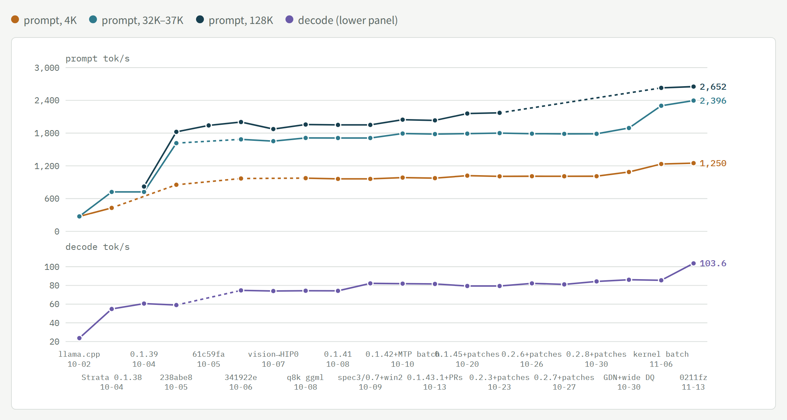

# Two RX 6900 XT under Linux: Qwen3.8-Flash-Next on Strata

[← README](../README.md) · [中文](linux-dual-6900xt.zh-CN.md) · [Full history](linux-history.md)

**Qwen3.8-Flash-Next (GSQ-RCO IQ3_S)** on a home box: 2x AMD RX 6900 XT (gfx1030, 16 GB, PCIe 4.0 x8 each), Ryzen 5 5600X, 128 GB DDR4-3200, Ubuntu 26.04, ROCm 10.0, the [Strata](https://github.com/Niko1221/Strata) engine. This page is the short version: what runs now, how fast, how to reproduce it, and which steps mattered. Every experiment is in [the full history](linux-history.md). Experiment numbers (E…) refer to the author's lab notebook (not public). Every number is measured on this machine unless marked as an estimate.

<picture>
  <source media="(prefers-color-scheme: dark)" srcset="speed-chart-en-dark.png">
  
</picture>

## Now (2026-11-13)

| | |
|---|---|
| Engine | `strata-0211fz-72bb0be6`: Strata upstream **0.2.11** + our patches ([`patches/strata/`](../patches/strata/README.md): 0001 on-demand DP read, 0002 the 11-06 kernel batch, 0003 slots / hc int8-only / VRAM calibration / elastic pictures, 0004 six decode fusions) + llama.cpp ggml with [`patches/llama.cpp/`](../patches/llama.cpp/README.md) |
| Model | GSQ-RCO IQ3_S, 262,144 context, KV int8 |
| Cards | layer split 27 / 21 with dense-weight trim; prompts of **9,216 tokens and more** are read by both cards together (on-demand DP); the picture encoder borrows VRAM only while it reads a picture and runs with one hardware queue |
| Decode | `--spec 3 --spec-min-p 0.6 --pipeline-windows 2`, two slots (`--parallel 2 --batch-mtp`), greedy sampling |
| Checks | Strata's standard gate 12/12, 0 stalls (E772); 27 pictures in a row 0 stalls, OCR unchanged (E796) |

**Prompt speed (tok/s)**

| Length | tok/s | Source |
|---|---|---|
| 4K | 1,235 | gate run, production config (E772) |
| 16K | 2,104 | same (E772) |
| 32K | 2,393–2,398 | `bench/benchmark.py`, parallel 1, three cold starts (E799) |
| 128K | 2,652 | production config (E772) |
| 250K | 2,645 | same (E772) |

**Decode:** 93.6–98.6 tok/s at 4K and 102.7–108.3 at 32K (`bench/benchmark.py`, parallel 1, two runs each, three cold starts, E799); 82.9 / 84.4 after a 128K / 250K prompt (E772). A verify window takes 22.0–22.2 ms (25.0 before the 11-06 kernel batch, 23.5 on 11-07 with pictures enabled).

**From the start:** same model, decode 26 → 94–108 tok/s (llama.cpp on 09-21 → today, short prompts), 32K prompt 274 → ~2,400 tok/s.

## Reproduce

Arguments, environment and build steps are in [`AGENTS.md`](../AGENTS.md) ("Reproduce: two cards on Linux"), kept in sync with production. Three things that are easy to get wrong:

- **Greedy sampling is required.** The pipelined decode turns itself off when a model card's `presence_penalty` is applied; the log says "decodes serially" (E528). Set sampling temperature 0 and presence penalty 0 in the run config.
- **Confirm every switch in the engine log.** On a stock build, unknown `STRATA_*` switches are ignored silently.
- **VRAM is tight.** With `STRATA_VRAM_CALIB=1` each card keeps what it measured after its cache plus 192 MiB free (~300–380 MiB after loading). Anything that allocates VRAM the calibration did not see (an extra feature, a changed config) eats that margin; delete the calibration files after a change. On one 16 GB card, leave `STRATA_HC_PERSIST_Q8` off (its copies take 641 MiB, E706).
- **Run the picture encoder with one hardware queue** (`GPU_MAX_HW_QUEUES=1` for `strata-vision` only). Engine plus encoder otherwise oversubscribe card 0's hardware queues and a request with pictures can stall for good (#267, E795/E796).

## One card (2026-11-13, E821)

The same build on **one** RX 6900 XT (the other card idle, `parallel 1`, 131,072 context, no pictures). Of the newer switches, three apply to one card: `STRATA_HC_I8ONLY=1` (the hc copies take half the VRAM; the draft head no longer misses the fit), `STRATA_VRAM_CALIB=1` (start once to write the calibration) and the six decode fusions. DP and lazy slots need two cards / two slots.

| | 11-06 build (0211wl2) | today (0211fz + the three) |
|---|---|---|
| expert slots | 4,718 | 5,156 (+9%) |
| prompt 5.6K / 16K / 31K / 62K / 128K | 1,301 / 1,488 / 1,479 / 1,461 / 1,461 | 1,308 / 1,485 / 1,469 / 1,461 / 1,457 |
| decode 4K / 32K (`bench/benchmark.py`) | 51.5 / 53.9 | **54.6 / 58.4** (+6% / +8%) |

Interleaved W F F W, two pairs in the same direction; today's decode is the mean of four runs over two sessions (32K 56.4–60.1: the same config moves ~5% between sessions); prompt is flat. Strata's standard benchmark on one card: prompt 4K / 16K **1,083 / 1,484**, decode short / 4K / 16K 52.8 / 51.5 / 54.0, 21/21 (11-06: 1,058 / 1,434, decode 49.8 / 48.6).

**Two cards against one** (same corpus, same build): 128K prompt 2,628 / 1,461 = **1.80×** (0211wl2), 2,652 / 1,457 = 1.82× (0211fz). Short-prompt decode 94–108 against 52–60. Where the remaining ~10% of an ideal 2× goes during a DP read (copying the other card's dense rows, publishing state between the halves, a cache that mostly holds the card's own layers) is an estimate, not measured.

Not worth it on one card either: lending the draft model's 512 experts to the prompt ring (`STRATA_MTP_ROOM_MIN=8192`, +265 ring slots): 16K −3% (the first loan of a process takes 325 ms), 31K–128K ±0.6% (E822). `--prefill-head-alias` does not apply: the automatic prompt chunk is already 8,192 on one card.

## What mattered

Ranked by effect. Numbers are from same-session interleaved A/B runs at the time of each step.

| Step | Effect | When (exp.) |
|---|---|---|
| llama.cpp → Strata | most of the journey: decode ≈3×, long prompts ≈6× | 10-04 |
| `--spec 3` + `--pipeline-windows 2` (min-p 0.7, later 0.6) | decode +10–16% at 4K, +8–11% at 32K; min-p 0.6 another +1.5% | 10-09 (E387), 11-03 (E651) |
| Pipelined MTP (#2985, now upstream) | decode about +20% | 10-18 |
| On-demand DP: both cards read one long prompt | +8~10% on 0.2.10; on today's build 16K–256K +10~26% over layer split | 11-06 (E675, E705b) |
| DP threshold 12,288 → 9,216 | 9.2K–12.3K prompts +7~21% | 11-07 (E712) |
| The 11-06 kernel batch (FP16 without widening, int8 hc copies, one-warp GEMV, expert layout table, fused SwiGLU) | prompt 8K +4.3%, 32K +7.3%; decode +8.5% | 11-06 (E703) |
| Decode fusions (`0004`: router doorbell, fused waits, rebased fetch, gate/up SwiGLU, q8_1 GDN/hc inputs) | −1.3% per window | 11-11 (E765, E772) |
| hc int8-only + elastic picture encoder + VRAM calibration (`0003`) | −5.6% per window with pictures enabled, slots +410 / +1,160 | 11-09 (E719, E739) |
| Lazy slot sessions (`STRATA_SLOT_LAZY=1`) | single-request decode −4.7% per window | 11-07 (E717) |
| `--prefill-pipe` + chunk floor | 8K +16%, 12K +8%, then +3~8% at 7K–20K | 10-29 (E613, E617) |
| GDN group + `STRATA_DEQUANT_WIDE=1` | prompt +5~12% | 10-30 (E621–E624) |
| MMQ activations read wave-uniformly (ggml patch) | prompt +2.8~4.9% from 4K to 128K | 11-06 (E685) |
| Dense-weight trim on the layer split | 2K prompt +8%, decode +1~3% | 10-29 (E618, E619) |
| `STRATA_SIDE_MIXER=2` | decode +3% | 11-03 (E649) |
| Slot-copy switches | a long request interrupted by a second one decodes +28% | 11-02 (E637) |

## Ruled out

Measured and closed on this box: tensor parallel, DFlash2 on two cards, the second GPU as an expert cache (`--peer-device`), PCIe x16+x4, GPU and CPU overclocks, decode knobs on their own, the 11-06 kernel ideas that did not pay, and (11-09 – 11-13) more hardware queues for the engine, the draft model on the first card, newer GPU firmware against #267, and upstream's Foresight swap space (prefetching experts into extra VRAM slots: net +0.5 to −2.6% once a thread-placement trap was removed; the slots compete with the expert cache for the same VRAM, see [history](linux-history.md#foresight-swap-space-11-13-e803e820)). The list with reasons is in [`AGENTS.md`](../AGENTS.md) ("Do not retry"); the mistakes behind some of them are in [mechanisms.md](mechanisms.md).

## Open

- **Strata 0.2.12 (11-07) and 0.2.13 (11-09) are not evaluated yet.** Candidates for this box: per-stage hyper-connection rows (#3559) and a fix for a first-request hang with `--pipeline-windows 2` on two AMD cards (#5149).
- **Thread placement upstream:** with `STRATA_PIPED_CONCURRENT` off, every thread the host creates after pinning itself (stage, watchdog, the Foresight filler) shares the host's single CPU. Harmless while they idle; it cost a whole Foresight experiment series here. Not reported yet.
- Open upstream as drafts: [#5474](https://github.com/Niko1221/Strata/pull/5474), [#5475](https://github.com/Niko1221/Strata/pull/5475), [#5476](https://github.com/Niko1221/Strata/pull/5476) (11-06 kernel batch), [#5691](https://github.com/Niko1221/Strata/pull/5691) (VRAM calibration), [#5698](https://github.com/Niko1221/Strata/pull/5698) (encoder warm-up), [#5897](https://github.com/Niko1221/Strata/pull/5897) (picture encoder environment, for the one-queue fix).

## History

[linux-history.md](linux-history.md), newest first: lazy slots, 0211vx, decode fusions, the #267 picture stall and Foresight (11-07 – 11-13); the DP threshold (11-07); 0.2.11, MMQ activation reads and the kernel batch (11-06); 0.2.10 and the on-demand DP read (11-03 – 11-06); 0.2.8 → 0.2.9 (10-30 – 11-02); prompt speed by length, SH_STREAM / KVA, dense-weight trim (10-29); where the time goes, stock against tuned (E505); one card, helper and layer split. A dated list of every step is in [timeline.md](timeline.md).
