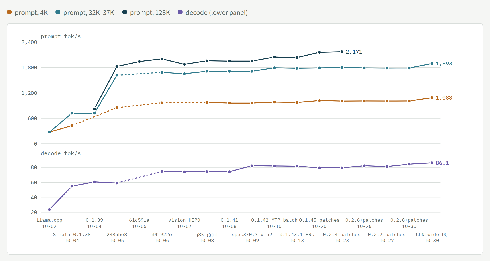

# Two RX 6900 XT under Linux: Qwen3.8-Flash-Next on Strata

[← README](../README.md) · [中文](linux-dual-6900xt.zh-CN.md) · [Full history](linux-history.md)

**Qwen3.8-Flash-Next (GSQ-RCO IQ3_S)** on a home box: 2x AMD RX 6900 XT (gfx1030, 16 GB, PCIe 4.0 x8 each), Ryzen 5 5600X, 128 GB DDR4-3200, Ubuntu 26.04, ROCm 10.0, the [Strata](https://github.com/Niko1221/Strata) engine. This page is the short version: what runs now, how fast, how to reproduce it, and which steps mattered. Every experiment is in [the full history](linux-history.md). Experiment numbers (E…) refer to the author's lab notebook (not public). Every number is measured on this machine unless marked as an estimate.

<picture>
  <source media="(prefers-color-scheme: dark)" srcset="speed-chart-en-dark.png">
  
</picture>

## Now (2026-11-07)

| | |
|---|---|
| Engine | `strata-0211wl2-1a996f63`: Strata upstream **0.2.11** + our patches ([`patches/strata/`](../patches/strata/README.md): 0001 on-demand DP read, 0002 the 11-06 kernel batch) + llama.cpp ggml with [`patches/llama.cpp/`](../patches/llama.cpp/README.md) |
| Model | GSQ-RCO IQ3_S, 262,144 context, KV int8 |
| Cards | layer split 27 / 21 with dense-weight trim; prompts of **9,216 tokens and more** are read by both cards together (on-demand DP) |
| Decode | `--spec 3 --spec-min-p 0.6 --pipeline-windows 2`, two slots (`--parallel 2 --batch-mtp`), greedy sampling |
| Checks | Strata's standard gate 12/12, 0 stalls; worst-case concurrent run with pictures 9/9 |

**Prompt speed (tok/s)**

| Length | tok/s | Source |
|---|---|---|
| 4K | 1,234 | standard benchmark, parallel 1 (E707) |
| 10.5K | 1,816 | one request through the proxy after the DP threshold change (E714; 1,631 before) |
| 16K | 2,124 | standard benchmark, parallel 1 (E707) |
| 31K | 2,301 | E659 code corpus, production concurrent config (E705) |
| 128.5K | 2,628 | same (E705) |
| 256K | 2,636 | same (E705) |

Every point from 46K up is above 2,500. **Decode:** 80.7 / 85.5 tok/s in the standard benchmark (4K / 16K, parallel 1, E707); the 11-06 kernel batch took a verify window from 25.0 to 22.9 ms with the same tokens per window (+8.5%, 24 replayed real requests, E703).

**From the start:** same model, decode 26 → 81–86 tok/s (llama.cpp on 09-21 → today), 32K prompt 274 → 2,301 tok/s.

## Reproduce

Arguments, environment and build steps are in [`AGENTS.md`](../AGENTS.md) ("Reproduce: two cards on Linux"), kept in sync with production. Three things that are easy to get wrong:

- **Greedy sampling is required.** The pipelined decode turns itself off when a model card's `presence_penalty` is applied; the log says "decodes serially" (E528). Set sampling temperature 0 and presence penalty 0 in the run config.
- **Confirm every switch in the engine log.** On a stock build, unknown `STRATA_*` switches are ignored silently.
- **VRAM is tight.** Card 0 has ~430 MiB free after loading. On one 16 GB card, leave `STRATA_HC_PERSIST_Q8` off (its copies take 641 MiB and the draft head then did not fit in one of two cold starts, E706).

## What mattered

Ranked by effect. Numbers are from same-session interleaved A/B runs at the time of each step.

| Step | Effect | When (exp.) |
|---|---|---|
| llama.cpp → Strata | most of the journey: decode ≈3×, long prompts ≈6× | 10-04 |
| `--spec 3` + `--pipeline-windows 2` (min-p 0.7, later 0.6) | decode +10–16% at 4K, +8–11% at 32K; min-p 0.6 another +1.5% | 10-09 (E387), 11-03 (E651) |
| Pipelined MTP (#2985, now upstream) | decode about +20% | 10-18 |
| On-demand DP: both cards read one long prompt | +8~10% on 0.2.10; on today's build 16K–256K +10~26% over layer split | 11-06 (E675, E705b) |
| DP threshold 12,288 → 9,216 | 9.2K–12.3K prompts +7~21% | 11-07 (E712) |
| The 11-06 kernel batch (FP16 without widening, int8 hc copies, one-warp GEMV, expert layout table, fused SwiGLU) | prompt 8K +4.3%, 32K +7.3%; decode +8.5% | 11-06 (E703) |
| `--prefill-pipe` + chunk floor | 8K +16%, 12K +8%, then +3~8% at 7K–20K | 10-29 (E613, E617) |
| GDN group + `STRATA_DEQUANT_WIDE=1` | prompt +5~12% | 10-30 (E621–E624) |
| MMQ activations read wave-uniformly (ggml patch) | prompt +2.8~4.9% from 4K to 128K | 11-06 (E685) |
| Dense-weight trim on the layer split | 2K prompt +8%, decode +1~3% | 10-29 (E618, E619) |
| `STRATA_SIDE_MIXER=2` | decode +3% | 11-03 (E649) |
| Slot-copy switches | a long request interrupted by a second one decodes +28% | 11-02 (E637) |

## Ruled out

Measured and closed on this box: tensor parallel, DFlash2 on two cards, the second GPU as an expert cache (`--peer-device`), PCIe x16+x4, GPU and CPU overclocks, decode knobs on their own, and the 11-06 kernel ideas that did not pay. The list with reasons is in [`AGENTS.md`](../AGENTS.md) ("Do not retry"); the mistakes behind some of them are in [mechanisms.md](mechanisms.md).

## Open

- **Strata 0.2.12 (11-07) is not evaluated yet.** Candidates for this box: per-stage hyper-connection rows (#3559, 414 MiB less per card on two A6000) and a fix for a first-request hang with `--pipeline-windows 2` on two AMD cards (#5149).
- **A tensor-parallel prompt read** would only help 6K–9.2K now (below the DP threshold): +44~48% at 6–8K in a deep-sleep test (E710), roughly +1~2% of total prompt time (estimate). Not ported.
- Three kernel PRs from the 11-06 batch are open upstream as drafts: [#5474](https://github.com/Niko1221/Strata/pull/5474), [#5475](https://github.com/Niko1221/Strata/pull/5475), [#5476](https://github.com/Niko1221/Strata/pull/5476).

## History

[linux-history.md](linux-history.md), newest first: the DP threshold (11-07); 0.2.11, MMQ activation reads and the kernel batch (11-06); 0.2.10 and the on-demand DP read (11-03 – 11-06); 0.2.8 → 0.2.9 (10-30 – 11-02); prompt speed by length, SH_STREAM / KVA, dense-weight trim (10-29); where the time goes, stock against tuned (E505); one card, helper and layer split. A dated list of every step is in [timeline.md](timeline.md).
