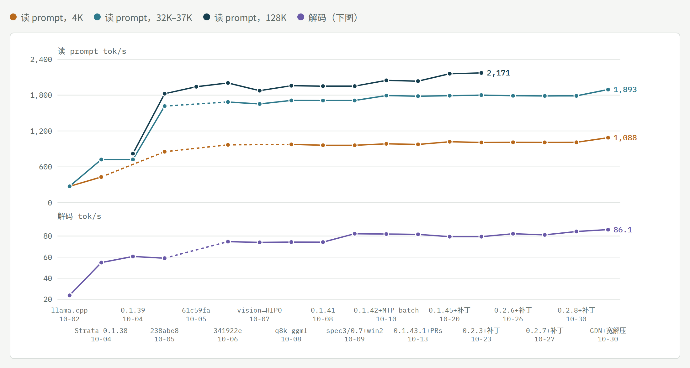

# Linux 双 RX 6900 XT：Strata 上的 Qwen3.8-Flash-Next

[← README](../README.zh-CN.md) · [English](linux-dual-6900xt.md) · [完整历史](linux-history.zh-CN.md)

在一台家用机上跑 **Qwen3.8-Flash-Next（GSQ-RCO IQ3_S）**：2× AMD RX 6900 XT（gfx1030，16 GB，各 PCIe 4.0 x8）、Ryzen 5 5600X、128 GB DDR4-3200、Ubuntu 26.04、ROCm 10.0，引擎 [Strata](https://github.com/Niko1221/Strata)。本页是简版：现在跑的是什么、多快、怎么复现、哪些步骤起了作用。每个实验的细节在[完整历史](linux-history.zh-CN.md)里。实验编号（E…）指作者的实验日志（未公开）。除非标明是估算，所有数字都在这台机器上实测。

<picture>
  <source media="(prefers-color-scheme: dark)" srcset="speed-chart-dark.png">
  
</picture>

## 现在（2026-11-07）

| | |
|---|---|
| 引擎 | `strata-0211wl2-1a996f63`：Strata 上游 **0.2.11** + 我们的补丁（[`patches/strata/`](../patches/strata/README.md)：0001 按需 DP 读，0002 11-06 内核批）+ 打了 [`patches/llama.cpp/`](../patches/llama.cpp/README.md) 的 llama.cpp ggml |
| 模型 | GSQ-RCO IQ3_S，上下文 262,144，KV int8 |
| 两张卡 | 分层 27 / 21，稠密权重裁剪；**9,216 token 及以上**的 prompt 两张卡一起读（按需 DP） |
| 解码 | `--spec 3 --spec-min-p 0.6 --pipeline-windows 2`，两个槽（`--parallel 2 --batch-mtp`），贪心采样 |
| 检查 | Strata 标准门 12/12、0 停转；带图片的最坏并发压测 9/9 |

**读 prompt 速度（tok/s）**

| 长度 | tok/s | 来源 |
|---|---|---|
| 4K | 1,234 | 标准基准，parallel 1（E707） |
| 10.5K | 1,816 | 改 DP 门槛后经代理实发一条（E714；改前 1,631） |
| 16K | 2,124 | 标准基准，parallel 1（E707） |
| 31K | 2,301 | E659 代码语料，生产并发配置（E705） |
| 128.5K | 2,628 | 同上（E705） |
| 256K | 2,636 | 同上（E705） |

46K 以上每个点都 >2,500。**解码：**标准基准 80.7 / 85.5 tok/s（4K / 16K，parallel 1，E707）；11-06 内核批把每个验证窗从 25.0 ms 降到 22.9 ms，每窗 token 数不变（+8.5%，24 条真实请求重放，E703）。

**从头算：**同一个模型，解码 26 → 81–86 tok/s（09-21 的 llama.cpp → 现在），32K 读 prompt 274 → 2,301 tok/s。

## 复现

参数、环境变量和编译步骤在 [`AGENTS.md`](../AGENTS.md)（"Reproduce: two cards on Linux"），与生产同步维护。三件容易做错的事：

- **必须贪心采样。**模型卡的 `presence_penalty` 一生效，流水线解码就会自己关掉，日志写 "decodes serially"（E528）。运行配置里把采样温度和 presence penalty 都设成 0。
- **每个开关都要在引擎日志里确认。**原版引擎遇到不认识的 `STRATA_*` 开关会静默忽略。
- **显存很紧。**卡 0 装完只剩约 430 MiB。单张 16 GB 卡上不要开 `STRATA_HC_PERSIST_Q8`（副本占 641 MiB，两次冷启动有一次草稿头装不下，E706）。

## 哪些步骤起了作用

按效果排序。数字都是当时同时段交替 A/B 的实测。

| 步骤 | 效果 | 时间（实验） |
|---|---|---|
| llama.cpp → Strata | 全程的大头：解码约 3 倍，长 prompt 约 6 倍 | 10-04 |
| `--spec 3` + `--pipeline-windows 2`（min-p 0.7，后改 0.6） | 解码 4K +10–16%、32K +8–11%；min-p 0.6 再 +1.5% | 10-09（E387）、11-03（E651） |
| 流水线 MTP（#2985，已进上游） | 解码约 +20% | 10-18 |
| 按需 DP：两张卡一起读一个长 prompt | 0.2.10 上 +8~10%；现在的版本 16K–256K 比分层 +10~26% | 11-06（E675、E705b） |
| DP 门槛 12,288 → 9,216 | 9.2K–12.3K 的 prompt +7~21% | 11-07（E712） |
| 11-06 内核批（FP16 不展宽、int8 hc 副本、单 warp GEMV、专家布局表、融合 SwiGLU） | 读 8K +4.3%、32K +7.3%；解码 +8.5% | 11-06（E703） |
| `--prefill-pipe` + 分块下限 | 8K +16%、12K +8%，之后 7K–20K 再 +3~8% | 10-29（E613、E617） |
| GDN 组 + `STRATA_DEQUANT_WIDE=1` | 读 prompt +5~12% | 10-30（E621–E624） |
| MMQ 激活按 wave 统一读（ggml 补丁） | 4K 到 128K 读 +2.8~4.9% | 11-06（E685） |
| 分层上的稠密权重裁剪 | 2K 读 +8%、解码 +1~3% | 10-29（E618、E619） |
| `STRATA_SIDE_MIXER=2` | 解码 +3% | 11-03（E649） |
| 槽复制三开关 | 长请求被第二个请求打断时解码 +28% | 11-02（E637） |

## 已否决

在这台机器上实测后关闭的：张量并行、双卡 DFlash2、把第二张卡当专家缓存（`--peer-device`）、PCIe x16+x4、GPU 与 CPU 超频、单独调解码参数，以及 11-06 那批没回本的内核想法。带原因的清单在 [`AGENTS.md`](../AGENTS.md)（"Do not retry"）；其中一些背后的错误在 [mechanisms.zh-CN.md](mechanisms.zh-CN.md)。

## 待办

- **Strata 0.2.12（11-07）还没评估。**对本机有意义的：按 stage 复制 hyper-connection 行（#3559，两张 A6000 上每卡省 414 MiB），以及两张 AMD 卡在 `--pipeline-windows 2` 下首个请求卡死的修复（#5149）。
- **张量并行读 prompt** 现在只能补 6K–9.2K（DP 门槛以下）：深睡档测试里 6–8K +44~48%（E710），约占读 prompt 总时间 +1~2%（估算）。未移植。
- 11-06 内核批的三个 PR 已在上游开为草稿：[#5474](https://github.com/Niko1221/Strata/pull/5474)、[#5475](https://github.com/Niko1221/Strata/pull/5475)、[#5476](https://github.com/Niko1221/Strata/pull/5476)。

## 历史

[linux-history.zh-CN.md](linux-history.zh-CN.md)，新的在前：DP 门槛（11-07）；0.2.11、MMQ 激活读法与内核批（11-06）；0.2.10 与按需 DP 读（11-03 – 11-06）；0.2.8 → 0.2.9（10-30 – 11-02）；读 prompt 随长度、SH_STREAM / KVA、稠密权重裁剪（10-29）；时间花在哪：原版对比调优后（E505）；单卡、helper 与分层。每一步的日期清单在 [timeline.zh-CN.md](timeline.zh-CN.md)。
