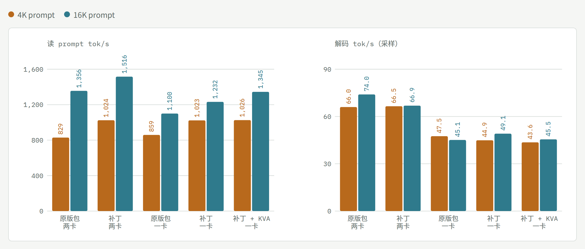
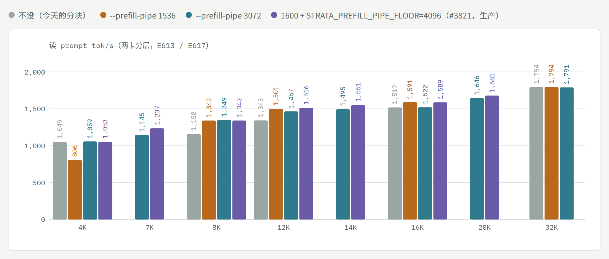
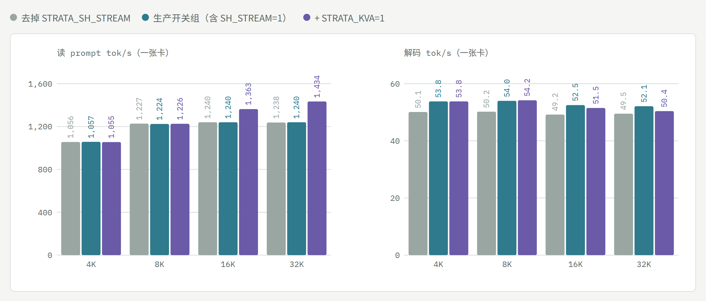

# Linux 双 RX 6900 XT：Strata 上的 Qwen3.8-Flash-Next

[← README](../README.zh-CN.md) · [English](linux-dual-6900xt.md)

在一台家用机器（**2× AMD RX 6900 XT，gfx1030，各 PCIe 4.0 x8 / Ryzen 5 5600X / 128 GB DDR4**，ROCm 10.0）上跑 **Qwen3.8-Flash-Next（GSQ-RCO IQ3_S）** 的调优记录，从 llama.cpp 到 [Strata](https://github.com/Niko1221/Strata)，2026-09-21 → 10-24；另有一张 RX 6900 XT 在 Windows 11 上的调优（[Windows 笔记](windows-one-card.zh-CN.md)）。

<picture>
  <source media="(prefers-color-scheme: dark)" srcset="speed-chart-dark.png">
  
</picture>

*各生产状态的读 prompt（4K、32K–37K、128K，左轴）和解码（右轴）tok/s。各点来自不同实验、条件不完全相同（前两步的 4K 点是 5K prompt；最后两点是 E504 和 E533，即 10-20 和 10-23 的生产跑 E415 同款负载；其余见交互页图下说明）；虚线段表示那一步没测这个指标。*

## 结论（先看这里）

- **生产（0.2.7 自 10-27 18:40，`--prefill-pipe 3072` 自 10-29 05:06）**：`strata-027-9ca7fd21` = Strata 上游 **0.2.7**（引擎 0.1.52；#2985 的流水 MTP 已作为 #4121 进上游）合并进本地补丁组——#3381（RDNA2 读 prompt 注意力）、#3382（`--batch` 旁的 CPU 分担）、#3073（SIMT=2 打分）、#3095（批槽旁保留流水窗口）——加改过的 llama.cpp ggml 和 rocBLAS 5.6.0 表；0.2.6（E587）、0.2.7（E596）各自对前一版持平。benchmark 负载（E596）：读 prompt **1,009 / 1,786**（4K / 32K），解码 78–85。之后 `--prefill-pipe 3072` 让 8K **+16%**、12K **+8%**（E613），上游 #3821 的分块下限（`STRATA_PREFILL_PIPE_FLOOR=4096` 配 `--prefill-pipe 1600`）在 7K–20K 再 +3~8%（E617，见下）；10-29 07:1x 起生产是 `strata-027f-3177b96f`。
- **Strata 标准基准，0.2.7（E616，10-29，全部 12/12、0 停转）**：

| 臂 | 读 prompt 4K | 读 prompt 16K | 解码 short / 4K / 16K |
|---|---|---|---|
| 补丁，两卡（生产） | 1,024 | 1,516 | 79.4 / 66.5 / 66.9 |
| 原版包 0.1.52 + 上游开关，两卡 | 829 | 1,356 | 73.8 / 66.0 / 74.0 |
| 补丁，一卡 | 1,023 | 1,232 | 49.0 / 44.9 / 49.1 |
| 补丁 + `STRATA_KVA=1`，一卡 | 1,026 | 1,345 | 50.3 / 43.6 / 45.5 |
| 原版包 + 上游开关，一卡 | 859 | 1,100 | 46.2 / 47.5 / 45.1 |

  <picture>
    <source media="(prefers-color-scheme: dark)" srcset="std-chart-zh-dark.png">
    
  </picture>

  补丁带来读 prompt 单卡 +19% / +12%、两卡 +24% / +12%；解码在协议的采样噪声内。原版包的 rocBLAS（5.4.0）和随附的 gfx1030 表（5.6.0）对不上，走默认内核，和 0.2.2 时一样（#3790）。默认轨（`strata launch` 的开箱配置）这次没跑成：已装的 0.1.47 引擎不会被 0.2.7 Terminal 自动升级，要手动 `strata update`；升级后 0.2.7 的 launch 在本机连不上运行时宿主（引擎本身能服务），原因未查。
- **生产（10-23 13:27 起）**：`strata-023-b523b933` = Strata 上游 **0.2.3**（合并进 0.2.2 生产，无冲突）+ #2985 的流水 MTP（`STRATA_PIPED_MTP=2`，JacobSussan）+ 我们的 5 个补丁：开批槽时单路保留 `--pipeline-windows`（`STRATA_PW_WITH_BATCH=1`，[#3095](https://github.com/Niko1221/Strata/pull/3095)）、HIP 上接通 #2071 的 SIMT=2 打分（[#3073](https://github.com/Niko1221/Strata/pull/3073)）、`--batch` 下读 prompt 也用 CPU 分担（`STRATA_PREFILL_CPU_SHARE_BATCH=1`，[#3382](https://github.com/Niko1221/Strata/pull/3382)）、gfx103x 读 prompt 注意力内核（`STRATA_PROMPT_ATTN_RDNA2=1`，[#3381](https://github.com/Niko1221/Strata/pull/3381)）、rocBLAS 解的本机缓存；外加 `STRATA_PREFILL_STREAM_MIN=2048` 和自改的 llama.cpp ggml。配置钉 `--conversation-cache-mib 0`：0.2.3 默认按内存自动开会话缓存，本机单会话读 prompt 因此 4K 慢 3%、32K–128K 慢 1.4%（E533）。两路并发（`"parallel": 2`）、双卡分层、IQ3_S 专家、int8 KV、`--spec 3 --spec-min-p 0.7 --pipeline-windows 2`；10-21 起两卡降压 −81 mV @245 W（E522/E523：37 轮 0 次翻转；解码不随频率变，E507–E512）。回退槽 `strata-split-prev` = 0.2.2 合并版（`strata-022-34cd8534`）。10-20 以来引擎 0.1.45 → 0.2.1.3（E516/E517）→ 0.2.2（E527）→ 0.2.3（E533），每一步速度和 KL 都与上一版持平。
- **现在的速度**（E533，E415 同款负载，生产配置去图片编码器，两轮）：prompt **1,008 / 1,800 / 2,171** tok/s（4K / 32K / 128K；10-20 生产的 E504 是 1,020 / 1,790 / 2,158，10-10 的 E415 是 985 / 1,792 / 2,046），单请求解码 **75 / 79 / 78**（E504：80 / 79 / 74）；两个请求同时跑合计 60–64 tok/s（E481），第二个请求首字 12 s → 0.5 s（E463–E470）。短 prompt：430 token 读 1.1 s（原来 1.7 s，E493）。同一台机器、同样设置下的上游 **0.2.0-beta** 原版（E503，社区报告 [#3426](https://github.com/Niko1221/Strata/pull/3426)）：自带套件 4K / 32K 979 / 1,662 tok/s，真实文本 119K 1,893，单请求解码 66——差距就是我们的补丁（每个都在上面的 PR 里用 0.2.0 重测过）。
- **从 llama.cpp 到 Strata 的总账**（同一份 IQ3_S）：解码 26 → 约 80 tok/s（≈3×），32K–37K prompt 274 → 1,790（≈6.5×），128K 821（0.1.39）→ 2,158。其中换引擎占大头，之后我们的补丁和配置让 prompt 大约翻倍（37K 714 → 1,433 → 1,705；10-20 的 32K 1,790、128K 2,158），解码约 +40%（56–58 → 80）。
- **已经到地板的（别再试）**：解码的配置级杠杆**单独调**全部否定——`--kv-resident` 缩小（E382）、单开 `--pipeline-windows 2`（E384，+1–6%）、pipeline-windows 1 下的 `--spec`/`--spec-min-p` 16 点网格（E385/b，4/0.5 是峰值）；**但组合有效**：`--spec 3 --spec-min-p 0.7 --pipeline-windows 2` 解码 4K +10–16%、32K +8–11%（E387，三轮确认；短草稿接受率 83% vs 68%，第二窗的推测才命中），prompt 不变，输出跨启动不确定（基线是确定的），128K 在无编码器配置下 +11%（E388）；10-09 00:16 上生产；并发批槽（10-08 结论：常驻专家 41% < 上游门槛 50%，槽里不带 MTP；**10-15 推翻**：加上槽位草稿、单路保留流水窗口和后来的 #2985，`"parallel": 2` 已是生产）；IQ3_S 的 MMQ 分块/stream-K（E279/E280）；`--prefill` chunk 8192 即甜点（E296）；上游的 GDN 分块、Foresight、STAGE_PIN（上游自测对小卡无益或有害）。
- **还有空间的**：长 prompt 的 PCIe 拓扑（保持 x8/x8：Strata 上长 prompt 等 PCIe 只占 0.2–0.7%，但 <2K 的短 prompt 占 43–54%，E482）；解码时每窗多换入专家（E499：自适应缓存命中已 85%，完美的 8 窗预测器在现在的换入量下也不更好——杠杆是换入预算，未测）。四个 PR 在 0.2.0-beta 上等上游审（#3381、#3382，以及 10-20 带 E503 数据重开的 #3073 / #3095）。

## 读 prompt 随长度：`--prefill-pipe`（0.2.7，10-29，E613）

<picture>
  <source media="(prefers-color-scheme: dark)" srcset="pipe-chart-zh-dark.png">
  
</picture>

两卡分层读 prompt 是两段流水：卡 1 算第 *n* 块的 0–23 层时，卡 2 算第 *n−1* 块的 24–47 层。Strata 的 `--prefill-pipe R`（来自 #1441；R 是一段要多少 token 才能盖住另一段的固定开销）在成本式算出流水能快 3% 以上时重新分块；本机自动块是 8,192，所以不设时 8K prompt 只有一块，第二张卡要等第一段整块算完。

- **3072 已上生产**（三个 Qwen 槽）：8K 切成 2×4096（**+16%**，合成 1,158 → 1,347，真实文本 1,145 → 1,327），12K 切成 2×6144（**+8%**），4K / 16K / 32K 分块不变。
- **1536** 还会切 16K（+5%）、12K +12%，但把 4K 切成 2×2048，**−23%**。按成本式推，没有一个 R 能既不切 4K 又切 16K，所以 3072 是本机最好的单一取值。
- 一个冷启动引擎，每条请求用 `strata_tune.prefill_pipe` 换值，每个值前后都有"不设"对照；真实文本终判（E572 的教训：分块类开关要用真实文本定）在 4K / 8K / 12K 同向。上游数据点：Strata PR #4587（文档）。
- 推翻 E393 的"两段上 pipe 没用"：E393 只测了 4K 和 32K，恰好是它不动的两个长度。

**有没有比 3072 更好的数？** 单个数字没有。`Prefill::pipeline_chunk`（src/prefill/prefill.cpp）把"k 块、每块 c token"的成本算成 `k·R + n + (段数−1)·(R + min(c, n))`，k 从今天的块数试到 64（块对齐 256、最少 512），最便宜的方案要低于今天的 97% 才用。把这个式子对 R = 1–20,000、prompt 2K–128K 全部算一遍（自动块 8,192，两段）：

| R | 比 3072 多切了什么 | 实测 |
|---|---|---|
| 2,976–3,400（3072 在这段） | 方案完全相同：8K 2×4096、10K 2×5120、12K 2×6144、14K 2×7168、20K 3×6912；每块都 ≥4,096 | 8K +16%、12K +8% |
| 2,551–2,975 | 7K 切成 2×3584 | 没测 |
| 2,048–2,550 | 6K 也切 | 没测 |
| 1,792–2,047 | 12K 改成 3×4096；5K 也切 | 12K +12%；5K 没测 |
| 1,701–1,791 | 同上，20K 4×5120 | 同上 |
| ≤1,700（1536 在这段） | 4K 切成 2×2048 | 4K −23% |

成本式给每块记同样的固定开销 R，实测却是块一小于 ~4,096 就罚得重得多（4K 切 2×2048 −23%，8K 切 3×2816 −2%，8K 切 2×4096 +16%；推测是小行数下 MMQ 效率低、加上每块都要把专家完整流一遍，未测）。所以单个 R 做不到既把 12K / 16K 切成三块、又不动 5K–7K。能比 3072 更快的是改代码而不是换数字：给分块加可配置下限（4,096 代替 512）再配 R≈1,536，按成本式会得到 8K 2×4096、12K 3×4096、16K 3×5632（这几种分法实测 +16 / +12 / +5%），8K 以下整块不动。**已测（E617，10-29）：上游 #3821 正是这个开关**（`STRATA_PREFILL_PIPE_FLOOR`，ruibeikaa）。下限 4,096、R = 1,600 时 4K–6K 整块不动，7K 切成 4,096 + 3,071 的尾块——这个带尾块的切法是赚的：对 3072，7K **+8%**、12K **+3%**（3×4096）、14K **+4%**（3×4864）、16K **+5%**（3×5632）、20K **+2%**（4×5120），4K / 8K 不变，合成与真实文本一致（同一引擎每请求换值，两侧夹 3072 对照）。亏的是每块都小（4K 切 2×2048），不是"一大块 + 尾块"。10-29 07:1x 上生产（`strata-027f`）。

## 一张卡上的两个开关：SH_STREAM 与 KVA（0.2.7，10-29，E615）

<picture>
  <source media="(prefers-color-scheme: dark)" srcset="one-chart-zh-dark.png">
  
</picture>

一张 RX 6900 XT（GPU 1），生产 027 二进制与开关组，131072 上下文，parallel 1；六个冷启动臂（N S K K S N），合成 prompt 4K–32K 各两次，128 token 贪心解码，0 停转。给单卡用户看（Strata PR #4475 问到）：

- **`STRATA_SH_STREAM=1` 在一张卡上解码 +5~7%**（去掉后 54 → 50 tok/s，每个长度都同向，读 prompt 不变）。0.1.40 起一直如此（E335）；上游 AMD_HIP 页写 gfx1151 关掉更好，所以要在自己的卡上 A/B。Windows 上关掉更好（E535）。
- **`STRATA_KVA=1`**（0.2.7，冷 prompt 的后 12 层 KV 走近似，尾部 2,048 精确）：**16K / 32K 读 prompt +10% / +16%**，解码 −2~3.5%，32K 针（深度 10/50/90）3/3。8,192 的块下 16K 以下不起作用：门槛是 4,096，第一块总是精确。只在单卡、无 batch 槽时生效，两卡生产用不上。
- 单卡读 prompt 从 8K 起就平在 ~1,240 tok/s（两卡 32K 1,794）；KVA 对四分之三的位置省掉后 12 层也只快 16%，说明单卡读 prompt 的墙主要不在显卡算力。

## 时间花在哪：原版对比调优后（0.2.0-beta 对比 10-20 的生产，E505）

<picture>
  <source media="(prefers-color-scheme: dark)" srcset="breakdown-prompt-zh-dark.png">
  
</picture>

<picture>
  <source media="(prefers-color-scheme: dark)" srcset="breakdown-decode-zh-dark.png">
  
</picture>

*同一台机器、同一模型（IQ3_S 双卡分层，无图片编码器），每边两个冷启动 server，每个长度 4 条请求，开着计时开关（代价 3–6%）。**原版** = 0.2.0-beta（main e88ee39d，按 setup.py 的 HIP 选项构建）+ setup 在 SSD 上写出的参数，不开任何开关；**调优** = 10-20 的生产（0.1.45 + #2985 + 我们的补丁 + 生产开关与参数，两路并发槽）。柱长是实测；分段来自引擎自带的计时开关（prompt：两张卡各阶段相加；解码：另跑一次剖析，单流水窗口），所以分段是估计。原始数据与脚本：`bench/results/e505/`（10-13 的上一版是 E449：0.1.43.1 对比当时的生产）。*

图中的数字（各段为估计，合计为实测；prompt 为每千 token 毫秒，解码为每 token 毫秒）：

| 长度 | | hc 读 | GDN | QSA 投影 | QSA 选块 + 注意力 | 专家 | 其他 | 合计（每千 token 毫秒） | tok/s |
|---|---|---|---|---|---|---|---|---|---|
| 4K | 原版 | 267 | 986 | 283 | 106 | 547 | 29 | **2,217** | 451 |
|  | 调优 | 122 | 283 | 76 | 79 | 478 | 18 | **1,056** | 947 |
| 32K | 原版 | 163 | 596 | 169 | 99 | 271 | 22 | **1,320** | 758 |
|  | 调优 | 71 | 160 | 43 | 68 | 210 | 27 | **578** | 1,731 |
| 128K | 原版 | 138 | 504 | 143 | 122 | 231 | 22 | **1,160** | 862 |
|  | 调优 | 57 | 130 | 35 | 63 | 171 | 24 | **479** | 2,088 |

| 上下文 | | hc 读 + 路由 | 稠密 GEMV（投影、共享专家、head） | 注意力 + GDN 递推 | 路由专家 | 等待（CPU 专家、PCIe） | 草稿 + 提交 | 合计（每 token 毫秒） | tok/s |
|---|---|---|---|---|---|---|---|---|---|
| 4K | 原版 | 3.37 | 4.32 | 1.18 | 3.35 | 1.74 | 1.83 | **15.79** | 63.3 |
|  | 调优 | 2.26 | 3.82 | 1.04 | 2.58 | 1.57 | 1.51 | **12.78** | 78.3 |
| 32K | 原版 | 3.87 | 4.91 | 1.51 | 3.62 | 0.96 | 1.99 | **16.86** | 59.3 |
|  | 调优 | 2.29 | 3.89 | 1.23 | 2.66 | 1.08 | 1.59 | **12.74** | 78.5 |
| 128K | 原版 | 3.21 | 4.08 | 1.69 | 3.15 | 1.30 | 1.91 | **15.33** | 65.2 |
|  | 调优 | 2.40 | 4.05 | 1.63 | 2.68 | 1.46 | 1.73 | **13.95** | 71.7 |

- **读 prompt 快 2.1–2.4 倍**：4K / 32K / 128K 451 → 947、758 → 1,731、862 → 2,088 tok/s（10-13 在 0.1.43.1 上同样的对比是 2.06 / 2.28 / 2.29 倍）。主要来自 GDN 段（32K 每千 token 596 → 160 ms：FP16 进出 + rocBLAS 解表），hc 读和 QSA 投影也明显变小。10-13 以后新出现的是 QSA 选块 + 注意力段（32K 99 → 68、128K 122 → 63，10-13 时调优侧是 90 / 87）——SIMT=2 打分（#3073）和 RDNA2 读 prompt 注意力（#3381），所以 128K 提升最多。专家段基本没动（271 → 210）。
- **解码快 1.10–1.32 倍**：63.3 → 78.3、59.3 → 78.5、65.2 → 71.7 tok/s（开着计时；不开时 80 / 79 / 74，E504）。hc 读 + 路由降得最多（3.4–3.9 → 2.3 ms/token，常驻 hc 读），其次是路由专家和草稿/提交；其余来自短草稿 + 两个流水窗口。

**每一项改在哪里**（各项来自不同版本、不同测量，**不能相乘**；合计效果看上面两张图：原版 0.2.0-beta 对比生产）

| 阶段 | 改动 | 来源 | 实测（版本） | 状态 |
|---|---|---|---|---|
| prompt：稠密 GEMM | 16 位 GEMM 以 FP16 进出（`STRATA_HIP_PROMPT_F16=1`） | [#835](https://github.com/Niko1221/Strata/pull/835) | prompt ≈2×（0.1.39） | 已收录，默认关 |
| prompt：稠密 GEMM | gfx1030 的 rocBLAS 解表 | [#1167](https://github.com/Niko1221/Strata/pull/1167) | 1K +13.9%、4K +12.1%（0.1.43.1，10 对） | 已收录（0.2.0） |
| prompt：QSA 注意力 | 每步 8 cell + DPP 交换 | #849 → 0.1.40.2 | +6–12%（0.1.40） | 已收录，默认开（两边都有） |
| prompt：QSA 选块 | HIP 上的 FP32 分块打分核（`STRATA_SELECT_SIMT=1`） | [#1151](https://github.com/Niko1221/Strata/pull/1151) | 128K +3.2%、32K +0.6%（0.1.43.1，10 对） | 已收录（0.2.0） |
| prompt：QSA 选块 | #2071 的 simt2 打分在 HIP 上接通（`STRATA_SELECT_SIMT=2` 原先静默退回） | [#3073](https://github.com/Niko1221/Strata/pull/3073) | 119K −6.5%、31K −1.35%（0.2.0-beta，10 对） | 待收录 |
| prompt：QSA 注意力 | gfx103x 读 prompt 注意力内核（不切块不合并，`STRATA_PROMPT_ATTN_RDNA2=1`） | [#3381](https://github.com/Niko1221/Strata/pull/3381) | 31K / 119K −3.49%（0.2.0-beta，10 对） | 待收录 |
| prompt：短读 | `--batch` 下的 CPU 分担（`STRATA_PREFILL_CPU_SHARE_BATCH=1`） | [#3382](https://github.com/Niko1221/Strata/pull/3382) | <2,048 token 的读 −28.8%（0.2.0-beta，10 对） | 待收录 |
| prompt：短读 | `STRATA_PREFILL_STREAM_MIN=2048` | 上游开关 | 真实文本 1.1–1.5K −6~17%（0.1.45，E485） | 开关 |
| prompt：整体 | `STRATA_SPLIT_MTP_BATCH=1` | 上游开关 | 4K / 32K / 128K +4 / +7 / +2%（0.1.42） | 10-15 起关（开批槽后） |
| 解码：草稿 | `--spec 3 --spec-min-p 0.7 --pipeline-windows 2` | 配置 | 4K +10–16%、32K +8–11%（0.1.41，E387） | 配置 |
| 解码：hc 读 | 验证器的 hc 读改成一个常驻内核 | [#2226](https://github.com/Niko1221/Strata/pull/2226) | 每窗 4K −6.6%、32K −4.4%（0.1.43.1，10 对） | 已收录（0.2.0） |
| 解码：单个请求 | 开批槽时单路保留 `--pipeline-windows`（`STRATA_PW_WITH_BATCH=1`） | [#3095](https://github.com/Niko1221/Strata/pull/3095) | 4K +16.1%、32K +12.3%（0.2.0-beta，10 对） | 待收录 |
| 解码：两个请求 | 批分组里的流水 MTP（`STRATA_PIPED_MTP=2`，JacobSussan） | 上游 #2985 | 两路 +13%（0.1.45，E481） | 他人的 PR，已移植 |
| 解码：共享专家 | 共享专家分叉流（calibrate 按机器决定） | [#1992](https://github.com/Niko1221/Strata/pull/1992) | 4K +8.0%、32K +9.5%（0.1.43.1，10 对） | 已收录（0.2.0） |
| 启动 | PLE 表锁进内存（`--ple-io ram`）+ `STRATA_IO_THREADS=128` | 配置 | 首块等待 600 → 306 ms（线程）→ 10 ms（锁页） | 配置 |
| 稳定性 | `STRATA_HIP_ADAPT_KERNEL_COPY=1` | 上游开关（#884） | 128K 停转 3/3 → 0/3 | 开关 |

**专家段为什么没动**（E450–E452）：调优后专家成了 prompt 里最大的一段，但测下来没有空间——llama.cpp 的 MMQ 在真实形状上 28–34 TOPS 封顶，每专家行数 ≥64 后不再涨；换 tile 宽度不省时；让 MMQ 原地读专家、不再搬进分组缓冲（输出逐位相同）只快 0.5%，因为省下的拷贝本来就便宜，原地读又让 GEMM 慢了 1.7%。

## 单卡、helper、双卡分层；UD-Q4_K_XL 对比 IQ3_S

<picture>
  <source media="(prefers-color-scheme: dark)" srcset="modes-chart-zh-dark.png">
  
</picture>

*单卡 vs helper vs 双卡分层（E388 / E388a，0.1.41，32K，无图片编码器）：16 GB 单卡不管哪个树解码都是 48–52（约 4,500 专家槽、命中 83%）；helper 把解码提到 66–75、prompt 仍是单卡速度；分层两项都提，E387 解码配置再加最后一步到 82。*

<picture>
  <source media="(prefers-color-scheme: dark)" srcset="udq4-vs-iq3s-zh-dark.png">
  
</picture>

*UD-Q4_K_XL 对比 IQ3_S（E415，0.1.42，无图片编码器，每格两轮，0 停转）。**单卡**：原版 UD-Q4 4K / 32K / 128K 为 471 / 505 / 489 tok/s，IQ3_S 为 476 / 504 / 488，解码 30–32 对 45–47；加 PR 和开关后 676 / 1,117 / 1,087 对 959 / 1,153 / 1,129，解码 32–33 对 47–53。按 #1897 的开关（加 `STRATA_ROUTE_TAIL_SKIP=7`），单卡 UD-Q4 在这条 x8 链路上 8K 1,085–1,093、16K 1,121–1,122 tok/s，解码 39–40，三次冷启动（E414；#1897 的 x16 卡是 1,036 / 1,104，解码 32–38）。**双卡分层**见图。原始数据：`bench/results/e414`、`e415`，以及 Strata PR #1927。*
