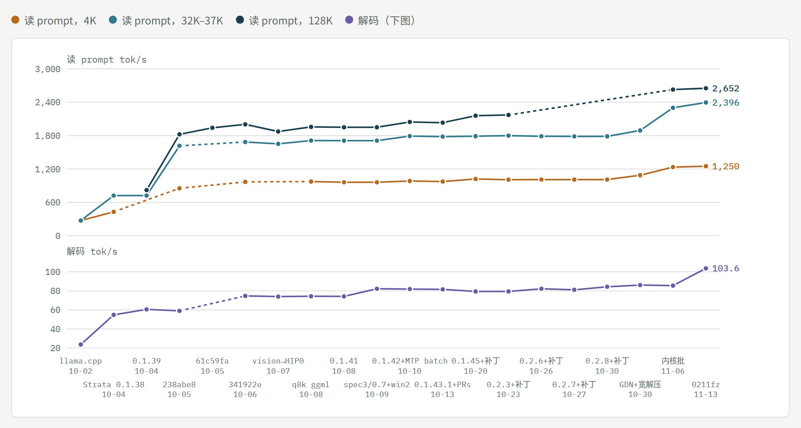

# Linux 双 RX 6900 XT：Strata 上的 Qwen3.8-Flash-Next

[← README](../README.zh-CN.md) · [English](linux-dual-6900xt.md) · [完整历史](linux-history.zh-CN.md)

在一台家用机上跑 **Qwen3.8-Flash-Next（GSQ-RCO IQ3_S）**：2× AMD RX 6900 XT（gfx1030，16 GB，各 PCIe 4.0 x8）、Ryzen 5 5600X、128 GB DDR4-3200、Ubuntu 26.04、ROCm 10.0，引擎 [Strata](https://github.com/Niko1221/Strata)。本页是简版：现在跑的是什么、多快、怎么复现、哪些步骤起了作用。每个实验的细节在[完整历史](linux-history.zh-CN.md)里。实验编号（E…）指作者的实验日志（未公开）。除非标明是估算，所有数字都在这台机器上实测。

<picture>
  <source media="(prefers-color-scheme: dark)" srcset="speed-chart-dark.png">
  
</picture>

## 现在（2026-11-13）

| | |
|---|---|
| 引擎 | `strata-0211fz-72bb0be6`：Strata 上游 **0.2.11** + 我们的补丁（[`patches/strata/`](../patches/strata/README.md)：0001 按需 DP 读，0002 11-06 内核批，0003 槽懒借 / hc 只存 int8 / 显存校准 / 弹性看图，0004 六个解码融合）+ 打了 [`patches/llama.cpp/`](../patches/llama.cpp/README.md) 的 llama.cpp ggml |
| 模型 | GSQ-RCO IQ3_S，上下文 262,144，KV int8 |
| 两张卡 | 分层 27 / 21，稠密权重裁剪；**9,216 token 及以上**的 prompt 两张卡一起读（按需 DP）；看图编码器只在读图时借显存，并且只用一个硬件队列 |
| 解码 | `--spec 3 --spec-min-p 0.6 --pipeline-windows 2`，两个槽（`--parallel 2 --batch-mtp`），贪心采样 |
| 检查 | Strata 标准门 12/12、0 停转（E772）；连续 27 张图 0 停转、OCR 不变（E796） |

**读 prompt 速度（tok/s）**

| 长度 | tok/s | 来源 |
|---|---|---|
| 4K | 1,235 | 门测，生产配置（E772） |
| 16K | 2,104 | 同上（E772） |
| 32K | 2,393–2,398 | `bench/benchmark.py`，parallel 1，三次冷启动（E799） |
| 128K | 2,652 | 生产配置（E772） |
| 250K | 2,645 | 同上（E772） |

**解码：**4K 93.6–98.6 tok/s、32K 102.7–108.3（`bench/benchmark.py`，parallel 1，每档两次、三次冷启动，E799）；128K / 250K prompt 之后 82.9 / 84.4（E772）。一个验证窗 22.0–22.2 ms（11-06 内核批之前 25.0，11-07 开看图时 23.5）。

**从头算：**同一个模型，解码 26 → 94–108 tok/s（09-21 的 llama.cpp → 现在，短 prompt），32K 读 prompt 274 → 约 2,400 tok/s。

## 复现

参数、环境变量和编译步骤在 [`AGENTS.md`](../AGENTS.md)（"Reproduce: two cards on Linux"），与生产同步维护。三件容易做错的事：

- **必须贪心采样。**模型卡的 `presence_penalty` 一生效，流水线解码就会自己关掉，日志写 "decodes serially"（E528）。运行配置里把采样温度和 presence penalty 都设成 0。
- **每个开关都要在引擎日志里确认。**原版引擎遇到不认识的 `STRATA_*` 开关会静默忽略。
- **显存很紧。**开 `STRATA_VRAM_CALIB=1` 时，每张卡只留自己测到的缓存后需求 + 192 MiB（装完约 300–380 MiB）。校准没见过的显存占用（加了新功能、手改了配置）会直接吃掉这点余量；改动后删掉校准文件。单张 16 GB 卡上不要开 `STRATA_HC_PERSIST_Q8`（副本占 641 MiB，E706）。
- **看图编码器只给一个硬件队列**（只对 `strata-vision` 设 `GPU_MAX_HW_QUEUES=1`）。否则引擎加编码器会超出卡 0 的硬件队列槽位，带图请求可能永久停住（#267，E795/E796）。

## 单卡（2026-11-13，E821）

同一版本只用**一张** RX 6900 XT（另一张卡闲着，`parallel 1`，上下文 131,072，不开看图）。新开关里对单卡有用的是三个：`STRATA_HC_I8ONLY=1`（hc 副本显存减半，草稿头不再装不下）、`STRATA_VRAM_CALIB=1`（先启动一次写校准）和六个解码融合。DP 和槽懒借需要两张卡 / 两个槽。

| | 11-06 版（0211wl2） | 现在（0211fz + 这三项） |
|---|---|---|
| 专家槽 | 4,718 | 5,156（+9%） |
| 读 5.6K / 16K / 31K / 62K / 128K | 1,301 / 1,488 / 1,479 / 1,461 / 1,461 | 1,308 / 1,485 / 1,469 / 1,461 / 1,457 |
| 解码 4K / 32K（`bench/benchmark.py`） | 51.5 / 53.9 | **54.6 / 58.4**（+6% / +8%） |

W F F W 交替，两对同向；现在版的解码取两个时段共四次的均值（32K 56.4–60.1：同一配置换个时段就能差约 5%）；读 prompt 持平。Strata 标准基准单卡：读 4K / 16K **1,083 / 1,484**，解码 short / 4K / 16K 52.8 / 51.5 / 54.0，21/21（11-06：1,058 / 1,434，解码 49.8 / 48.6）。

**双卡对单卡**（同语料、同版本）：读 128K 2,628 / 1,461 = **1.80×**（0211wl2），2,652 / 1,457 = 1.82×（0211fz）。短 prompt 解码 94–108 对 52–60。DP 读时离理想 2× 还差的约 10% 花在哪（拷对方卡的稠密行、两半之间同步状态、缓存主要放本卡层的专家）是估算，没测。

单卡上同样不值：把草稿模型的 512 个专家借给读 prompt 环（`STRATA_MTP_ROOM_MIN=8192`，环 +265 槽）：16K −3%（进程第一次借出 325 ms），31K–128K ±0.6%（E822）。`--prefill-head-alias` 用不上：单卡自动分块已经是 8,192。

## 哪些步骤起了作用

按效果排序。数字都是当时同时段交替 A/B 的实测。

| 步骤 | 效果 | 时间（实验） |
|---|---|---|
| llama.cpp → Strata | 全程的大头：解码约 3 倍，长 prompt 约 6 倍 | 10-04 |
| `--spec 3` + `--pipeline-windows 2`（min-p 0.7，后改 0.6） | 解码 4K +10–16%、32K +8–11%；min-p 0.6 再 +1.5% | 10-09（E387）、11-03（E651） |
| 流水线 MTP（#2985，已进上游） | 解码约 +20% | 10-18 |
| 按需 DP：两张卡一起读一个长 prompt | 0.2.10 上 +8~10%；现在的版本 16K–256K 比分层 +10~26% | 11-06（E675、E705b） |
| DP 门槛 12,288 → 9,216 | 9.2K–12.3K 的 prompt +7~21% | 11-07（E712） |
| 11-06 内核批（FP16 不展宽、int8 hc 副本、单 warp GEMV、专家布局表、融合 SwiGLU） | 读 8K +4.3%、32K +7.3%；解码 +8.5% | 11-06（E703） |
| 解码融合（`0004`：路由器写门铃、合并等待、拷贝里改指针、gate/up 并 SwiGLU、GDN/hc 输入用 q8_1） | 每窗 −1.3% | 11-11（E765、E772） |
| hc 只存 int8 + 弹性看图编码器 + 显存校准（`0003`） | 开看图时每窗 −5.6%，专家槽 +410 / +1,160 | 11-09（E719、E739） |
| 槽会话懒借（`STRATA_SLOT_LAZY=1`） | 单请求解码每窗 −4.7% | 11-07（E717） |
| `--prefill-pipe` + 分块下限 | 8K +16%、12K +8%，之后 7K–20K 再 +3~8% | 10-29（E613、E617） |
| GDN 组 + `STRATA_DEQUANT_WIDE=1` | 读 prompt +5~12% | 10-30（E621–E624） |
| MMQ 激活按 wave 统一读（ggml 补丁） | 4K 到 128K 读 +2.8~4.9% | 11-06（E685） |
| 分层上的稠密权重裁剪 | 2K 读 +8%、解码 +1~3% | 10-29（E618、E619） |
| `STRATA_SIDE_MIXER=2` | 解码 +3% | 11-03（E649） |
| 槽复制三开关 | 长请求被第二个请求打断时解码 +28% | 11-02（E637） |

## 已否决

在这台机器上实测后关闭的：张量并行、双卡 DFlash2、把第二张卡当专家缓存（`--peer-device`）、PCIe x16+x4、GPU 与 CPU 超频、单独调解码参数，11-06 那批没回本的内核想法，以及（11-09 – 11-13）给引擎加硬件队列、把草稿模型挪到第一张卡、用新固件对付 #267、上游的 Foresight 换入区（把专家提前拷进额外的显存槽：排掉一个绑核陷阱后净 +0.5% 到 −2.6%；槽和专家缓存抢同一块显存，见[历史](linux-history.zh-CN.md)）。带原因的清单在 [`AGENTS.md`](../AGENTS.md)（"Do not retry"）；其中一些背后的错误在 [mechanisms.zh-CN.md](mechanisms.zh-CN.md)。

## 待办

- **Strata 0.2.12（11-07）和 0.2.13（11-09）还没评估。**对本机有意义的：按 stage 复制 hyper-connection 行（#3559），以及两张 AMD 卡在 `--pipeline-windows 2` 下首个请求卡死的修复（#5149）。
- **上游的线程绑核：**不开 `STRATA_PIPED_CONCURRENT` 时，主机线程绑核之后建的线程（stage、watchdog、Foresight 填充线程）全都和主机线程共用它那一个 CPU。它们闲着时无害；这里因此白测了一整串 Foresight 实验。尚未报上游。
- 上游草稿：[#5474](https://github.com/Niko1221/Strata/pull/5474)、[#5475](https://github.com/Niko1221/Strata/pull/5475)、[#5476](https://github.com/Niko1221/Strata/pull/5476)（11-06 内核批）、[#5691](https://github.com/Niko1221/Strata/pull/5691)（显存校准）、[#5698](https://github.com/Niko1221/Strata/pull/5698)（编码器跳过预热）、[#5897](https://github.com/Niko1221/Strata/pull/5897)（看图编码器环境变量，用于单队列修复）。

## 历史

[linux-history.zh-CN.md](linux-history.zh-CN.md)，新的在前：槽懒借、0211vx、解码融合、#267 看图停转与 Foresight（11-07 – 11-13）；DP 门槛（11-07）；0.2.11、MMQ 激活读法与内核批（11-06）；0.2.10 与按需 DP 读（11-03 – 11-06）；0.2.8 → 0.2.9（10-30 – 11-02）；读 prompt 随长度、SH_STREAM / KVA、稠密权重裁剪（10-29）；时间花在哪：原版对比调优后（E505）；单卡、helper 与分层。每一步的日期清单在 [timeline.zh-CN.md](timeline.zh-CN.md)。
