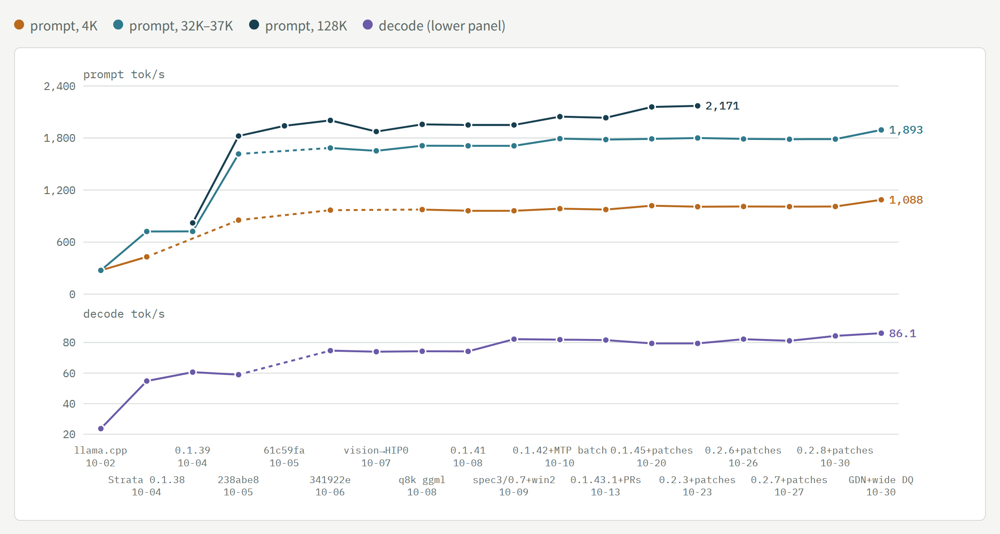
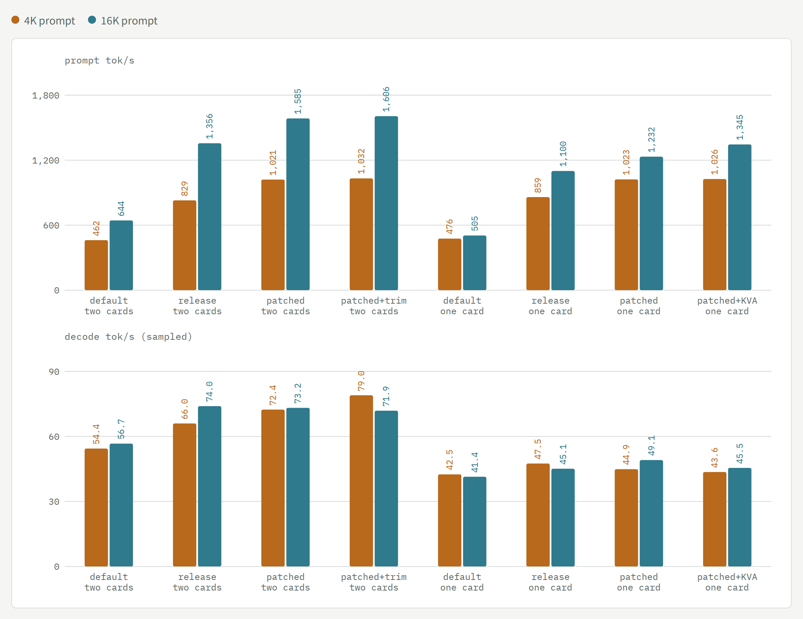
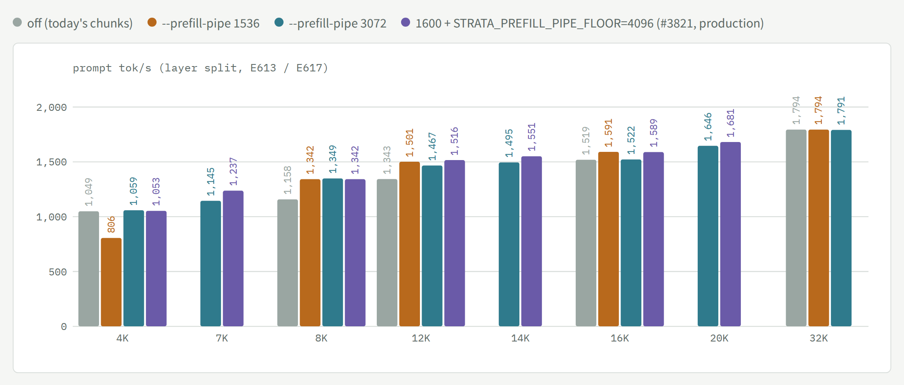
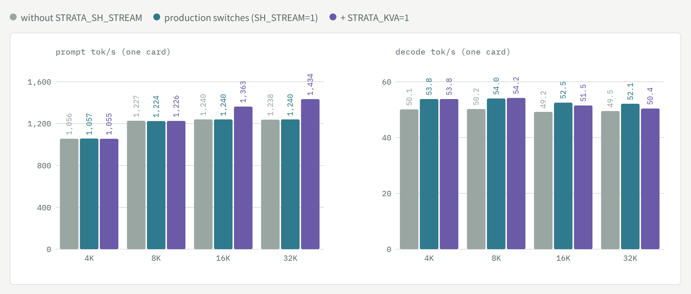
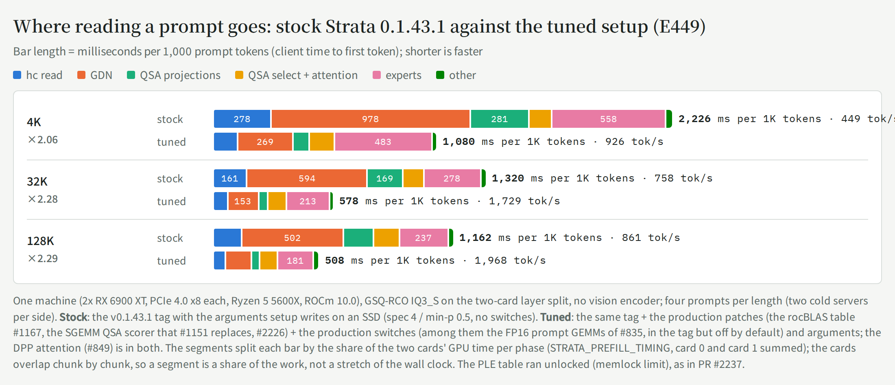
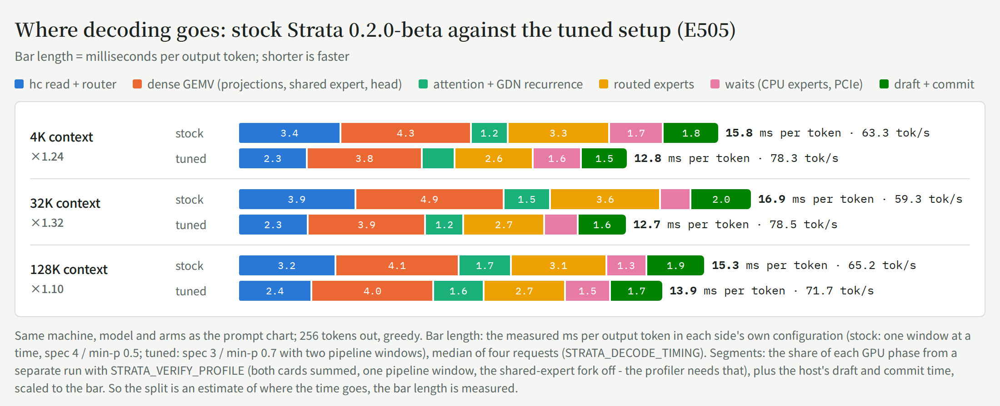
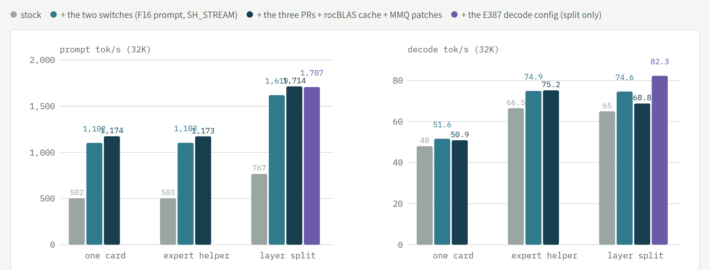
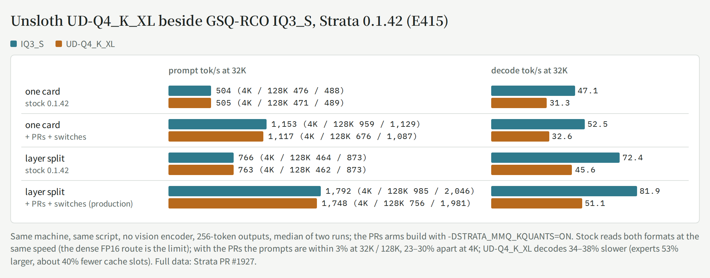

# History: two RX 6900 XT under Linux, 09-21 → 11-07

[← Current state](linux-dual-6900xt.md) · [README](../README.md) · [中文](linux-history.zh-CN.md)

The full log, newest first. The short version (what runs now, how to reproduce it, which steps mattered) is [linux-dual-6900xt.md](linux-dual-6900xt.md). "Where it stands" below is kept as written at each production change.

Tuning log for **Qwen3.8-Flash-Next (GSQ-RCO IQ3_S)** on a home box with **2x AMD RX 6900 XT (gfx1030, PCIe 4.0 x8 each) / Ryzen 5 5600X / 128 GB DDR4**, ROCm 10.0 — from llama.cpp to [Strata](https://github.com/Niko1221/Strata), 2026-09-21 → 11-06; plus one RX 6900 XT under Windows 11 ([Windows notes](windows-one-card.md)). Experiment numbers (E…) refer to the author's lab notebook (not public). Every number is measured on this machine unless marked as an estimate.

<picture>
  <source media="(prefers-color-scheme: dark)" srcset="speed-chart-en-dark.png">
  
</picture>

*Prompt tok/s at 4K, 32K–37K and 128K (left axis) and decode tok/s (right axis) at each production state. Points come from different experiments under slightly different conditions (the 4K points of the first two steps are 5K prompts; from 10-20 the points are E504 / E533 / E587 / E596 / E620 / E623, the same load on each production, parallel 1, no encoder; the last two decode points, 84 / 86, are run-to-run swing at pipeline-windows 2 - real-text decode is 79-80 on every version; 0.2.9 is output-identical to 0.2.8 and ±0.3% (E631), so it has no point of its own; the notes under the chart on the interactive page list the rest); a dashed segment bridges a step where that metric was not measured.*

## Where it stands

- **11-07 12:4x: `STRATA_DP_MIN` 12,288 → 9,216** on the same binary: prompts of 9.2K–12.3K read +7~21% (E712), shorter and longer ones unchanged; gate 12/12 (E714). Details: [DP threshold](#dp-threshold-11-07-e712-e714).
- **Production (since 11-06 22:3x, the merged kernel batch):** `strata-0211wl2-1a996f63` = the 09:40 build below + the 11-06 kernel batch (`patches/strata/0002`; the int8 hc copies on Q8_0's grid, `STRATA_HC_PERSIST_Q8=2`): prompt **2,301 / 2,628 / 2,636** at 31K / 128.5K / 256K, +5~9% over the 09:40 build and **+20~24%** over the 11-04 production from 16K to 256K, every point from 46K up above 2,500 (E705); deterministic 32K +7.3%, decode whole-run **+8.5%** (E703); standard benchmark 4K / 16K **1,234 / 2,124**, decode 80.7 / 85.5 (parallel 1, E707), gate 12/12; worst-case concurrent run with vision 9/9 (E704). Details: [the 11-06 section](#0211-mmq-activation-reads-and-the-merged-kernel-batch-11-06-e678e708).
- **Production (11-06 09:40 – 22:3x, 0.2.11 + MMQ activation reads):** `strata-0211scal-9e10fd77` = Strata upstream **0.2.11** (03:16, flat, token-for-token identical to 0.2.10 with `--vram-reserve-later-mib 444`, E678) + a ggml patch that reads the MMQ activations wave-uniformly (E685): prompt **2,160 / 2,507** at 32K / 128K (+2.8~4.9% from 4K to 128K, 1–2K flat), decode flat, gate 12/12.
- **Production (since 11-06 00:57 on 0.2.10 + on-demand DP):** `strata-0210dp-e6e76570` = Strata upstream **0.2.10** merged into the local patch set (flat against 0.2.9, E645) with `STRATA_SIDE_MIXER=2` (decode +3%) and `--spec-min-p 0.6` (11-03), plus upstream PR #5002's data-parallel prompt read with our changes on top: prompt **1,858 / 2,094 / 2,425** at 16K / 32K / 128K (+8~10%), decode unchanged, gate 12/12. Card-to-card copies need the cards awake *and* BIOS Preferred IO = Manual. Details: [the 11-03 – 11-06 section](#0210-on-demand-dp-prompt-read-and-the-card-to-card-collapse-11-03--11-06-e645e677).
- **Production (since 10-31 16:0x on 0.2.9; kernel 7.0.0-42 since 11-02):** `strata-029f` = Strata upstream **0.2.9** merged into the same local patch set, with the 10-29 settings below plus two prompt switches (GDN group, `STRATA_DEQUANT_WIDE=1`; prompt +5~12%, 10-30) and, since 11-02, the slot-copy switches (a long request interrupted by a second one decodes +28%). Standard benchmark (E642, production concurrent config): prompt **1,136 / 1,793** at 4K / 16K, 12/12, 0 stalls. Details and what was ruled out: [the 10-30 – 11-02 section](#028--029-two-prompt-switches-and-what-the-last-four-days-ruled-out-10-30--11-02-e620e642).
- **Production (since 10-27 18:40 on 0.2.7, `--prefill-pipe 3072` since 10-29 05:06):** `strata-027-9ca7fd21` = Strata upstream **0.2.7** (engine 0.1.52; #2985's pipelined MTP is upstream now as #4121) merged into the local patch set - #3381 (RDNA2 prompt attention), #3382 (CPU share beside `--batch`), #3073 (SIMT=2 scorer), #3095 (pipeline windows beside batch slots) - plus the modified llama.cpp ggml and the rocBLAS 5.6.0 table; 0.2.6 (E587) and 0.2.7 (E596) were each flat against the build before. Benchmark load (E596): prompt **1,009 / 1,786** at 4K / 32K, decode 78-85. `--prefill-pipe 3072` then lifted 8K **+16%** and 12K **+8%** (E613), and upstream #3821's chunk floor (`STRATA_PREFILL_PIPE_FLOOR=4096` with `--prefill-pipe 1600`) another +3-8% at 7K-20K (E617, below); production is `strata-027f-3177b96f` since 10-29 07:1x; since 10-29 13:01 its json also pins `layer_split: 27` with `STRATA_STAGE_TRIM=1` (each card keeps only its own layers' dense weights; 2K prompt +8%, decode +1-3%, E618/E619, below).
- **Strata's standard benchmark on 0.2.7 (E616, 10-29, all 12/12, 0 stalls):**

**Two cards (layer split)**

| Arm | Prompt 4K | Prompt 16K | Decode short / 4K / 16K |
|---|---|---|---|
| Setup defaults (`strata launch`, 0.1.52) | 462 | 644 | 61.7 / 54.4 / 56.7 |
| Release package 0.1.52 + upstream switches | 829 | 1,356 | 73.8 / 66.0 / 74.0 |
| Patched (production 027f, with #3821) | 1,021 | 1,585 | 76.1 / 72.4 / 73.2 |
| + dense-weight trim, split 27 (production since 13:01, E619)* | 1,032 | 1,606 | 80.4 / 79.0 / 71.9 |

\* The row above it ran with auto split, which picked 24 on this config; this one pins 27 and trims. Two changes at once, one run each: a sanity check, not an A/B (the A/B is in the trim section below).

**One card**

| Arm | Prompt 4K | Prompt 16K | Decode short / 4K / 16K |
|---|---|---|---|
| Setup defaults | 476 | 505 | 45.8 / 42.5 / 41.4 |
| Release package + upstream switches | 859 | 1,100 | 46.2 / 47.5 / 45.1 |
| Patched | 1,023 | 1,232 | 49.0 / 44.9 / 49.1 |
| Patched + `STRATA_KVA=1` | 1,026 | 1,345 | 50.3 / 43.6 / 45.5 |

  <picture>
    <source media="(prefers-color-scheme: dark)" srcset="std-chart-en-dark.png">
    
  </picture>

  The patches are worth +19% / +12% prompt on one card and +24% / +12% on two; decode is within the protocol's sampling noise. The release package's rocBLAS (5.4.0) does not match the shipped gfx1030 table (5.6.0), so it runs the default kernels, as on 0.2.2 (#3790). The default track equals 0.2.2 (#3790: 479 / 507 and 464 / 645). Two upgrade notes: an engine installed by an older Terminal stays until `strata update`; on 0.2.7 `--save-preset NAME` stores the benchmark profile as `launch-NAME`.
- **Production (since 10-23 13:27):** `strata-023-b523b933` = Strata upstream **0.2.3** (merged into the 0.2.2 production, no conflicts) + #2985's pipelined MTP (`STRATA_PIPED_MTP=2`, JacobSussan) + five patches of ours: the solo path keeps `--pipeline-windows` beside batch slots (`STRATA_PW_WITH_BATCH=1`, [#3095](https://github.com/Niko1221/Strata/pull/3095)), #2071's SIMT=2 scorer on HIP ([#3073](https://github.com/Niko1221/Strata/pull/3073)), the prompt's CPU share beside `--batch` (`STRATA_PREFILL_CPU_SHARE_BATCH=1`, [#3382](https://github.com/Niko1221/Strata/pull/3382)), a gfx103x prompt-attention kernel (`STRATA_PROMPT_ATTN_RDNA2=1`, [#3381](https://github.com/Niko1221/Strata/pull/3381)), a per-device rocBLAS solution cache; plus `STRATA_PREFILL_STREAM_MIN=2048` and the modified llama.cpp ggml (MMQ dot-chain heads in VOP3P). The config pins `--conversation-cache-mib 0`: 0.2.3 turns a conversation cache on by default, and it read a single session's prompts 3% / 1.4% slower at 4K / 32K-128K here (E533). Two parallel slots (`"parallel": 2`), layer split, IQ3_S experts, int8 KV, `--spec 3 --spec-min-p 0.7 --pipeline-windows 2`; both cards undervolted −81 mV at 245 W since 10-21 (E522/E523: 37 rounds without a flipped token; decode does not follow the clock, E507-E512). Rollback slot `strata-split-prev` = the 0.2.2 merge (`strata-022-34cd8534`). Since 10-20 the engine moved 0.1.45 → 0.2.1.3 (E516/E517) → 0.2.2 (E527) → 0.2.3 (E533), each step speed- and KL-neutral against the one before.
- **Speed (E533, the E415 load, the production config without the vision encoder, two rounds):** prompt **1,008 / 1,800 / 2,171** tok/s at 4K / 32K / 128K (E504 on the 10-20 production: 1,020 / 1,790 / 2,158; E415 on 10-10: 985 / 1,792 / 2,046), decode **75 / 79 / 78** for one request (E504: 80 / 79 / 74); two requests at once 60–64 tok/s together (E481), a second request's first token 0.5 s instead of 12 s (E463–E470). Short prompts: a 430-token read 1.1 s (was 1.7 s, E493). Upstream **0.2.0-beta** stock on the same box and settings (E503, community report [#3426](https://github.com/Niko1221/Strata/pull/3426)): 979 / 1,662 tok/s at 4K / 32K with its own suite, 1,893 at 119K real text, decode 66 for one request - our patches are the difference (each re-measured on 0.2.0 in the PRs above).
- **Whole journey, same IQ3_S model:** decode 26 → ~80 tok/s (≈3×), 32K–37K prompt 274 → 1,790 tok/s (≈6.5×), 128K 821 (0.1.39) → 2,158. The engine switch (llama.cpp → Strata) is most of it; the patches and configuration after that roughly doubled the prompt (37K 714 → 1,433 → 1,705; 32K 1,790 and 128K 2,158 on 10-20) and added about +40% decode (56–58 → 80).
- **Closed directions (measured; do not retry on this box):** every decode-side configuration knob — `--kv-resident` shrink (E382), `--pipeline-windows 2` alone (E384, +1–6%), the 16-point `--spec` × `--spec-min-p` grid at `--pipeline-windows 1` (E385, 4/0.5 is the peak of accepted tokens per window) — **but the combination works**: `--spec 3 --spec-min-p 0.7 --pipeline-windows 2` decodes +10–16% at 4K and +8–11% at 32K (E387, three confirmation rounds; the short draft is accepted 83% of the time instead of 68%, so the speculative second window hits). Prompt speed unchanged; output differs between starts (the baseline is deterministic); 128K +11% in the no-vision-encoder configuration (E388); in production since 10-09 00:16; batch slots as evaluated on 10-08 (resident experts 41% < upstream's 50% gate, slots decode without MTP; **overturned 10-15**: with slot drafts, the solo path kept pipelined and later #2985, `"parallel": 2` is production); MMQ tile / stream-K for IQ3_S (E279/E280); `--prefill` chunks other than 8192 (E296); tensor parallel (E234, +6%); and the upstream opt-ins that upstream itself measured as neutral or negative on small cards (chunked GDN, Foresight swap slots, pinned stage buffers).
- **What is left:** the PCIe topology for long prompts (x8/x8 kept: on Strata a long prompt waits on PCIe only 0.2–0.7% of the time; a <2K one ~6–13% on 0.2.9, E634 - E482's 43–54% is overturned); more expert swaps per decode window (E499: the adaptive cache already hits 85%, a perfect 8-window predictor would not beat it at today's swap rate - the swap budget is the lever, untested). Four PRs wait for upstream review on 0.2.0-beta (#3381, #3382, and #3073 / #3095 reopened 10-20 with the E503 numbers).

## DP threshold (11-07, E712, E714)

`STRATA_DP_MIN` decides from which prompt length the two cards read one prompt together. Production had it at 12,288 since the DP build and it had never been swept. E712 swept it on the production binary (`strata-0211wl2-1a996f63`, production json without vision and `--batch-mtp`, parallel 1), arms 12,288 / 8,448 / 9,728 in the order Z A B B A Z, two reads per length per arm, prompt tok/s medians of four:

| Prompt | 12,288 (old) | 8,448 | 9,728 | 8,448 vs old |
|---|---|---|---|---|
| 8,704 | 1,562 | 1,529 | 1,542 (no DP) | −2% (DP on, slower) |
| 9,216 | 1,605 | 1,722 | 1,601 (no DP) | **+7%** |
| 9,728 | 1,606 | 1,766 | 1,755 | **+10%** |
| 10,240 | 1,631 | 1,819 | 1,821 | **+12%** |
| 11,264 | 1,582 | 1,908 | 1,908 | **+21%** |
| 12,288 | 1,986 | 1,985 | 1,984 | 0 (DP in all three) |

At 9,216 the four DP reads were 1,718–1,730 and the four layer-split reads 1,585–1,609, no overlap. Decode after the read (ms per window) moved −4.6~+3.6% with no direction. Just above 8.4K DP loses (each card reads every layer, and the chunks are too short to pay for it); from ~9K it wins. **Production since 11-07 12:4x: `STRATA_DP_MIN=9216`** in the three slots (E714: gate 12/12, 0 stalls; a 10,532-token request through the proxy read at 1,816 tok/s against 1,631 before). In this box's request log 8.4K–12.3K is 11% of fresh reads, so the whole prompt time moves about 1%. Raw values: `data/linux-dp-min-0.2.11.csv`.

## 0.2.11, MMQ activation reads, and the merged kernel batch (11-06, E678–E708)

Three steps in one day. Every number is from same-session interleaved runs unless marked; the raw values are in `data/linux-steps-0.2.11.csv`.

**1. 0.2.11, production since 11-06 03:16** (`strata-0211dp-7680d258`, E678). v0.2.11 merged into the DP build (205 commits, one conflict, both sides kept). Prompt 16K–128K within ±1% in the production concurrent config, decode within the run-to-run spread, standard gate 12/12 (1,122 / 1,921 against 1,123 / 1,918 in the same session). The output text changed, and a diagnostic arm showed why: 0.2.11 reserves 256 MiB more on the later card, which cost card 1 123 expert slots, and the extra CPU-computed experts round differently. With `--vram-reserve-later-mib 444` (444 + 256 = the old 700) the slots come back and the output is token-for-token identical to 0.2.10, so production runs with that flag.

**2. MMQ activations read wave-uniformly, production since 11-06 09:40** (`strata-0211scal-9e10fd77`, E679–E685). A newer upstream MMQ was no faster end to end here (E682, ±1%). Performance counters on the production MMQ kernels (E679c) showed them VALU-issue-bound (70–77% of issue slots busy, dot4 only 38–43% of the VALU work), with most of the extra instructions in the inner loop being shared-memory address arithmetic and reads of the q8_1 activations. Reading those activations through the scalar unit instead (`s_load`, wave-uniform addresses, no y tile in shared memory) took a minimal kernel from 31 to 44 TOPS (E683) and the real kernels up 9~27% (IQ3_XXS / IQ3_S / IQ4_NL / IQ2_S, real routing, E684c). In Strata:

| | 4K | 32K | 64K | 128K |
|---|---|---|---|---|
| 0.2.11 (production concurrent config, two runs) | 1,086–1,092 | 2,102 / 2,098 | 2,327 / 2,327 | 2,407 / 2,426 |
| + MMQ y reads | 1,128–1,132 | 2,160 / 2,161 | 2,401 / 2,402 | **2,507 / 2,507** |

Deterministic arms: 8K +4.3/+4.9%, 32K +2.5/+2.9%, 1–2K within ±1%. Decode flat, gate 12/12, ctest no new failures, the MMQ parity test passes. Output is not bitwise (the same build is not bitwise across runs either). Patch: [`patches/llama.cpp/extra-mmq-y-scalar-rdna2.diff`](../patches/llama.cpp/README.md).

**3. The merged kernel batch, production since 11-06 22:3x** (`strata-0211wl2-1a996f63`, E688–E708). Each change was checked alone first, then all of them were tested together against production (E703, one maintenance window):

| Change | Checked alone |
|---|---|
| `STRATA_F16_NOWIDEN=1`: the hyper-connection up projection and `attn_qkv` stay FP16; the mixer and the GDN convolution read FP16 instead of a widened copy (E688/E688b) | bitwise (12/12, 6/6 self-checks); up projection alone 8K +1.3~2.7%, 32K +1.9~2.1% |
| `STRATA_HC_PERSIST_Q8=2`: the persistent hc read (our #2226) reads int8 copies of its weights on Q8_0's grid, one fp16 scale per 32 values (E693b with a coarser grid, E708) | decode +6.4% whole-run (E693b); not bitwise (see quality below) |
| `STRATA_MMVQ_NW1=1`: a one-warp dense GEMV for 2–4 tokens (E698) | kernels −6~42%, bitwise |
| `STRATA_EXP_TABLE=1`: decode expert kernel layout chosen per quant format (E698/E699) | layers −5~27%, bitwise (one layer slower with few groups and three tokens) |
| `STRATA_SWIGLU_Q8=1`: the fused SwiGLU + quantize kernel on HIP too (E701) | 408/408 byte-identical |
| upstream `STRATA_ATTN_MERGE_V2 / FUSE_HITS / IQ_STAGE_TABLES / PLE_COMPACT / PLE_COPY_STREAM`, `--mtp-q4 head` (E697) | prompt 32K +2%, decode +0.5% / +0.7% |

Together (E703): ctest 224 with only the three known failures; deterministic prompt 1K +0.6~1.4%, **8K +4.3~4.5%, 32K +7.2~7.4%**; decode in the production pipelined setup, whole-run total tokens over total decode time with 24 replayed real requests, **+8.5%** (three pairs interpolated between baseline runs: +7.2 / +10.9 / +7.5%; 25.0 → 22.9 ms a window, tokens per window unchanged); standard gate 12/12, 0 stalls; 128K and 200K reads (synthetic text) **2,645 / 2,715 tok/s**, no OOM, no stall.

**Quality of the int8 hc copies.** Teacher-forced over 8 chats against a double-precision reference: mean KL 0.0496 for the merged build and 0.0496 for production; chat by chat each side wins four and single chats differ by up to 5×, so the mean says nothing finer than "no large regression" (E693b alone showed 0.0454, which is the same noise - it is not "more accurate"). The one consistent signal: top-10 overlap is lower in all 8 chats, −1.3 points (−1.1 for E693b alone), argmax agreement shows no consistent change - the int8 weights move the tail of the distribution, not the top token. An offline check of the quantisation error (E708a, every BF16 hc tensor of the 48 layers) explains part of it: one fp32 scale per 128 columns (down / inject) and per 320-value row (up) gives 0.81 / 0.88 / 1.09% relative RMS error, 1.3–1.6× the 0.61–0.67% of a Q8_0 grid (one fp16 scale per 32 values, what upstream's `STRATA_HC_Q8` uses). Production therefore runs that grid (`STRATA_HC_PERSIST_Q8=2`, E708; `=1`, the coarser grid, is still in the code; E703 above was measured with `=1`): the start-up self-check's max relative difference drops from 0.00705 to 0.00497; top-10 overlap with the reference is −0.7 points from the unquantised read instead of −1.3 (upstream's `STRATA_HC_Q8` in the same run: −0.4), better than the coarser grid in 6 of 8 chats, with the KL means again inside the chat-to-chat noise; decode whole-run +0.3% against the coarser grid (noise: the 3% more bytes do not show), 24/24 replays, gate 12/12.

**Cost and worst case.** The copies take 360 / 280 MiB on the two cards (347 / 269 with the coarser grid; `--vram-reserve-later-mib 844`). Card 1 gives up 196 expert slots; card 0 keeps its slots and has 452 MiB free after loading instead of 908 (318 MiB at the start of a request, under the engine's 512 MiB warning). E704 ran the production json with the GPU vision encoder on: a picture alone; a 200K read on one slot while the other read a picture and then 32K; two ~120K reads at once; a picture and a sanity question - 9/9 correct, 0 stalls, 0 OOM, VRAM peak 16.3 GB on each card, GTT at most 38 MiB (nothing paged to system memory). At the production switch-over (Q8_0 grid) card 0 had ~430 MiB free after loading. **One card is on the edge:** a single 6900 XT holds all 96 hc reads, 641 MiB of copies, which left 264 MiB for the 213 MiB draft head (the fit check counts the Q6_K head even with `--mtp-q4 head`); in E706 one of two cold starts refused the draft head and stopped. On one card leave `STRATA_HC_PERSIST_Q8` off, or free VRAM first (smaller context or reserve). Patch: [`patches/strata/0002-waitlist-0211-2x6900xt.patch`](../patches/strata/README.md).

**Prompt-speed curve (E705 / E705b).** The 11-04 curve's corpus and load (E659: synthetic code text, production concurrent config without the encoder, 26 points to 128.5K with two runs each, 153.6K–256K once, every request fresh). Columns: the 11-04 production (0.2.10, layer split, before DP), the 09:40 production (0211scal), the merged build with DP, and the same merged build with `STRATA_DP_PREFILL=0` (layer split 27). Selected points (all 31 in the interactive page's data):

| Prompt | 11-04 | 0211scal | merged | merged, no DP | merged vs 11-04 | DP vs layer split |
|---|---|---|---|---|---|---|
| 5.6K | 1,165 | 1,214 | 1,282 | 1,289 | +10.0% | −0.6% |
| 10.8K | 1,518 | 1,563 | 1,644 | 1,651 | +8.3% | −0.4% |
| 15.9K | 1,704 | 1,972 | 2,119 | 1,794 | +24.4% | +18.1% |
| 26.1K | 1,873 | 2,160 | 2,340 | 2,016 | +24.9% | +16.1% |
| 31K | 1,902 | 2,131 | 2,301 | 2,064 | +21.0% | +11.5% |
| 62K | 2,092 | 2,321 | 2,525 | 2,287 | +20.7% | +10.4% |
| 82K | 2,114 | 2,518 | 2,670 | 2,121 | +26.3% | +25.9% |
| 128.5K | 2,197 | 2,493 | **2,628** | 2,313 | +19.6% | +13.6% |
| 204.8K | 2,208 | 2,519 | 2,646 | 2,346 | +19.9% | +12.8% |
| 256K | 2,187 | 2,516 | **2,636** | 2,362 | +20.5% | +11.6% |

The merged build is +5~9% over 0211scal at every point above 5K and +20~24% over the 11-04 production from 16K to 256K; every point from 46K up is above 2,500 (plateau ~2,630–2,670). Below 12,288 tokens DP did not engage at the time (`STRATA_DP_MIN`; 9,216 since 11-07, see above), so 5.6K / 10.8K show the kernels alone. DP against layer split on the same build: ≤11K flat, 16K–26K +16~19%, 31K–67K +10~15%, 72K–123K +16~26%, 154K–256K +12~17% - more than on 0.2.10 (E675: +7.7% at 16K, +10.4% at 128K); why was not measured. The prompt read does not go through the hc read, so the curve holds for either hc grid (it ran with the coarser one). The 512-token point is cold-start noise and left out.

**One card (E706, the E643 one-card config, five prompt lengths):**

| Build | 5.6K | 15.9K | 31K | 62K | 128.5K | decode 32K (benchmark) |
|---|---|---|---|---|---|---|
| 0211dp (two runs) | 1,165–1,173 | 1,306–1,307 | 1,304–1,305 | 1,300 | 1,293–1,294 | 51.3 / 54.6 |
| 0211scal (two runs) | 1,204–1,219 | 1,359 | 1,352–1,358 | 1,349–1,350 | 1,345–1,347 | 53.4 / 51.0 |
| merged, Q8_0 grid (one run) | 1,250 | 1,437 | 1,427 | 1,411 | 1,408 | 54.2 |

The day's kernels give one card +4.6~5.7% prompt over 0211scal from 16K to 128K (+9~10% over 0211dp); decode is one sample per arm, inside the spread. The merged arm has one run because its other cold start refused the draft head (see the cost paragraph above).

**Strata's standard benchmark on the merged build (E707, `strata bench run`, custom track, all 12/12, 0 stalls):**

| Arm | Prompt 4K | Prompt 16K | Decode short / 4K / 16K |
|---|---|---|---|
| Two cards, parallel 1 (the #4602 setup) | 1,234 | 2,124 | 84.7 / 80.7 / 85.5 |
| One card | 1,058 | 1,434 | 52.9 / 49.8 / 48.6 |

Against the patched 0.2.7 rows above (E616, two cards 1,021 / 1,585, one card 1,023 / 1,232; different days): +21% / +34% on two cards, +3% / +16% on one.

**Closed on 11-06 (measured; do not retry unless the stated condition changes):**
- **Prompt attention with dot2 scores** (`STRATA_PROMPT_ATTN_RDNA2=2`, E687/E702): kernel −14% (prompt 32K ≈ +1.6%, estimated), but the FP16 rounding of Q comes out as 3e-3 relative error against FP64, against 2e-6 for the current kernel. The code stays in `0002` unused. Reopen only with a path that does not round Q to FP16, or if attention grows past ~25% of the prompt time.
- **MMQ IQ2_S / Q2_0 at fewer VGPRs** (E700): 174 → 160 and 216 → 177 VGPRs reached the next occupancy step, prompt 0 to −1%. Reopen if shared memory, not VGPRs, turns out to cap the waves and can be cut too.
- **hc read without barriers** (E691): the barriers cost ~4 µs a read; replacing them with one atomic barrier made the read 21–25% slower.
- **Prefetch inside the int8 hc read** (E693c): moved the reads to an earlier phase, saved 0.4 µs; the int8 read already runs at ~95% of bandwidth.
- **A second guess on the bonus token** (E694/E694b): the runner-up token is right 31% of the time the top one is wrong, but each extra verify row costs card 0 +1.9 ms (most new experts are in the CPU pool), at least as much as it would win. Reopen if a row costs <0.5 ms (all experts in VRAM).

## 0.2.10, on-demand DP prompt read, and the card-to-card collapse (11-03 – 11-06, E645–E677)

**On-demand data-parallel prompt read, in production since 11-06 00:57** (`strata-0210dp-e6e76570`). Production concurrent config (`--parallel 2 --batch-mtp`), `bench/benchmark.py` load, two interleaved runs:

| | 16K | 32K | 64K | 128K | decode 4K | decode 32K |
|---|---|---|---|---|---|---|
| layer pipeline (0.2.10 + patches, `0210f`) | 1,724 | 1,905 | 2,109 | 2,197 | 88.3 | 81.3 |
| + on-demand DP, `--prefill 16384` | 1,858 | 2,094 | 2,325 | **2,425** | 88.0 | 81.7 |

Prompt **+8~10%**, decode unchanged, standard benchmark 12/12 twice (E675/E676: 4K / 16K 1,123 / 1,919 against 1,119 / 1,750), 0 stalls, no loss with concurrent requests. 16–32K stay below 2,400; only 128K passes it.

- **Why DP:** with the layer split one card waits about 40% of a long prompt read (E660, busy sampling: both cards >80% busy only 57–59% of the time). DP lets each card read its own chunks through all 48 layers; the layers held by the other card ("foreign layers") have to get their weights from somewhere else.
- **Upstream's DP as is did not pay here** (PR #5002 with stage trim: ≤+5%, long prompts slower, E662). Five changes made it pay, each behind its own switch:
  - **Foreign-layer experts streamed from RAM** (`STRATA_DP_PEER_RES=0`) instead of gathered in place from the other card's VRAM over x8: +4~6% (this is also why an older fork's DP was ~5% faster).
  - **A staging ring** (`STRATA_DP_STAGE_W=3`): a foreign layer's dense rows, and the next two layers', are copied into local slots on a side stream; compute waited 0–1 ms on them in total. Under a real read the copies ran 7–11 GB/s even with deep sleep at the default (E672b, rocprofv3).
  - **Small rows staged too** (`STRATA_DP_STAGE_MIN=0`): stage trim's whole cost was the rows under 256 KiB (hc inject / norm, ssm_*, norms; ~15–20 MiB a card) that kernels read across PCIe for every layer of every chunk. Copying them removed the cost (DP + trim then about even with DP without trim, and trim keeps its expert slots).
  - **The draft layer sees every chunk** (`STRATA_DP_MTP_ALL=1`): after a DP read the drafter had seen only half the cells, accepted tokens per window fell 4% and decode 4~5%. Feeding both paths' chunks in prompt order brings it back.
  - **DP beside batch slots** (`STRATA_DP_BATCH=1`) and **VRAM borrowed only for the read** (`STRATA_DP_LAZY=1`): the concurrent-read path bypassed DP's start test; the DP sessions held 534 expert slots permanently. A prompt of ≥12,288 tokens that arrives with no other slot decoding is read on both cards; a request that arrives during that read waits for it (0 of 122 reads overlapped in two days of real traffic).
- `--prefill 16384` (instead of 8192): 128K +3.2%, 16K −2%. One crash fixed on the way: `WeightTable::find` recursed between the two DP tables on a name neither held (SIGSEGV on the first DP read with trim). Patch and switches: [patches/strata/](../patches/strata/README.md); findings and a correction posted on [PR #5002](https://github.com/Niko1221/Strata/pull/5002).

**Card-to-card copies: two conditions, not one.** One direction runs 14.2 GB/s; both directions at once collapsed to 3–4 GB/s each. It takes both of these to avoid it:
1. the cards awake - a connected display, or the five SMU deep-sleep features `DS_SOCCLK / DS_FCLK / DS_DCEFCLK / DS_UCLK / FW_DSTATE` cleared;
2. BIOS AMD CBS → NBIO → **Preferred IO = Manual** (ASUS X570, AGESA).

Display + Auto: 3.3–4.3 (E578c); display + Manual: 7.5 (E578d); no display + Manual: 3.3–4.8 (E665); deep sleep off + Manual: 8.15 (E665g). Deep sleep off + Auto was never measured. The collapse happens only while the GPUs idle and only copy; under load the copies are not collapsed, so production runs with deep sleep at the default (±0.6% on the layer pipeline; the DP read would gain 4–6 points with it off). **Do not write `pp_features` while the driver runs:** a full mask written while a card is in GFXOFF makes the driver re-enable the gated GFX features, the SMU stopped answering and the box rebooted (E668). `amdgpu.ppfeaturemask` cannot clear these five bits (the driver allows them unconditionally).

**Also in these four days:**
- **0.2.10 (E645), production since 11-03 00:5x:** output identical to 0.2.9, ±1.5%, gate 12/12 (1,122 / 1,753). #3073 and #3382 are upstream now.
- **`STRATA_SIDE_MIXER=2` (E649), production since 11-03 15:4x:** the mixer work that only reads the layer's input runs on a branch of the window graph beside the main chain; decode +3.0~3.5% in the deterministic setup, identical text, gate 12/12. Off by default on HIP. Of the 11 decode switches tested with it, the others were within ±1% or slower.
- **`--spec-min-p 0.6` (E651), production since 11-03 22:26:** +1.5% (two rounds, weak evidence); 4/0.5 is −3.5% in the production setup although it was +9~16% on synthetic text with one window.
- **Not adopted:** DFlash2 on two cards (E646/E647: behind MTP + `--pipeline-windows 2` after every tuning step, a zeroed draft only ties; one card +4.4%, weak, table as draft PR #5146); the waits inside `--pipeline-windows 2` (E653–E658: the cards overlap only in the 37% of windows whose guess is right; building the window after next early −3.8%, THETA 0 +0.8%, merging the draft graphs ≤0.3%); tensor parallel (E660–E664: decode 6–7% slower a window because each card caches half of each layer's expert pairs, hit rate 80–85% vs 92–94%, and it cannot run beside `--parallel 2`; its prompt read was 35% slower than DP at 16–32K, measured while its card-to-card exchange was in the collapsed state, so that margin is not final).

## 0.2.8 → 0.2.9, two prompt switches, and what the last four days ruled out (10-30 – 11-02, E620–E642)

Strata's standard benchmark after each change (12-question gate, sampled decode, one run each, so decode moves within ±10% by itself; every gate below is 12/12 with 0 stalls unless noted):

| Gate | Build / config | Prompt 4K | Prompt 16K | Decode short / 4K / 16K |
|---|---|---|---|---|
| E620 (10-30) | 0.2.8 merge (`028f`), production env, parallel 1 | 1,034 | 1,599 | 76.0 / 69.2 / 66.4 |
| E625 (10-30) | + GDN group + `DEQUANT_WIDE` (below) | 1,111 | 1,720 | 79.5 / 71.7 / 82.2 |
| E631 (10-31) | 0.2.9 merge (`029f`), same env | 1,094 | 1,700 | 75.6 / 69.7 / 84.0 |
| E638 (11-01) | the same, production concurrent config (parallel 2, `--batch-mtp`) | 1,109 | 1,743 | 75.1 / 72.3 / 72.7 |
| E642 (11-02) | the same on kernel 7.0.0-42 | 1,136 | 1,793 | 77.0 / 77.4 / 68.5 |

- **0.2.8 (E620) and 0.2.9 (E631) are flat on this box.** Deterministic A/B (pipeline windows 1, parallel 1, two interleaved pairs, 4K / 32K): within ±1.5%, output identical. 0.2.9's new default `STRATA_GR_R2` (exact-T kernel for 5-8-token verify windows) is inert here (identical text, ±0.2%). Production moved for the fixes, not for speed: `028f` on 10-30, `029f` on 10-31.
- **Two upstream prompt switches, in production since 10-30 22:5x (E621-E625):**
  - **GDN group** `STRATA_GDN_HEAD=1 STRATA_GDN_PP=2 STRATA_GDN_CONVL2=1 STRATA_GDN_NOY=1`: the quad2c recurrence plus the in-loop normalisation. The quad kernel alone is ~10% slower than the default on 80 CUs; the two-step PP form (registers 196 → 142, two columns per lane) reverses that. Single kernel −41~51% per layer, bit-identical. Whole model, real text, two ABBA pairs: prompt **+2.3~3.8%** at 4K-32K, decode unchanged, 25/25 outputs identical.
  - **`STRATA_DEQUANT_WIDE=1`**: the projection GEMMs already run at table speed; the cost was unpacking Q6_K / IQ4_XS. Prompt **+8~12% at ≤1.6K, +6~8% at 2K, +4~5% at 4K-16K, +3% at 32K** (a fixed cost per block, so short prompts gain most), decode unchanged, bit-identical (360/360 in the kernel test, 25/25 whole model). This looks worth a default-on for HIP; not yet reported upstream.
- **UD-Q4_K_XL wants its own settings (E626):** carrying the IQ3_S chunking (`--prefill-pipe 1600`, floor 4096) over made its prompt 4-12% slower. Without them and with the split pinned at 24 (auto picks 23, worse): prompt flat to +4%, **decode +15~18%** against the older UD-Q4 slot (7,806 expert slots instead of 6,403). Its own chunk value: R = 3450 is the only one that helps 9K-25K (+4~12%) and leaves ≤8K alone. Gate 12/12 (U29: 797 / 1,491, decode 57 / 50 / 52).
- **Not adopted - 0.2.8's new switches (E627/E628):** of 161 read in the source, 7 apply to HIP; together `ATTN_MERGE_V2 + FUSE_HITS + IQ_STAGE_TABLES + PLE_COMPACT/COPY_STREAM` decode +1.0~1.2% with identical text, but that combined config failed the gate 3 times out of 3 with the stall below, while the production env passed every time. `SCORES_HALVE` (32K text changes, 4K prompt −3.8%), `EXPDEC` (−1~3%) and `GU_SWIGLU` lose.
- **A rare stall (upstream #267), not new:** with streaming + sampling + thinking, a request that follows a `tool_calls` answer can hang in `pipelined decode: verify` - about 1 in 500 on a replayed agent load (E632/E633: 1/520 on 0.2.9, 0/160 on 0.2.8, which cannot tell the versions apart at that rate). Greedy non-streamed replays never show it. `HSA_ENABLE_SDMA=0`, which cured the DeepSeek slot's stall, does not help here and costs 28-32% prompt. Open.
- **Short prompts and PCIe, re-measured (E634/E636) - overturns E482's "43-54% waiting on PCIe":** on 0.2.9 a 100-2K prompt waits on host-to-device copies ~6-13% (4K: 0.8%), and merging the copies would save ≤1%. Kernel traces (rocprofv3) put the expert gather at 4.4-5.6% of a prompt at every length; the "MMQ gather 19-23%" the engine's own timing reported was mostly gaps its per-expert events created (~80% of them vanish with the timing switch off). Nothing left there worth a kernel.
- **Two parallel slots: the slot-copy switches (E637-E639), in production since 11-02:** `STRATA_SLOT_COPY_DIRECT=1 STRATA_SLOT_COPY_BATCHSYNC=1 STRATA_SLOT_CKPT_MOVE=1` copy a slot's state 135-550 ms → 5-88 ms. A long (64K) request that gets a short one inserted decodes **+28%** (53.1 → 67.9), first tokens 0.1-0.4 s earlier, two requests started 6 s apart +2.5%; one request alone does not use the path. Gate 12/12 (1,119 / 1,748); 640 replayed concurrent agent requests, 0 stalls.
- **`reasoning_loop_recovery: recover` (E640/E641):** on one real 41K-token request where the abliterated model loops at greedy + `xhigh` (3/3), it caught the loop at 12.8K tokens and finished on a low-effort continuation (+31 s re-read) - it stops the loop, it does not fix the answer. The normal model did not loop on that request at all (3/3). Not in production.
- **Kernel 7.0.0-38 → 7.0.0-42 (E642):** output identical token for token, accepted drafts identical, prompt +3~5% (part of it is a fresh boot against five days of uptime), decode flat, gate 12/12. One side effect: -42 no longer loads simpledrm, so the GPUs moved from DRM card 1/2 to 0/1 - scripts that address `cardN` or `debugfs dri/N` should go by PCI address instead (a case-fan script here had been reading a card that was not a GPU).

## Prompt speed by length: `--prefill-pipe` (0.2.7, 10-29, E613)

<picture>
  <source media="(prefers-color-scheme: dark)" srcset="pipe-chart-en-dark.png">
  
</picture>

On a layer split the prompt is read as a two-stage pipeline: card 1 runs layers 0-23 on chunk *n* while card 2 runs layers 24-47 on chunk *n-1*. Strata's `--prefill-pipe R` (from #1441; R = how many tokens one stage takes to cover the other's fixed cost) re-chunks a cold prompt when its cost formula says the pipeline wins by more than 3%; the auto chunk here is 8,192, so without it an 8K prompt is one chunk and the second card waits for the whole first stage.

- **3072 is in production** (all three Qwen slots): 8K becomes 2x4096 (**+16%**, 1,158 -> 1,347 synthetic, 1,145 -> 1,327 real text), 12K 2x6144 (**+8%**), and 4K / 16K / 32K keep today's chunks.
- **1536** also splits 16K (+5%) and gives 12K +12%, but it cuts 4K into 2x2048, **-23%**. Working the cost formula through, no value of R splits 16K without also splitting 4K, so 3072 is the best single value here.
- One cold engine, the value switched per request (`strata_tune.prefill_pipe`), an "off" control before and after every value; the real-text check (E572 lesson: chunking switches are judged on real text) agreed at 4K / 8K / 12K. Data point upstream: Strata PR #4587 (docs).
- This overturns E393's "pipe does nothing on two stages": E393 tested only 4K and 32K, the two lengths it leaves alone.

**Is there a better number than 3072?** Not as a single value. `Prefill::pipeline_chunk` (src/prefill/prefill.cpp) costs a plan of k chunks of c tokens as `k*R + n + (stages-1)*(R + min(c, n))`, tries k from today's count up to 64 (chunks on a 256 grid, at least 512) and takes the cheapest only if it is under 97% of today's cost. Running that formula for every R from 1 to 20,000 over 2K-128K prompts (auto chunk 8,192, two stages):

| R | What changes against 3072 | Measured |
|---|---|---|
| 2,976-3,400 (3072 is here) | the same plan: 8K 2x4096, 10K 2x5120, 12K 2x6144, 14K 2x7168, 20K 3x6912; every chunk >= 4,096 | 8K +16%, 12K +8% |
| 2,551-2,975 | 7K cut into 2x3584 | not measured |
| 2,048-2,550 | 6K cut too | not measured |
| 1,792-2,047 | 12K becomes 3x4096; 5K cut too | 12K +12%; 5K not measured |
| 1,701-1,791 | as above, 20K 4x5120 | as above |
| <= 1,700 (1536 is here) | 4K cut into 2x2048 | 4K -23% |

The formula charges every chunk the same fixed cost R, but here a chunk under ~4,096 tokens costs far more than that (4K as 2x2048 -23%, 8K as 3x2816 -2%, 8K as 2x4096 +16%; the guess, not measured, is MMQ efficiency at small row counts plus one full expert pass per chunk). So no single R both splits 12K / 16K into three and leaves 5K-7K alone. What could beat 3072 is a code change, not a number: a configurable minimum chunk (4,096 instead of 512) with R near 1,536 would, by the formula, give 8K 2x4096, 12K 3x4096, 16K 3x5632 (+16 / +12 / +5% measured for those plans) and leave everything under 8K whole. **Measured (E617, 10-29): upstream #3821 is exactly this switch** (`STRATA_PREFILL_PIPE_FLOOR`, ruibeikaa). With the floor at 4,096 the plan at R = 1,600 keeps 4K-6K whole and cuts 7K into 4,096 plus a 3,071 tail - and that tail split is a win: against 3072, 7K **+8%**, 12K **+3%** (3x4096), 14K **+4%** (3x4864), 16K **+5%** (3x5632), 20K **+2%** (4x5120), 4K / 8K unchanged, on synthetic and real text alike (same engine, value switched per request, 3072 controls on both sides). What hurts is every chunk being small (4K as 2x2048), not one big chunk plus a tail. In production since 10-29 07:1x (`strata-027f`).

## Two switches on one card: SH_STREAM and KVA (0.2.7, 10-29, E615)

<picture>
  <source media="(prefers-color-scheme: dark)" srcset="one-chart-en-dark.png">
  
</picture>

One RX 6900 XT (GPU 1), the production 027 binary and switches, 131072 context, parallel 1; six cold-started arms (N S K K S N), synthetic prompts 4K-32K twice each, 128-token greedy answers, 0 stalls. For one-card readers (asked in Strata PR #4475):

- **`STRATA_SH_STREAM=1` is worth +5-7% decode on one card** (54 -> 50 tok/s without it, same direction at every length, prompt unchanged). It has been so since 0.1.40 (E335); upstream's AMD_HIP page has gfx1151 preferring it off, so A/B it on your card. On Windows it was better off (E535).
- **`STRATA_KVA=1`** (0.2.7, approximates the last 12 layers' KV on cold prompts, exact 2,048-token tail): **+10% / +16% prompt at 16K / 32K**, decode -2 to -3.5%, the 32K needle (depths 10/50/90) 3/3. Nothing below 16K with the 8,192 chunk: the threshold is 4,096 and the first chunk is always exact. It applies to one card without batch slots only, so the two-card production cannot use it.
- One card's prompt rate flattens at ~1,240 tok/s from 8K on (two cards: 1,794 at 32K); KVA skipping the last 12 layers for three quarters of the positions buys only 16%, so the one-card prompt wall is not mainly the card's compute.

## Dense-weight trim on the layer split, and five other switches (0.2.7, 10-29, E618/E619)

Tested from cobra91's upstream PRs (#4522, #4534, carried over from Hardin22's Strata-DualGPU) and bitaccesscomau's fork (#4283, the round-7 settings). Cold engine per arm, two interleaved pairs per switch, parallel 1, 262,144 context, no vision; placement and routing switches judged on real text (decode = median of 11 generations of 384 tokens, greedy).

- **`STRATA_STAGE_TRIM=1` is in production since 10-29 13:01.** On a layer split each card keeps the dense weights of all 48 layers unless told otherwise; the trim drops the layers the card does not run, and the freed VRAM goes to its expert cache. Main already has it, but only with an explicit `--layer-split` (`auto` trims only the later card), so the production json pins `layer_split: 27`, the value auto picks there anyway. Expert cache 5,893 / 4,688 -> **6,750 / 5,677** slots (bench config; production config 5,320 / 3,275 -> 6,175 / 4,265).

| Real text | trim 1 | trim 2 | off 2 | off 3 |
|---|---|---|---|---|
| decode median | 78.3 | 78.6 | 76.0 | 77.5 |
| prompt 2K | 846 | 842 | 783 | 782 |
| prompt 4K / 8K | 1,047 / 1,335 | 1,047 / 1,338 | 1,042 / 1,333 | 1,040 / 1,332 |
| prompt 16K / 32K | 1,576 / 1,810 | 1,594 / 1,814 | 1,592 / 1,810 | 1,592 / 1,810 |
| follow-up ~1.8K on a 16K conversation | 1,385 | 1,397 | 1,365 | 1,365 |

  2K **+8%**, follow-ups +1.5-2%, decode +1.4-3%, 4K-32K flat. Far less than #4522's 5.2x on a 32 GB box, because here every expert already sits in RAM and the extra slots save PCIe copies, not SSD reads. Gate (E619): Strata's standard benchmark 12/12, 0 stalls, 4K / 16K 1,032 / 1,606. Data point upstream: #4522.
- **The split point (with trim):** 24 / 25 / 26 / 27 / 28 / 29 decode 80.4 / 81.4 / 79.9 / 78.3-79.5 / 78.8 / 76.1, 32K read 1,792 / 1,798 / 1,805 / ~1,792 / 1,740 / 1,710. 25 against 27 re-run in two ABBA pairs: +0.6% / +1.4%, noise. **24-27 are flat; 28-29 cost 3-9%** on long reads and long-history decode. Auto picks 27 on the production config and 24 on the bench config (it prices free VRAM). Data point upstream: #4534.
- **Not adopted (both pairs under 3% or opposite):** `--adapt-decay 0.5` (78.0 / 78.0 vs 79.6 / 78.1), `--adapt-every 2` (opposite directions), `STRATA_KV_PREFETCH=1` (128K / 224K read +0.5 / +1-1.5%, needle found), and upstream **#4283** `STRATA_PREFILL_ROUTED_STREAM=1`, which is **slower** here: 8K -4.2% / -2.7%, 16K -2%, 32K -1%, output identical (the link is rarely the wait on this box, E482). Data points: #4283 and the fork's PR #6.

## Where the time goes: stock against tuned (0.2.0-beta vs the 10-20 production, E505)

<picture>
  <source media="(prefers-color-scheme: dark)" srcset="breakdown-prompt-en-dark.png">
  
</picture>

<picture>
  <source media="(prefers-color-scheme: dark)" srcset="breakdown-decode-en-dark.png">
  
</picture>

*One machine, one model (IQ3_S on the two-card layer split, no vision encoder); two cold servers per side, four requests per length, the timing switches on (they cost 3–6%). **Stock** = 0.2.0-beta (main e88ee39d, built with setup.py's HIP options) with the arguments setup writes on an SSD and no switches; **tuned** = the 10-20 production (0.1.45 + #2985 + our patches + the production switches and arguments, two parallel slots). The bar lengths are measured; the segments come from the engine's own timing switches (prompt: both cards' phases summed; decode: a separate profiling run with one pipeline window), so the split is an estimate. Raw data and scripts: `bench/results/e505/` (the 10-13 version of these charts, 0.1.43.1 vs the 10-13 production, was E449).*

The numbers in the charts (the phases are estimates, the totals measured; prompt in ms per 1,000 tokens, decode in ms per token):

| length | | hc read | GDN | QSA projections | QSA select + attention | experts | other | total (ms per 1K tokens) | tok/s |
|---|---|---|---|---|---|---|---|---|---|
| 4K | stock | 267 | 986 | 283 | 106 | 547 | 29 | **2,217** | 451 |
|  | tuned | 122 | 283 | 76 | 79 | 478 | 18 | **1,056** | 947 |
| 32K | stock | 163 | 596 | 169 | 99 | 271 | 22 | **1,320** | 758 |
|  | tuned | 71 | 160 | 43 | 68 | 210 | 27 | **578** | 1,731 |
| 128K | stock | 138 | 504 | 143 | 122 | 231 | 22 | **1,160** | 862 |
|  | tuned | 57 | 130 | 35 | 63 | 171 | 24 | **479** | 2,088 |

| context | | hc read + router | dense GEMV (projections, shared expert, head) | attention + GDN recurrence | routed experts | waits (CPU experts, PCIe) | draft + commit | total (ms per token) | tok/s |
|---|---|---|---|---|---|---|---|---|---|
| 4K | stock | 3.37 | 4.32 | 1.18 | 3.35 | 1.74 | 1.83 | **15.79** | 63.3 |
|  | tuned | 2.26 | 3.82 | 1.04 | 2.58 | 1.57 | 1.51 | **12.78** | 78.3 |
| 32K | stock | 3.87 | 4.91 | 1.51 | 3.62 | 0.96 | 1.99 | **16.86** | 59.3 |
|  | tuned | 2.29 | 3.89 | 1.23 | 2.66 | 1.08 | 1.59 | **12.74** | 78.5 |
| 128K | stock | 3.21 | 4.08 | 1.69 | 3.15 | 1.30 | 1.91 | **15.33** | 65.2 |
|  | tuned | 2.40 | 4.05 | 1.63 | 2.68 | 1.46 | 1.73 | **13.95** | 71.7 |

- **Prompts read 2.1–2.4× faster**: 451 → 947, 758 → 1,731, 862 → 2,088 tok/s at 4K / 32K / 128K (on 10-13 the same comparison on 0.1.43.1 was 2.06 / 2.28 / 2.29×). Mostly the GDN phase (596 → 160 ms per 1,000 tokens at 32K: FP16 in and out plus the rocBLAS solution table); the hc read and the QSA projections shrink too. New since 10-13: the QSA selection + attention phase (99 → 68 at 32K, 122 → 63 at 128K, against 90 / 87 on 10-13) - the SIMT=2 scorer (#3073) and the RDNA2 prompt attention (#3381), which is why 128K gains the most. The experts barely move (271 → 210).
- **Decode 1.10–1.32× faster**: 63.3 → 78.3, 59.3 → 78.5, 65.2 → 71.7 tok/s (timing switches on; without them 80 / 79 / 74, E504). The hc read and router most (3.4–3.9 → 2.3 ms per token, the persistent hc read), the routed experts and the draft/commit next; the rest is the short draft with two pipeline windows.

**Where each change sits** (the rows come from different versions and measurements and **do not multiply**; the charts above are the combined effect, stock 0.2.0-beta against the production)

| Phase | Change | Source | Measured (version) | Status |
|---|---|---|---|---|
| prompt: dense GEMMs | the 16-bit GEMMs in FP16 in and out (`STRATA_HIP_PROMPT_F16=1`) | [#835](https://github.com/Niko1221/Strata/pull/835) | prompt ≈2× (0.1.39) | upstream, off by default |
| prompt: dense GEMMs | a rocBLAS solution table for gfx1030 | [#1167](https://github.com/Niko1221/Strata/pull/1167) | 1K +13.9%, 4K +12.1% (0.1.43.1, 10 pairs) | upstream (0.2.0) |
| prompt: QSA attention | 8 cells per step + DPP lane exchanges | #849 → 0.1.40.2 | +6–12% (0.1.40) | upstream, on (both sides) |
| prompt: QSA selection | the FP32 tiled block scorer on HIP (`STRATA_SELECT_SIMT=1`) | [#1151](https://github.com/Niko1221/Strata/pull/1151) | 128K +3.2%, 32K +0.6% (0.1.43.1, 10 pairs) | upstream (0.2.0) |
| prompt: QSA selection | #2071's simt2 scorer on HIP too (`STRATA_SELECT_SIMT=2` fell back silently) | [#3073](https://github.com/Niko1221/Strata/pull/3073) | 119K −6.5%, 31K −1.35% (0.2.0-beta, 10 pairs) | open |
| prompt: QSA attention | a gfx103x prompt-attention kernel (no split and merge; `STRATA_PROMPT_ATTN_RDNA2=1`) | [#3381](https://github.com/Niko1221/Strata/pull/3381) | 31K / 119K −3.49% (0.2.0-beta, 10 pairs) | open |
| prompt: short reads | the CPU share beside `--batch` (`STRATA_PREFILL_CPU_SHARE_BATCH=1`) | [#3382](https://github.com/Niko1221/Strata/pull/3382) | reads < 2,048 tokens −28.8% (0.2.0-beta, 10 pairs) | open |
| prompt: short reads | `STRATA_PREFILL_STREAM_MIN=2048` | upstream switch | real text 1.1–1.5K −6~17% (0.1.45, E485) | switch |
| prompt: overall | `STRATA_SPLIT_MTP_BATCH=1` | upstream switch | 4K / 32K / 128K +4 / +7 / +2% (0.1.42) | off since 10-15 (with batch slots) |
| decode: drafting | `--spec 3 --spec-min-p 0.7 --pipeline-windows 2` | configuration | 4K +10–16%, 32K +8–11% (0.1.41, E387) | configuration |
| decode: hc read | the verifier's hc read as one persistent kernel | [#2226](https://github.com/Niko1221/Strata/pull/2226) | per window 4K −6.6%, 32K −4.4% (0.1.43.1, 10 pairs) | upstream (0.2.0) |
| decode: lone request | keep `--pipeline-windows` beside batch slots (`STRATA_PW_WITH_BATCH=1`) | [#3095](https://github.com/Niko1221/Strata/pull/3095) | 4K +16.1%, 32K +12.3% (0.2.0-beta, 10 pairs) | open |
| decode: two requests | pipelined MTP in the batch groups (`STRATA_PIPED_MTP=2`, JacobSussan) | upstream #2985 | two streams +13% (0.1.45, E481) | open PR, ported |
| decode: shared expert | the shared-expert stream fork (calibrate decides it per PC) | [#1992](https://github.com/Niko1221/Strata/pull/1992) | 4K +8.0%, 32K +9.5% (0.1.43.1, 10 pairs) | upstream (0.2.0) |
| start-up | the PLE table locked in RAM (`--ple-io ram`) + `STRATA_IO_THREADS=128` | configuration | first-chunk wait 600 → 306 ms (threads) → 10 ms (locked) | configuration |
| stability | `STRATA_HIP_ADAPT_KERNEL_COPY=1` | upstream switch (#884) | 128K stalls 3/3 → 0/3 | switch |

**Why the experts did not move** (E450–E452): after the tuning the experts are the largest part of a prompt, but there is no room in them - llama.cpp's MMQ tops out at 28–34 TOPS on the real shapes and stops rising from 64 rows per expert; another tile width saves nothing; letting MMQ read the experts in place instead of gathering them into a group buffer (bitwise the same output) is only 0.5% faster, because the copy it saves was cheap and reading in place made the GEMM 1.7% slower.

## One card, helper, layer split; UD-Q4_K_XL beside IQ3_S

<picture>
  <source media="(prefers-color-scheme: dark)" srcset="modes-chart-en-dark.png">
  
</picture>

*One card vs expert helper vs layer split (E388 / E388a, 0.1.41, 32K prompts, no vision encoder): a 16 GB card alone decodes at 48–52 whatever the tree (about 4,500 expert slots, 83% hit rate); the helper mode lifts decode to 66–75 at one card's prompt speed; the split lifts both, and the E387 decode configuration adds the last step to 82.*

<picture>
  <source media="(prefers-color-scheme: dark)" srcset="udq4-vs-iq3s-en-dark.png">
  
</picture>

*UD-Q4_K_XL beside IQ3_S (E415, 0.1.42, no vision encoder, two runs each, 0 stalls). **One card:** stock 471 / 505 / 489 tok/s at 4K / 32K / 128K for UD-Q4_K_XL against 476 / 504 / 488 for IQ3_S, decode 30–32 against 45–47; with the PRs and switches 676 / 1,117 / 1,087 against 959 / 1,153 / 1,129, decode 32–33 against 47–53. With #1897's switches (`STRATA_ROUTE_TAIL_SKIP=7`) the one-card UD-Q4_K_XL reads 8K at 1,085–1,093 and 16K at 1,121–1,122 tok/s, decode 39–40, over three cold starts on this x8 slot (E414; #1897's x16 card: 1,036 / 1,104, decode 32–38). **Layer split:** see the chart. Raw data: `bench/results/e414`, `e415`, and Strata PR #1927.*
